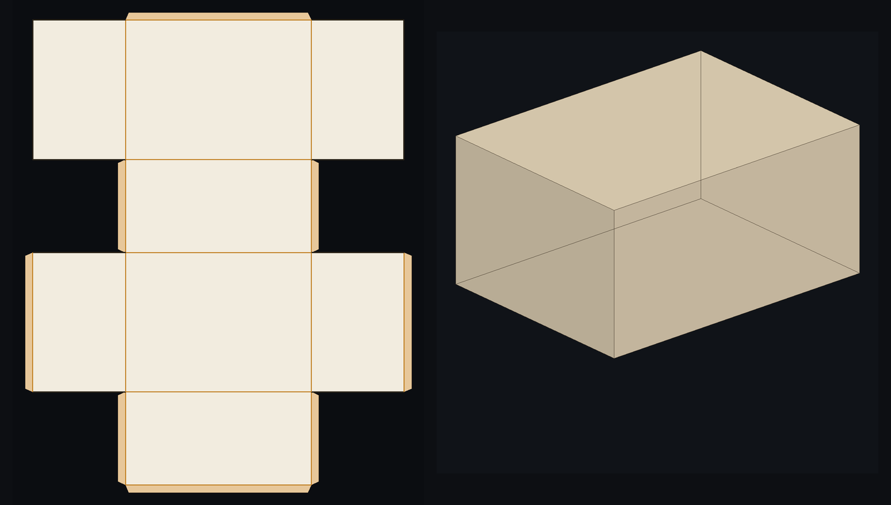
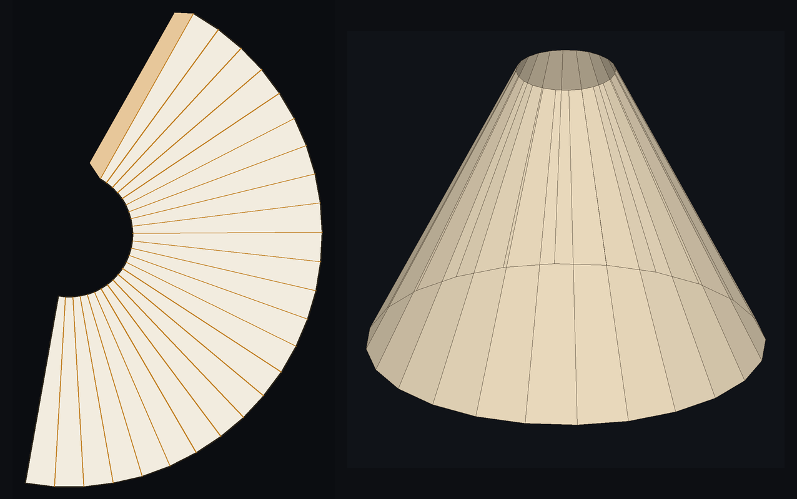
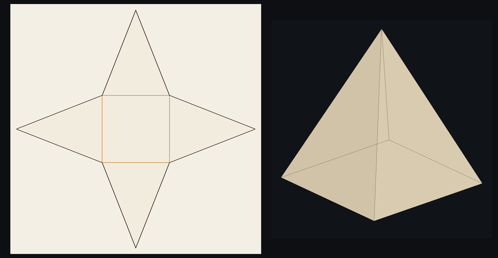

# Сгиб — объёмные детали из плоской развёртки

Текстовый редактор деталей, который начинается не с 3D, а с листа. Вы пишете
словами, что нужно («коробка 200×150×100 с крышкой»), приложение строит плоскую
выкройку с линиями реза и сгиба, а затем складывает её в объём — и показывает оба
состояния одновременно.

```
запрос  →  развёртка 1:1  →  3D-сборка  →  проверка  →  файлы для резки и 3D-печати
```



| Воронка | Стакан | Пирамида |
|---|---|---|
|  |  |  |

## Идея

Объёмную деталь из листа можно получить двумя путями:

* **от 3D** — лепим модель и потом ломаем голову, как её развернуть (так делают
  все CAD-системы);
* **от плоскости** — рисуем то, что реально режется и гнётся, а объём получаем
  сгибами под заданными углами (так работают жестянщики, переплётчики и
  картонажники).

Второй путь короче ровно там, где деталь существует как лист: коробки, лотки,
обечайки, кожухи, профили, воронки. Он даёт то, чего не даёт обратный:
настоящие размеры заготовки, расход материала, углы и порядок гибки. Плата —
ограничение: так описываются только разворачиваемые поверхности (гнущиеся без
растяжения). Литую или точеную деталь этим не сделать.

Поэтому модель здесь — это **плоские панели + сгибы**, а 3D не хранится, а
вычисляется. Один и тот же лист можно «сложить» на любой угол, и приложение
честно показывает, где деталь сходится, а где остаются открытые кромки.

## Что умеет

**Запросы словами** (одна строка, числа в мм):

| Запрос | Деталь |
|---|---|
| `коробка 200x150x100 с крышкой` | коробка с крышкой на сгибе и клапанами |
| `коробка 200x150x100 без крышки` | открытая коробка |
| `лоток 180x120x40` | донце и борта |
| `крышка 200x150x30` | крышка-обечайка, надевается сверху |
| `труба 120x200 24 гран` | обечайка (круглое приближено фасетками) |
| `стакан 90x110 6 гран` | шестигранный стакан с дном |
| `воронка 160x40x120` | усечённый конус |
| `конус-колпак 140x0x160` | конус с вершиной |
| `пирамида 4 120 140` | пирамида: грани, сторона основания, высота |
| `уголок 50x50 длина 400` | гнутый профиль |
| `швеллер 60x40x60 длина 300` | П-профиль |
| `z-профиль 30x70x30 длина 500` | Z-профиль |

**Своя развёртка** — полигоны и сгибы вручную, когда готовой фигуры нет:

```
полигон дно 0 0 100 0 100 60 0 60
полигон стенка 0 60 100 60 100 140 0 140
сгиб дно стенка 90
```

**Сборка и разборка** ползунком: видно, как лист превращается в деталь.

**Проверка по факту, а не по обещаниям:** габарит собранной детали, площадь
материала, число и суммарный угол сгибов, длина реза, замкнутость оболочки
(в том числе рёбра, которые ложатся друг на друга под склейку).

**Файлы:** SVG и DXF 1:1 (рез/сгиб по слоям) для лазера и ножа, STL/OBJ
собранной детали с толщиной материала, JSON-проект.

## Запуск

```bash
npm install
npm run dev        # http://localhost:5173
npm run build      # статичная сборка в dist/
npm run selftest   # проверка геометрии без браузера
```

Приложение для ПК (Electron, тот же код):

```bash
npm i -D electron electron-builder
npm run desktop         # запуск окна
npm run dist:win        # portable .exe + установщик в release/
```

Готовые сборки Windows собираются в CI: `.github/workflows/build.yml` →
артефакты `Сгиб-windows.zip` и `Сгиб-setup.exe`.

## Как это устроено

```
src/core/vec.ts       векторы, матрицы, полигоны
src/core/model.ts     модель детали (панели + сгибы), сборка, проверка
src/core/unfold.ts    обратная задача: оболочка → развёртка (для круглых тел)
src/core/build.ts     генераторы: коробка, лоток, обечайка, конус, профиль, клапаны
src/core/lang.ts      разбор текстового запроса
src/core/export.ts    SVG, DXF, STL, OBJ, JSON
src/render/net.ts     чертёж развёртки (SVG, мм, 1:1)
src/render/scene.ts   3D-вид (three.js)
src/main.ts           интерфейс
```

Коротко о математике: каждый сгиб — поворот поддерева панелей вокруг общего
ребра (дерево обхода), поэтому поза панели получается композицией поворотов, а
не решением системы уравнений. Для круглых тел (труба, конус, пирамида) грани
задаются в 3D и разворачиваются автоматически: каждый следующий сгиб
укладывается в плоскость листа единственным поворотом, который ставит нормаль
грани «лицом вверх». Подробнее — [docs/SPEC.md](docs/SPEC.md).

## Ограничения

* Только разворачиваемые поверхности. Сферы, штамповка, литьё — не сюда.
* Толщина материала не влияет на развёртку (нет припуска на сгиб/K-фактора):
  лист считается тонким. Толщина есть в 3D и в STL.
* Круглые тела — многогранная аппроксимация: чем больше фасеток, тем ближе к
  кругу и тем больше сгибов.
* Самопересечения при складывании не ищутся; проверяется только совпадение
  кромок и габариты.

## Лицензия

MIT.
