# ФОРМА 3D 0.79 — 3D-редактор, которым управляют словами

Параметрический редактор твёрдых тел для Windows. Модель описывается текстовым
сценарием: одна команда на строку. Приложение строит замкнутую геометрию,
показывает её в 3D, проверяет фактические размеры и связи и возвращает отчёт,
который можно отдать человеку или нейросети для следующей правки.

```forma
корпус = lathe points=[[0,0],[42,0],[42,95],[0,95]] segments=144 thickness=4 open=top
ручка = sweep path=[[40,0,28],[58,0,28],[67,0,42],[67,0,62],[58,0,76],[40,0,76]] width=9 height=13 smooth=10
кружка = union [корпус,ручка]
color кружка material=ceramic

check кружка watertight
check кружка height 90..100
check кружка wall 3..5
check кружка symmetric y
```

Текущий реестр: **242 команды, из них 123 примитива**. Полное описание каждой
команды, всех параметров, псевдонимов, ориентации и пример формируются из того
же реестра, которым пользуется геометрическое ядро.

**Готовый анатомический проект:** пример `human_skeleton` содержит скелет
взрослого человека из **206 отдельных костей** (80 осевых + 126 аппендикулярных),
400 168 треугольников и 412 встроенных проверок. Отдельный GLB совместим с
Blender. Состав, источники, лицензии, воспроизводимость и восемь проверенных
видов: [docs/human_skeleton.md](docs/human_skeleton.md).

Ещё в реестре: **типы объявлены у 1526 параметров из 2505** (224 команды), и
каждый пример реестра собирается — отчёт `docs/revision.md`, документ
[docs/types_079.md](docs/types_079.md).

---

## Что нового в 0.79

**Типы параметров — у большинства команд.** Раньше типизированные контролы
(число, ползунок, вектор, флажок) были только у двенадцати «избранных» команд:
всё остальное панель показывала свободным вводом. Теперь тип объявляется один
раз для повторяющегося имени — `radius`, `wall`, `at`, `segments`, `angle` — в
таблице `forma/param_types.py`, и достаётся каждой операции, где это имя
встретилось. Явное объявление команды по-прежнему важнее общего.

| | 0.78 | 0.79 |
|---|---|---|
| параметров с типом | 133 | **1526** из 2505 |
| команд хотя бы с одним типом | 12 | **224** из 242 |

**Формула в сценарии остаётся формулой.** Если значение задано выражением
(`round=R/2`, `at=[R, 0, 10]`), контрол показывает его как есть и работает
только на чтение: правка числом молча разорвала бы связь с параметром `R`.

**Ревизия команд — машинная и повторяемая.** `tools/audit_commands.py` строит
пример каждой команды, считает время и треугольники, проверяет тела на
manifold и делит падения по причинам. Все 242 команды проверены: **241 пример
собирается**, один (`openscad`) ждёт установленной внешней программы, без
примеров — ноль. Шесть примеров, которые раньше не собирались, исправлены и
закреплены тестами: `hinge_move`, `slider`, `kerf_cut`, `scatter`,
`fold_pattern`, `import`. Отчёт — `docs/revision.md`, шаг ревизии добавлен в CI.

---

## Что нового в 0.78

**Шаг в стек объекта.** В панели объекта под списком его строк появился блок
«Добавить шаг»: объединить с деталью, вычесть деталь, оставить общее, сварить,
сдвинуть, повернуть, масштабировать, разрезать, покрасить. Шаг — это **одна
строка** `.forma`, которую сервер складывает из проверенных значений
(`forma/steps.py`): `a = union [a, b]`, `translate [a] offset=[0, 0, 10]`,
`color a #ff0000 material=plastic`. Полей ровно столько, сколько у операции
параметров; имена деталей берутся из сцены, а не вводятся руками.

Строка встаёт на своё место в стеке: **после** деталей, которые использует, но
**до первого их использования** — группы, проверки или булевой операции,
поэтому они видят уже новую форму. Второй шаг идёт под первым, а не над ним.

Сборка проверяется до правки: если сценарий с шагом не собирается (например,
вычитание совпадающих деталей оставляет пустоту), текст в редакторе остаётся
прежним, шаг не появляется, причина показывается в панели. Откат не «чинит»
сценарий задним числом — он просто не применяет шаг.

---

## Что нового в 0.77

**Все примитивы — плитками.** В режиме плиток больше нет «избранных» 23 фигур:
плитка есть у **каждого** конструктора реестра — 123 примитива плюс тела
вращения и метабол (точение, выдавливание, протяжка, лофт, труба, метабол),
итого 128 картинок 128×128. Рядом с картинками `tools/render_thumbs.py` пишет
`web/thumbs/tiles.json`: слово операции, заводская строка параметров и
подпись. Клик вставляет **одну строку** — `arch = arch` или
`воронка = воронка` — и ничего больше; панель объекта открывает эти параметры
как обычные. Над сеткой появился поиск: сто двадцать восемь плиток иначе не
найти.

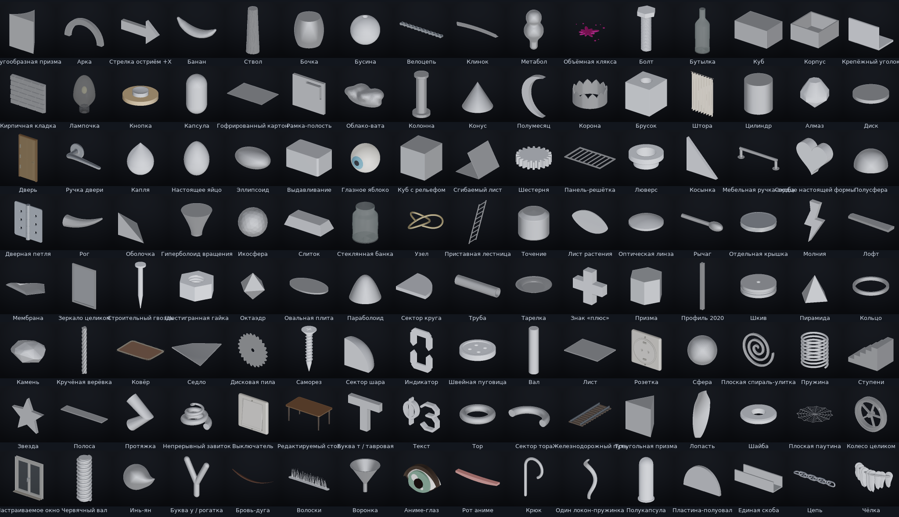

**Кэш операций.** Одна и та же деталь больше не строится дважды. Ключ —
слово операции, её параметры, точность сцены и значения параметров сценария
(`forma/cache.py`), кэшируется геометрия, а не объект: имя, цвет и материал
остаются принадлежностью конкретной строки. Команды, которые берут готовый
объект (`difference`, `hull` по именам), не кэшируются, а составные операции
(разъём, крепёж) — тем более: повтор только главной детали потерял бы
подсборку. Кэш живёт на процесс, счётчики — на сборку: при правке одной строки
интерфейс заново строит сценарий, но детали приходят из кэша. Проверено на
всех `examples/*.forma` и на полном прогоне тестов в порядке CI: набор
объектов, объёмы и треугольники совпадают с построением без кэша. Вагон
(1212 операций): первый прогон ≈3.0 с, повторный и после правки параметра —
≈2.0 с. В ключ входят не только параметры команды, но и параметры сцены,
переменные, настройки точности и имена готовых тел и контуров; детали со
сведениями о сборке (`meta`), покраской, мазками или ролями граней не
кэшируются вовсе. Потолок — 1500 деталей и 1.5 млн треугольников, тяжёлая
геометрия в памяти не оседает. Отключается `FORMA_CACHE=0`, статистика
попаданий едет в payload сборки (`cache`) и в подсказку строки состояния.

---

## 1. Что нового в 0.75

**Источник истины — текст `.forma`.** Панель объекта больше не подменяет
значения «на лету»: она меняет **одну строку** сценария и пересобирает модель.
Правка приходит из разбора, а не из регулярных выражений, поэтому вектор
`at=[0,0,5]`, комментарий в конце строки и перенос через `\` остаются целыми,
а связанное значение вида `round=R/2` не перезаписывается молча — сначала
спрашивается подтверждение «разорвать связь».

| Правка | Что делает |
|---|---|
| `set_param` | заменяет значение ровно в найденном диапазоне строки |
| `unset_param` | убирает параметр — так включается «авто» |
| `set_params` | несколько параметров одной строки за один проход |
| `add_command` / `delete_line` / `move_line` | порядок шагов объекта |
| `set_enabled` | временно выключает шаг: строка становится комментарием |

**Типы параметров объявлены, а не угадываются.** Для примитивов появилась
спецификация (`forma/param_spec.py`): диапазон, шаг, единица, набор вариантов
и режим «авто» (`omitted`, `sentinel`, `enum`). Интерфейс строит по ней
слайдер со стрелками и полем, вектор — покомпонентно, флаг — чекбоксом,
список — стрелками. Свободный ввод остался только у `type: "str"`.

```forma
корпус = cylinder radius=40 height=90 wall=3 cavity=верх
винт  = shaft length=60 diameter=12 chamfer=0.8
```
У `cylinder.segments` и `shaft.segments` есть режим `авто`: параметра в строке
нет — число сегментов выбирает операция по детализации.

**Пресеты формы из сценария.** `пресет_формы "плита" box size=[200,100,12]` —
объявление в `.forma`; панель показывает его рядом с заводскими, а применение
остаётся одной правкой строки. Пресеты сцены (`preset`) не затрагиваются.

**Плитки.** В инструментах есть режим плотной сетки: 128-пиксельные
изометрические миниатюры без пола, сетки и тени (`tools/render_thumbs.py`,
идемпотентно). Клик — операция с заводскими параметрами.

**Скорость.** `/api/edit` собирает модель без анализа (`analyze_model=False`)
и возвращает `timings`: правка `alien.forma` — 0.8 с, разбор — 1.1 мс.

**Где это видно.** Вкладка «Параметры» → блок «Объект» (он больше не прячется:
пока деталь не выбрана, там подсказка). Быстрый переход — кнопка
«параметры объекта →» в карточке выбранной детали. У объекта видны все его
строки: порядок (`▲`/`▼`),
выключение (`◼`), удаление (`✕`) и параметры каждой строки. У `union` и
`difference` сверху появляются блоки **фигур-источников** из провенанса —
у каждой свои параметры. Невалидная перестановка откатывается: текст
возвращается к прежнему виду, модель остаётся рабочей.

## 2. Что нового в 0.74

**Полигонаж стал управляемым.** Раньше это был один режим с сюрпризами: сетка
исчезала в художественном стиле, а «просвечивали ли грани» зависело от
дальности и удачи z-fighting. Теперь у полигонажа два явных параметра:

| Параметр | Значения | Смысл |
|---|---|---|
| `poly_fill` | `непрозрачный` / `сквозной` | оставить грани или сделать деталь полупрозрачной (рентген: видны все рёбра, включая задние) |
| `poly_edges` | `сетка` / `структурные` | все рёбра треугольников или только настоящие изломы, посчитанные по геометрии |
| `poly_angle` | 5…89° | порог излома для структурных рёбер |

В непрозрачном режиме грани отодвигаются по глубине (`polygonOffset`), поэтому
линия всегда выигрывает у своей же поверхности — одинаково и на детали 5 мм, и
на вагоне 1300 мм. Мировой сдвиг глубины, который врал на разных расстояниях,
убран.

**Структурные рёбра не пропадают.** Новый режим считает рёбра из самой сетки:
вершины сшиваются по координатам, каждому ребру находятся две соседние грани,
и в рисунок попадают только те, где двугранный угол больше порога. Куб даёт
ровно 12 рёбер и ни одной диагонали треугольников, гранёный цилиндр при пороге
30° — только два обода. Такие линии рисуются экранными полосами: толщина
стабильна, лесенок нет, при повороте ребро не исчезает.

Подробности — [`docs/RENDERING.md`](docs/RENDERING.md).

**Пол больше не обрезается хордами.** Круг пола строился из 96 отрезков: при
радиусе 2 м хорда — 134 мм, и на видах «спереди/справа» пол заканчивался
заметной прямой. Теперь число сегментов считается от стрелки прогиба 0.3 мм.

**Тень на полу — настоящая, а не «запечённая».** В маску падающей тени попадала
сама модель: её затенённые грани рисовались туда `ShadowMaterial`, и рядом с
тенью появлялся серый двойник. Модель из маски убрана; эвристика по яркости
осталась только запасным источником и больше не подмешивается к точной маске.

**Стили больше не смешиваются.** Смена режима начинается с его пресета: после
«скетча» в «аниме» не остаётся штриховки, после «линии» в «манге» — выключенного
затенения. Правило одно для окна и для сценария (`scene anime mode=…`), оно
лежит в `web/js/style_presets.js` и повторено в Python.

**Оси и сетка.** Оси пересчитываются от габарита новой модели (раньше оставались
длиной прошлой сцены), стрелки снова участвуют в глубине и не протыкают деталь,
а сетка и оси в художественном стиле подчиняются своим переключателям, а не
прячутся сами.

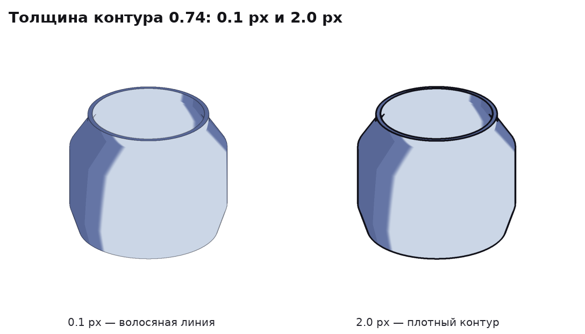

**Волосяные контуры.** Нижний предел толщины контура снижен: в шейдере 0.28
плотного пикселя вместо 0.6, в окне — 0.1 px с шагом 0.05. Там, где контуры
идут плотно, больше нет чёрных заливок; в Python-рендере линия тоньше 0.2 px
ослабляется, а не пропадает.

### Что было в 0.73

**Габарит — это изделие, а не ядро.** `face_box` в выпуклом режиме наращивал
выступы наружу: деталь «куб 80» с `relief=7` получалась 94 мм, и в отчёте
сборки это не всплывало — вызов формально успешен. Теперь ядро сжимается на
relief с той стороны, где стоит выступ, и габарит готовой детали в точности
равен `size`. Углубления проверяются тем же фильтром, что и экспорт: если
тело распадается на части или внутри появляются закрытые полости, операция
останавливается и называет безопасную глубину («relief не больше 10 мм»).

**Новые параметры.**

| Команда | Параметр | Что даёт |
|---|---|---|
| `face_box` | `offset=[u,v]` | рельеф не по центру грани |
| `cube_hole` | `offset=[u,v]` | отверстия от центра: крепёж по углам фланца |
| `cube_hole` | `depth=` | глухое отверстие от стороны +оси |
| `box` | `wall=`, `cavity=`, `cavity_depth=` | полость со стенкой в любом блоке, включая наклонный |

**Полость в `box`** повторяет форму основания: контур берётся из двух срезов
блока, сжатых внутрь на `wall`, поэтому стенка нигде не тоньше заданной, а
дно остаётся не пробитым. Раньше «наклонная коробка с полостью» была
недоступна: `box_body` не умеет наклон, а `box` не умел полость.

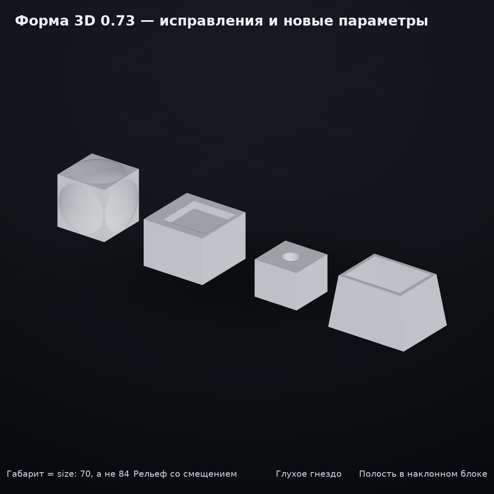

**Единый стандарт имён.** Появились [`docs/NAMING.md`](docs/NAMING.md)
(правила, словарь канонических имён, местные синонимы, чек-лист нового
параметра) и [`docs/ATLAS.md`](docs/ATLAS.md) (атлас понятий: поверхность →
элемент → структура корпуса, у каждого — определение, параметры, чем строится
и чего в языке пока нет). В интерфейсе: «направление» вместо «рельеф»,
«форма рельефа» вместо «профиль», «угол между сторонами», «разница половин»,
«глубина нахлёста», «радиус углов в плане», «припуск на сборку».

**Интерфейс догнал язык.** `cube_hole` получил независимые оси
(`hole_x/hole_y/hole_z` со своими формами), `hole_all`, `oval_aspect`,
`offset`, `depth`; `face_box` — `segments` и `offset`; `box_body` —
`припуск` и `сегменты`; `box` — полость. Правило проверяется тестом: каждый
параметр этих команд обязан быть в карточке.

## 2. Что нового в 0.72

**Наружность и внутренность отдельных граней.** Новый режим «грани» позволяет
самому выбрать треугольники на модели и назначить требование: **синие** —
целиком снаружи других видимых тел, **красные** — целиком и строго внутри
другого замкнутого тела, **серые** — без требования. ЛКМ выбирает грань,
Shift добавляет, Ctrl/Cmd снимает; соседние тела можно сделать прозрачными,
чтобы выбрать полностью скрытый корень. Это отдельный диагностический режим,
а не художественная кисть и не проверка направления normals.

Проверяется вся грань, а не только её центр: пересечение или касание оболочки
не проходит strict inside. Поэтому у красного корня зуба наружу не должен
торчать ни один треугольник. Разметка записывается в Forma-сценарий командой
`полигоны`, переживает rebuild и автоматически перепроверяется; явный контроль
добавляется строкой `check корень наружность`. Подробности, DSL и ограничения:
[docs/face_visibility.md](docs/face_visibility.md).

## История: 0.71

**Playback и Studio.** Автосборка подсвечивает именно текущую строку,
прокручивает редактор и gutter к ней и выделяет создаваемый или изменяемый
объект. В кадры попадают форма, положение и видимость, включая пустой кадр
`hide`; проверки, цвет и служебные команды не создают лишних остановок.
Повторный ▶ — единственная команда остановки: клики по сцене, выбор объектов,
переход по кадрам и закрытие окон не останавливают показ. Камера показывает
XYZ, азимут, наклон и крен. Свет, фон, NPR, тени, сетка, пол, оси, полигонаж,
заслонки, автоповорот, орбита и «к предмету» сохраняются через rebuild и
перезагрузку; Studio перестроена секциями и проверена на ширинах 340–1440 px.

**Качество сетки.** Новый `forma/mesh_quality.py` различает плоские иглы и
иглы на кривизне, находит колпаки, полюса/стяжки, перегрузы плотности, швы,
bowtie, границы, non-manifold рёбра, дубли и вырожденные грани. Добавлены
`check тело сетка`, автоматические замечания и `metrics["mesh_quality"]`,
а также `forma mesh модель.forma --json --sliver 0.3`. `simplify` пишет
изменение показателей до/после. Это диагностика и измерение эффекта, не
автоматический remesh: детектор не обещает исправить шов или геометрию.
Пороги и ограничения описаны в [docs/mesh_quality.md](docs/mesh_quality.md).

Защищённая лампа Arte Lamp Banker A2492LT-1AB и material-aware NPR проходят
свои регрессии; файлы постороннего кронштейна в этот проект не добавлялись.

## История: 0.70

Лампа **Arte Lamp Banker A2492LT-1AB** получила новую крупную форму: широкий
колокол основания, крупные точёные пояса колонны без универсального fillet и
продольный свод абажура с пятью сечениями. Высота остаётся 400 мм; 54 видимые
детали содержат 10 724 triangles. Полость, вкладыш, контакты и all-pair audit
сохранены. Для NPR добавлены отдельные albedo/emissive/pass и material-aware
аниме, манга, комикс, скетч и line art; polygon overlay больше не смешивается с
рисунком. Загруженный GLB несёт fingerprint текущего script/overrides/engine,
поэтому устаревший файл отклоняется вместо молчаливой подмены модели.

## История: 0.69

Переработан пример **Arte Lamp Banker A2492LT-1AB**: отдельные детали,
открытая полость абажура, наружный держатель, присоединённая цепочка и
измеренные зазоры. Сумма сетки видимых редактируемых частей уменьшена с
84 276 до 14 620 triangles; бюджеты и all-pair intersection audit добавлены
в тесты. Для связанных размеров добавлен лёгкий `derive`: изменение исходной
высоты пересчитывает колонну, шарнир и стойку при обычном rebuild, без дерева
FreeCAD. `lathe`/`extrude` получили адаптивный бюджет настоящих дуговых
микрофасок (`fillet_steps`, `fillet_angle`), без подмены Loop-сглаживанием.

## История: 0.68

Добавлены собственные include/module/function с локальными scope и диагностикой
циклов, панель параметров и presets на общем rebuild/morph, нативный SCAD
`polyhedron` export, фоновый OpenSCAD/BOSL2 runner, плоский provenance,
реперная подгонка размеров по фотографии, DXF с размерами и opt-in глобальная
точность. Подробности и ограничения: [docs/stage3_features.md](docs/stage3_features.md).

```forma
param height=95 min=20 max=200 label="Высота"
preset tall height=140
preset tall  # явно выбрать набор; иначе используется default
body = cylinder radius=35 height=height
```

```bash
python -m forma export model.forma --format scad --out model.scad
python -m forma export model.forma --format drawing --out model-drawing.dxf
```

SCAD export — это построенная mesh-геометрия, а не параметрический round-trip.
Произвольный SCAD/BOSL2 исполняется только настоящим OpenSCAD в фоне; его
отсутствие показывается диагностикой, а не фиктивным успешным результатом.

## История: 0.67

Первый выпуск этапа 3 с библиотеками, пресетами, SCAD/DXF, фоновым OpenSCAD,
provenance, фото-подгонкой и opt-in точностью.

## История: 0.66

Добавлены точные проверки пересечений и дискретного свободного хода. Общий
модуль `forma/collide.py` использует AABB только как фильтр и вычисляет объём
`a ^ b` для `interference`, `check … collision` и автоматических предупреждений.
Правило `check … ход` поддерживает произвольную ось, pivot, отрицательный угол,
точный конечный шаг и машинные списки `blocked_by`/`blocked_mm3` для всех пар
первой проблемной позы. Подробности: [docs/rules_upgrade.md](docs/rules_upgrade.md).

```forma
check нож collision tolerance=0.01
check лезвие ход axis=z до=90 step=5
```

## История: 0.65

Реализован этап 3 — оригами и механизмы. Ограниченная история хранит только
последние складки листа (8 на объект, 32 на сцену), а `unfold` восстанавливает
снимок и оставляет настоящую канавку. Добавлены FOLD/.cp, реальный `packet`,
`hinge_move`/`slider` с проверкой промежуточных столкновений и `kerf_cut` с
физической шириной реза. Подробности: [docs/stage3_origami.md](docs/stage3_origami.md).

```forma
лист = fold_sheet width=120 length=200 thickness=1 angle=80
разгиб = unfold лист groove=0.5 depth=0.2
створка = hinge_move дверь angle=90 axis=z pivot=[0,0,0] against=[стена]
```

Добавлен отдельный редактируемый проект **Arte Lamp Banker A2492LT-1AB** по
трём референсам: высота ровно 400 мм, зелёный абажур с открытой полостью,
светлый вкладыш, латунное ступенчатое основание, фигурная колонна, изогнутая
стойка, боковые крепления и цепочка из 30 отдельно выбираемых бусин. Исходник:
`examples/arte_lamp_banker_a2492lt_1ab.forma`; в CI экспортируются GLB и Forma.

Проверки этапа: **17 targeted-тестов оригами и 6 геометрических тестов лампы**.
Полный Windows CI дополнительно повторяет общий Python/JS-регресс, golden/eval,
fuzz и экспорт моделей перед сборкой EXE-only ZIP.

## История: 0.64

Реализован геометрический фундамент этапа 1. `contour2d` хранит аналитические
линии, дуги/окружности, эллипсы и квадратичные/кубические Bézier. Адаптивная
выборка управляется хордовым `tolerance`, допуском стыков и `max_points`.
Контуры можно повторно использовать в `extrude`, `lathe`, `loft` и `sweep`;
для loft автоматически согласуются ориентация, стартовая вершина и число точек.

`extrude` получил точную толщину стенки (`thickness`, `open`) и литейный уклон
(`draft`) через 2D-offset, включая отверстия и их сочетание. Добавлены меры
`area`, `tris`, `parts`, `genus` и машинный семантический diff объектов,
контуров и параметров:

```forma
профиль = contour2d kind=ellipse rx=20 ry=10 tolerance=.08
деталь = extrude profile=профиль height=10 thickness=2 open=top draft=2
```

```bash
python -m forma diff old.forma new.forma --json --linear-tol .01
```

Проверки этапа: 17 targeted acceptance-тестов, реальные manifold/объёмы,
точность дуг и Bézier, стыки, толщина/уклон, JSON и меры. Подробности и схема
отчёта: [docs/stage1_foundation.md](docs/stage1_foundation.md).

## История: 0.63

Добавлен измеримый контур качества этапа 0: benchmark из 20 пользовательских и
геометрических задач, 80 независимых проверок, сохранённый baseline и сравнение
первой/последующих попыток ответов нейросети. `build --profile` показывает время
каждой DSL-команды, а `eval` записывает ошибки, метрики, треугольники и профиль.
Детерминированный `fuzz` изолированно проверяет 24 сценария и структуру GLB,
при падении сохраняя minimal repro. Подробности:
[docs/foundation_eval.md](docs/foundation_eval.md).

В оригами малый угол `сгиб` больше не схлопывает дугу при упрощении сетки.
Повторный `fold` при отклонении объёма свыше 5% сообщает фактическое отклонение
и не возвращает повреждённую геометрию как успешную. Полный локальный регресс:
1267/1267 тестов.

## История: 0.62

Dragon Sovereign v4 — новая анатомическая ревизия, а не переупаковка v3. Удалены
шарообразный челюстной сустав и дефектная дублирующая губная цепочка; увеличены
глазные щели, добавлены чередующиеся мелкие зубы (24 всего), сужены суставы и
запястья. Спина получила четыре dorsal-нароста, крылья — camber 32 мм и более
глубокие scallop-провисы. Горловые щитки сдвинуты ниже подбородка.

Чешуя по-прежнему строится только штатной `scales`. Для хвоста используются три
path-диапазона с уменьшением пластин по радиусу, поэтому тонкий изгиб не покрыт
крупной бахромой. Принято 869 из 1656 кандидатов. Source/GLB дракона имеют одну
компоненту и genus 0; проверены 14 контактов опор, семь ракурсов и picking
1/1 + 4/4. Подробности: [docs/dragon_sovereign.md](docs/dragon_sovereign.md).

В приложении также сохранены исправления инструментов 0.60–0.61: диаметральные
касательные соединения, `scales.on/safe`, одиночные path-колонки и цельная
объёмная кромка `membrane`.

## История: 0.61

`membrane` получила интегральный объёмный передний край через
`edge_indices/edge_thick/edge_height`. Индексы относятся к исходному `outline`,
в том числе после обращения его ориентации; кромка остаётся частью той же
замкнутой сетки, без отдельных пересекающихся трубок.

`scales path` допускает `per_row=1` для одиночной центральной колонки щитков.
Такие ряды больше не чередуются с противоположной стороной; для обычной
круговой раскладки минимум по-прежнему равен трём.

Dragon Sovereign v3: узкие глаза и исправленная посадка зубьев, четыре опоры,
цельные крылья с объёмной кромкой, 4 крупных щитка горла штатной `scales` и 6
chevron-пластин груди. Раскладка покрывает голову, торс, конечности и хвост:
принято 867 из 1620 кандидатов, остальные отклонены topology-guard. Source и
GLB имеют одну компоненту и genus 0; проверены 14 контактов опор, семь ракурсов
и picking 1/1 + 4/4. Подробности: [docs/dragon_sovereign.md](docs/dragon_sovereign.md).

## История: 0.60

Органические соединения получили второй режим `диаметры`: соседние round-cone
секции проходят через касательные диаметральные точки и не создают smin-бугор
на суставе. Режим доступен в `Tube` и `blob`; прежний `smin` сохранён.

`scales` умеет несколько центральных путей (`paths`), независимый `pitch` и
раздельные поверхности посадки/проверки: `on=кожа` выполняет ray-cast, а `safe=да`
проверяет объединение с полным итоговым телом. `spikes safe=да` использует тот же
принцип и не допускает новые компоненты, полости и петли.

Замкнутая `membrane` строит прогиб `camber`, толщину и интегральные рёбра
`rib_angles/rib_height/rib_width` непосредственно в своей сетке. Это не отдельные
трубки поверх тонкого полотнища:

```forma
крыло = membrane root=[40,-5] outline=[[0,-20],[20,-5],[45,0],[100,50],[140,0],[100,-50],[0,-30]] camber=12 thick=.8 rings=12 rib_angles=[25,85] rib_height=2 rib_width=6
```

Обновлённый Dragon Sovereign использует четыре опоры, касательные хвост и
конечности, объёмные крылья и штатную чешую `scales.on` после всех деталей.
Source/GLB, 14 контактов опор, пять ракурсов, крупные виды головы и picking 4/4
зафиксированы в [docs/dragon_sovereign.md](docs/dragon_sovereign.md).

## История: 0.59

Экспорт и диагностика твёрдых тел переведены на единый topology-контур.
`check <объект> topology` проверяет границы, non-manifold рёбра, согласованность
обхода, дубли и вырожденные грани отдельно от предупреждений о плотности и
треугольниках-иглах. Правила quad/SubD не выдаются за ошибки треугольного
Manifold.

```forma
деталь = gear teeth=36 module=2.6 thickness=8 bore=5 hub=12
check деталь topology
```

GLB и другие mesh-экспорты используют очистку в фактической точности float32 и
structural gate. Guarded weld выполняется только в экспортной копии: кандидат
заново проверяется как Manifold, а род, число частей, объём, площадь и bbox
должны сохраниться в узких пределах. Неоднозначный результат останавливает
экспорт вместо скрытого изменения формы. Адаптивный SDF cleanup выбирает малый
допуск от исходной сетки и записывает измерения в отчёт.

Исправлены совпадающие крышки у `expand_joint=посадка|стык` для
`sphere/ellipsoid/capsule/box`. Минимальный пример с 44 non-manifold рёбрами
теперь даёт замкнутый шар с родом 0; 40 посадочных и 16 flush-случаев прошли
обычный и точный аудит. Прежняя неизменность противоположной половины сохранена.

Измерения, fixtures «до/после» и ограничения метода:
[docs/topology.md](docs/topology.md). Плохие примеры остаются тестами и не
добавляются в меню. Стенд 0.59 показывает только изменения версии на
существующем `alien.forma`.

Для восстановления по изображению добавлен `forma.vision`: маска превращается в
измеряемый паспорт, кандидат ортографической камеры подбирается проекциями, а
`compare` возвращает IoU, ошибку строк, пропорции, перекос и худшую клетку.
Бинарный rasterizer переиспользует исходную сетку и не вычисляет освещение. В
контрольном прогоне его маска совпала с полным рендером пиксель-в-пиксель, а 33
ракурса в кадре 128 заняли 10,99 с.

```python
from forma.vision import mask_by_background, measure, report
mask = mask_by_background(rgb)       # numpy H×W×3 или H×W×4
passport = measure(mask)
vision_report = report(rgb, result.visible_solids(), size=128)
```

`report["provenance"]` отделяет измеренное по маске от подобранного ракурса.
`compare["passed"]` означает только прохождение порогов одной проекции: это не
доказательство правильного объёма. Абсолютный масштаб без опорного размера и
скрытые поверхности без других видов остаются неизвестными.

## История: 0.58

В основной список из **20 готовых проектов** по прямому запросу добавлены
`living_room_diorama` (комната: гостиная 1:20) и `train_carriage` (поезд:
плацкартный вагон 61-4194). Они открываются как редактируемые сценарии без
импортов; версионные выставки и другие демонстрационные сцены в меню не
возвращаются.

`bottle` получил пять самостоятельных силуэтов: `универсальная`, `винная`,
`бургундская`, `пивная` и `спортивная`. У них разные пропорции корпуса, талия,
плечо и переход в горло. `jar` имеет `классическая`, `коническая` и `амфора`.
`style` сохраняется в проекте и доступен в карточках.

```forma
винная = bottle style=винная bottom=углубление closure=пробка
спорт = bottle style=спортивная bottom=ножки feet_count=5 kind=пластик
банка = jar style=коническая cap=да
```

`bottom=ножки` теперь строит настоящее литое petaloid-дно одной сеткой: девять
колец центрального подъёма и восемь переходных колец, самостоятельные гладкие
профили вершины и впадины, общая волна наружной и внутренней оболочек.
`feet_count=3…8` меняет число лепестков. Отдельные эллипсоидальные лапки не
используются. Касательные перехода проверены по рёбрам, сечениям и GLB/WebGL.

`kind` и `material` у бутылки влияют только на отделку и больше не ограничивают
геометрию. Явные `material`, `transmission`, `rough` и `density` не
перезаписываются. Добавлен корректный пресет `металл`; карточка `lid` отправляет
только параметры выбранного типа, а `closure=пробка` не добавляет неявную
резьбу.

GLB-экспорт удаляет нулевые треугольники boolean-стыков до разбиения нормалей.
Это устраняет ложные не-manifold рёбра после сварки координат в Blender и не
меняет силуэт или полезную тесселяцию. Все три банки с резьбой повторно
импортированы из GLB и проверены на замкнутость, winding и положительный объём.

Проведён аудит **122 примитивов**, фактических сценариев **142 карточек** и
**543 сочетаний choice-параметров**. Исправлены также исходная площадка
`spikes` для всех сторон, устаревшие значения `hair.growth` и исходный `gap`
карточки `shrinkwrap`, несовместимый со `сгладить`. Подробности:
[docs/containers_058.md](docs/containers_058.md).

## История: 0.57

Добавлены `jar`, `bottle`, `lid` и `bicycle_chain`. Сосуды имеют настоящие
полости и стенки; резьба, центральное углубление дна, рифление и пластиковые
лапки являются геометрией. Крышки, пробки, ручки, крепёж и каждый элемент цепи
остаются независимо выбираемыми и экспортируются в Blender-совместимый GLB.

```forma
банка = jar form=округлая ribs=40 bottom=углубление cap=да
бутылка = bottle kind=пластик neck=округлая bottom=ножки closure=крышка
крышка = lid kind=кастрюля material=стекло handle=дуга vent=да
цепь = bicycle_chain links=12 pitch=12.7
```

У `track` появились сквозные `rail_holes` в стенке. Молния получила новый
центральный силуэт с плоским верхом и одним нижним остриём; дополнительные
`zigzags` удалены. `switch` поддерживает современную двойную и старую выпуклую
клавиши. Подробности: [docs/containers_057.md](docs/containers_057.md).

Из основного приложения удалены «Бутылка», «Мебельная фурнитура», выставки и
версионные проекты 0.53+. Примеры новой работы находятся только на сайте-стенде
и не добавляются в меню программного проекта.

## 2. Что нового в 0.46

### Поры с заданной формой и размером

`porous` строит сферические ямы, цилиндрические отверстия с плоским дном и
внутренние пузыри. `size` — радиус раскрытия, `width` — диаметр и имеет
приоритет; `depth` измеряется от исходной поверхности. `count` и `seed`
повторяемы. Раскрытия разводятся без перекрытий; невозможный `count` явно
отклоняется. `smooth`, `uneven` и `rough` меняют саму геометрию стенок и кромки.

```forma
камень = box size=[100,80,30] round=4
камень = porous [камень] mode=поры size=5 depth=2.5 count=24 smooth=.35 uneven=.12 rough=.08 seed=3

плита = box size=[100,80,30]
плита = porous [плита] mode=отверстия width=10 depth=6 count=18 smooth=.2 seed=8
```

### Плоский срез и канавка по его периметру

`shave` снимает материал плоскостью под произвольным углом. По контуру нового
среза можно пройти прямоугольной, овальной или треугольной канавкой. Это не
второй срез и не текстура: профиль имеет собственные ширину, глубину и отступ.

```forma
деталь = box size=[90,70,40] round=3
деталь = shave [деталь] depth=6 groove=овальная groove_width=5 groove_depth=2.5 groove_offset=4
```

`point` сохраняет положение вершины острия, возвращает одно корректное тело и
проверяет ошибку ядра после сборки.

### Трещины и древесные ложбинки

Новый `crack` вдавливает линии в существующую поверхность. `удар` создаёт
ветвящиеся лучи, `разлом` — длинную трещину с ответвлениями, `дерево` — ровные
продольные ложбинки. Лучи проецируются на настоящую сетку, поэтому инструмент
работает не только на плоскости.

```forma
плита = box size=[120,90,16]
плита = crack [плита] mode=удар at=[0,0,16] dir=[0,0,1] count=8 radius=43 width=2 depth=1.2 seed=4

доска = box size=[140,70,16]
доска = crack [доска] mode=дерево count=13 width=1.7 depth=.8 angle=0 seed=2
```

### Складки без диагональных артефактов

`wrinkle` автоматически разбивает сетку по длине волны. Режимы `радиус`,
`высота`, `шум`, `клетка`, `трещины` деформируют объёмное тело, а не добавляют
декорации. У рукава `surface=наружная` сохраняет внутреннюю стенку;
`surface=вся` деформирует обе. Угловые режимы плавно затухают у торцов и не
образуют звезду на торцевом веере.

```forma
наружная = cylinder radius=40 height=90 segments=64
внутренняя = cylinder radius=28 height=90 segments=64
рукав = difference [наружная,внутренняя]
delete наружная
delete внутренняя
рукав = wrinkle [рукав] mode=радиус amp=2.5 freq=12 axis=z surface=наружная
```

### Сгибы исходной поверхности

* `fold` и `fold_sheet` делят оставшуюся после дуг длину на равные плоские
  полотнища; каждая вторая складка больше не шире остальных.
* `сгиб` непрерывно отображает собственную сетку листа на прямые участки и
  дуги. Поддерживаются диагональ, линия через угол и `parts=3…12` для гармошки.
* `складка` в режимах `гребень` и `канавка` перемещает вершины исходной
  поверхности. Не добавляет полукольцо и не подставляет вторую плоскость.

```forma
лист = sheet width=105 length=240 thickness=1
гармошка = fold [лист] parts=5 angle=150 gap=.8 sharp=.15 axis=x

квадрат = sheet width=120 length=120 thickness=1
угол = сгиб [квадрат] at=[0,0,1] dir=45 angle=120 gap=.5

основа = sheet width=120 length=100 thickness=1
гребень = складка [основа] from=[-50,0,1] to=[50,0,1] r=6 depth=5 mode=гребень taper=.3
```

### Рифление, вафля, кора и рельеф

`corrugate mode=рифление` зависит только от одной координаты и даёт прямые
параллельные рёбра. `mode=вафля` зависит от двух координат и даёт двумерную
клетку. Плотность сетки — не меньше двенадцати рёбер на шаг.

`bark` строит нерегулярные извилистые борозды разной ширины и глубины,
вторичные трещины и мелкие пластины. Узор бесшовный по окружности и повторяется
по `seed`.

`relief` без `image` использует встроенную `docs/pattern.png`. Карта доступна
из любой рабочей папки и включается в однофайловую Windows-сборку.

```forma
рельеф = box size=[120,100,12]
рельеф = relief [рельеф] depth=2 mode=плоскость
```

### Наращивание на выбранном объекте

`hair` требует существующий объект. Иголки, волоски, локоны и мех начинаются
внутри поверхности и свариваются с ней в одно тело; автономной основы не
создаётся. `surface` выбирает каноническую сторону или всю поверхность,
`at+radius` может ограничить пятно.

```forma
основа = cylinder radius=43 height=28 segments=56
иголки = hair [основа] style=иголки surface=верх count=65 length=22 thick=1.6 spread=.18 seed=4
```

### Покраска узором

`pattern` остаётся покраской, а не рельефом. Перед назначением цветов сетка
автоматически разбивается под размер фигуры с ограничением бюджета, поэтому
круги и ромбы не превращаются в несколько крупных цветных заплаток. Форма,
габарит и объём не меняются.

```forma
куб = box size=[70,70,70]
color куб #f0e6cf
pattern куб #b44b3e shape=круги size=10 step=20
```

---

## Что нового в 0.53 — путь, фурнитура и объёмные значки

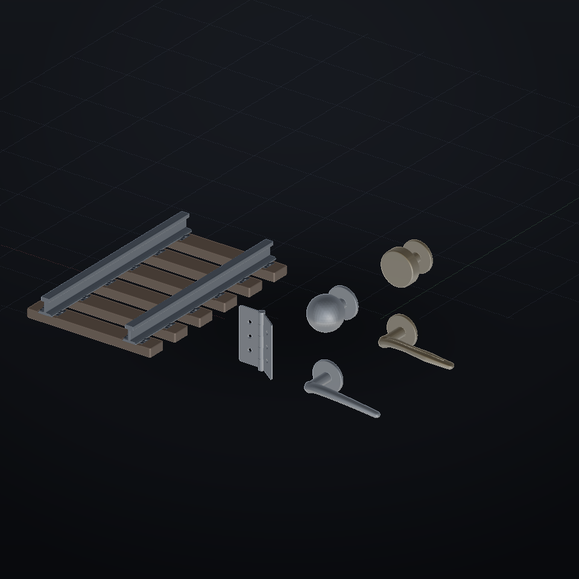

`track` строит один или два рельса вдоль Y с профилями `рельса`, `двутавр`,
`т` и `брусок`. Шпалы бывают скошенными, бетонными и прямоугольными, имеют
собственные размеры, скругление, шаг и посадочные карманы. Подкладки, прижимы
и гайки можно отключить; рельсы, шпалы и крепления остаются отдельными
scene-объектами. Невозможное перекрытие шпал отклоняется понятной ошибкой.

`hinge` возвращает **ровно два редактируемых объекта**: `<имя>` и `<имя>.right`.
У петли чередующиеся кулаки, палец, осевой и радиальный зазоры, сквозные
отверстия с зенковкой и угол правой створки 0…180°. `door_handle` имеет четыре
разные конструкции: `изогнутая`, `рельефная`, `сферическая`, `дисковая`.

```forma
путь = track length=390 rails=2 gauge=180 sleeper_step=65 fasteners=да
петля = hinge height=90 leaf_width=38 knuckles=5 holes=3 open_angle=35
ручка = door_handle form=рельефная lever_length=115 relief=.7
```

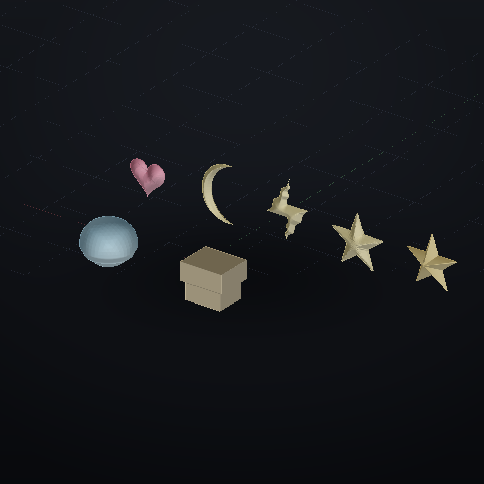

У `heart`, `crescent`, `star` и `lightning` режим `volume=да` теперь строит
замкнутые выпуклые стороны по всей площади, а не плоскую крышку с фаской.
Кончики и заданные габариты сохраняются. У звезды есть
`volume_style=фасеточный`; молния имеет плоский верх, центральный зигзаг и одно нижнее остриё
диагоналей без разделения детали на куски.

У `sphere`, `ellipsoid`, `capsule` и `box` параметры `expand_side`,
`expand_joint=посадка|стык`, `expand_seat` и `expand_smooth` разделяют увеличение
половины, заход колпачка и плавность внешнего перехода. Дальняя половина вне
зоны перехода не деформируется.

Все новые команды имеют карточки с живыми превью, поля с истинными параметрами,
справку и ориентацию. Проекты `fittings_053` и `glyphs_expansion_053` доступны
в меню и поставляются как `.forma` + Blender-совместимый `.glb`.
Полный локальный регресс — **1183/1183 unittest**, все пять JS-наборов CI;
стенд из трёх версий и четырёх моделей пересобран и проверен по хешам.
Численные и визуальные проверки: [docs/primitive_updates_053.md](docs/primitive_updates_053.md).

## Что нового в 0.52 — редактируемый интерьер и ткань

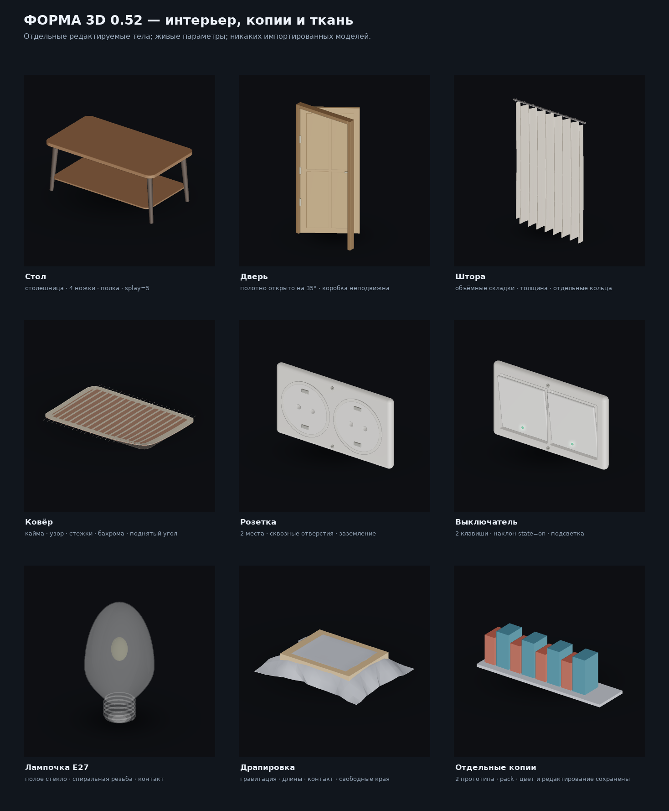

Группы теперь целиком принимают обычные `translate`, `rotate` и `scale`: общий
pivot, отдельные тела, прежние имена и материалы. `array` и `scatter` получили
`as=objects`, последовательности прототипов, повторяемые диапазоны масштаба и
поворота, посадку на хозяина и режимы без пересечений. Старое объединение
остаётся через `as=merged`.

Добавлены составные `table`, `door`, `curtain`, `rug`, `socket`, `switch` и
`bulb`: столешница, ножки, полка, полотно, филёнки, петли, ручка, замок, ткань,
карниз, кайма, подложка, бахрома, контакты, клавиши, полое стекло, цоколь и
резьба не запекаются в один непрозрачный монолит. Все семь примитивов имеют
живые карточки с настоящими сохраняемыми параметрами.

`drape` — рабочий первый уровень ткани: подразбиение и деформация сетки,
гравитация, ограничения длин и изгиба, закрепления, контакт с опорой и
свободные участки. Это не проекция `shrinkwrap`; контакт первой версии —
высотная карта, самопересечения и сложные поднутрения честно не заявляются.

`interference` выполняет AABB-отбор и точный Manifold-расчёт объёма пересечений
в мм³. Разрешённые пары задаются масками; отчёт попадает во вкладку «Проверки»,
копируемый текст и подсветку проблемных пар. Те же разрешённые пары сохраняются
в сцене и учитываются автоматическим предупреждением `Детали пересекаются`.

Для утверждений прямо в сценарии добавлены:

```forma
check нож collision tolerance=0.01 allow="нож:втулка"
check лезвие ход axis=z до=90 step=5
check дверца ход ось=[0,0,1] центр=[0,0,0] до=-110 допуск=1 against=[короб]
```

`collision` возвращает точные `pairs`; его `actual` равен нулю, потому что
булево правило не имеет одного скалярного «худшего» значения. `ход` проверяет
исходную позу и дискретные положения, включая точный конечный угол. При
столкновении `blocked_at` — угол первой проблемной позы, а `blocked_by` и
`blocked_mm3` — списки всех её пар (первую дублирует `blocked_pair`). Свободный
ход означает отсутствие
столкновений **в проверенных положениях**, а не непрерывное доказательство между
шагами. Подробности и границы: [docs/rules_upgrade.md](docs/rules_upgrade.md).

`text` покрывает все **95 печатных ASCII-символов** стандартной клавиатуры,
включая кавычки, обратную косую черту, апостроф, обратный апостроф и вертикальную
черту. Строчные буквы имеют самостоятельные контуры, а не масштабированные
прописные. Геометрия всех 94 непустых знаков, DSL-roundtrip и ввод через живую
карточку проверяются отдельно; атласы создаёт `docs/make_text_ascii_052.py`.

Проект `living_room_diorama` пересобран с новыми дверью, столами, шторами,
драпировкой, ковром, электрикой, лампой, группами и отдельными копиями. В сцене
233 видимых объекта и 94 608 исходных треугольников; используются также `lathe`,
`sweep`, `oval`, `torus`, `leaf`, `sphere`, `text` и булевы операции. Отчёт не
нашёл неожиданных пересечений и наложений каркаса книжного шкафа, а зонды
дверного и оконного проёмов дали нулевой остаток стены. Подробности:
[docs/living_room_diorama.md](docs/living_room_diorama.md).

Подробные примеры и границы решателя: [docs/interior_052.md](docs/interior_052.md).
Галерея воспроизводится скриптом `docs/make_interior_052.py` из исполняемых
сценариев; отдельные GLB и численные проверки находятся в `tests/test_v052.py`,
`tests/test_text_ascii.py` и `tests/test_living_room_052.py`.

## Что нового в 0.51 — соус, клякса и узлы

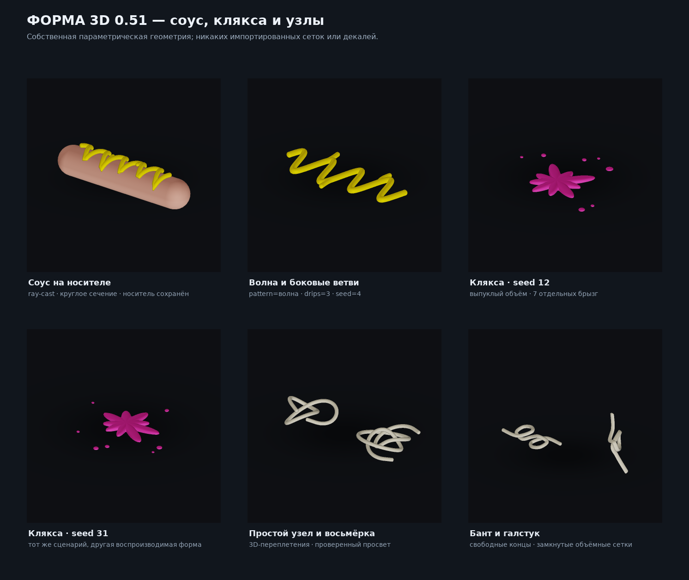

### Объёмный соус на поверхности

`sauce` (`соус`, `горчица`, `кетчуп`) строит круглую 3D-полосу, а не декаль:
`pattern=зигзаг|волна|прямая`, длина, размах, число колебаний, радиус и
неровность задаются отдельно. `seed` воспроизводимо меняет фазу и мелкие
неровности, `drips` добавляет боковые ветви растекания. Без носителя получается
самостоятельный объёмный объект; с носителем каждая точка проецируется лучом на
его верхнюю поверхность и смещается по фактической нормали. Носитель остаётся
отдельным объектом и не удаляется.

```forma
сосиска = capsule radius=15 height=150 color=#b96755
сосиска = rotate [сосиска] angle=90 axis=y
горчица = sauce [сосиска] length=105 amplitude=12 waves=5 radius=2.2 pattern=зигзаг drips=2 seed=4 color=#e7b700
```

### Клякса с воспроизводимой рандомизацией

`blot` (`клякса`, `брызги`) создаёт замкнутую кляксу со сплайновым контуром,
скруглённым краем и выпуклым верхом. `radius`, `thickness`, `dome`, `lobes` и
`irregularity` управляют самой геометрией. `droplets` добавляет отдельные
объёмные брызги без пересечений. Один `seed` повторяет ту же сетку, другой —
действительно новый контур и размещение брызг.

```forma
клякса = blot radius=45 thickness=4 dome=1.4 lobes=9 irregularity=.85 droplets=7 seed=12 color=#d51f72
```

### Заготовки настоящих 3D-узлов

`knot` (`узел`) содержит четыре варианта: `kind=простой`, `восьмерка`, `бант` и
`галстук`. Это пространственные переплетения со свободными концами и закрытыми
торцами, а не плоские значки. `size`, `radius`, `tail` и `detail` изменяют
геометрию. `height=0` автоматически разносит проходы над/под; положительное
значение задаёт высоту явно. Для всех вариантов проверяются замкнутость сетки и
просвет между нелокальными участками центральных линий.

```forma
восьмёрка = knot kind=восьмерка size=105 radius=2.6 tail=18 color=#d5c59c
бант = knot kind=бант size=100 radius=2.5 tail=15 at=[140,0,0]
```

Все три команды имеют карточки с живыми превью и сохраняемыми параметрами,
полные help-описания и заметки об исходной ориентации. Изображения выше
построены исполняемыми сценариями `docs/make_organic_051.py`; сторонние сетки,
координаты из референсов и плоские подмены не используются.

## Что нового в 0.50 — лёгкие пакеты обновлений

Windows CI теперь публикует дополнительный `Forma3D-…-update-from-….zip`:
в нём только файлы, изменённые с предыдущего Forma-релиза, а также манифест
с точными Git-ревизиями и списком удалений. Это пакет исходников и ресурсов,
а не бинарный патч: после изменения Python-кода готовой программе всё ещё нужен
новый EXE. Отдельные `.forma`, GLB и документы можно скачивать без полного ZIP.

Экспорт `human_skeleton_original.glb` и его аудит больше не дублируются внутри
EXE: оригинальный проект строит геометрию собственным кодом. Прежний импортированный
GLB сохранён в сборке, поэтому старый `human_skeleton.forma` продолжает работать.

## Что нового в 0.49 — самостоятельный параметрический скелет

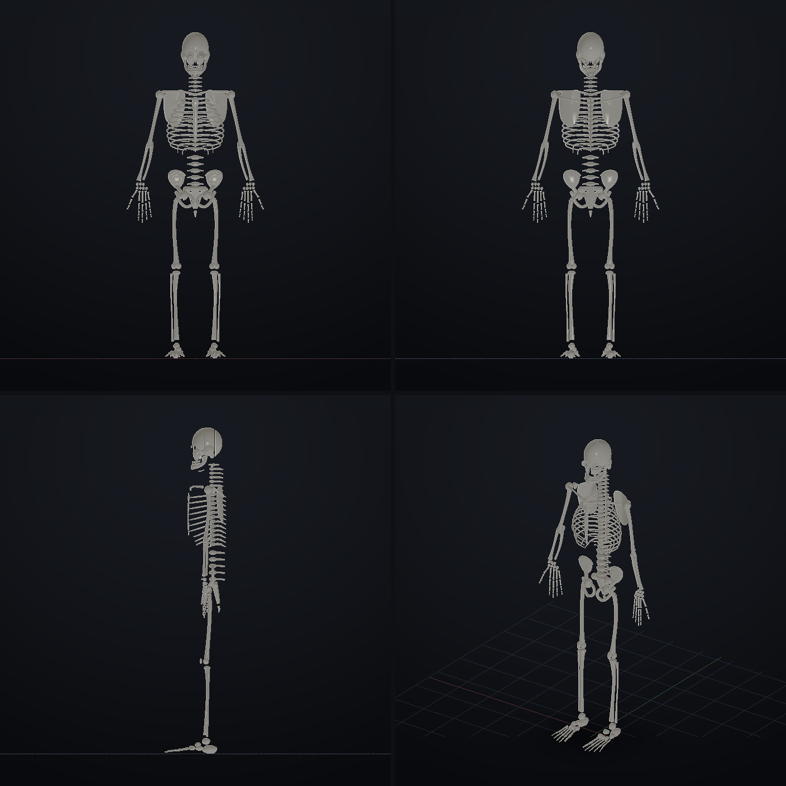

Новый проект `examples/human_skeleton_original.forma` строит с пустой сцены **206 костей
(80 осевых + 126 аппендикулярных)** только собственной параметрической геометрией Forma.
В нём нет `import` или готовых сторонних сеток; прежний адаптированный скелет оставлен без
изменений. Кольцевые сечения, изогнутые пластины, SDF и булевы операции создают полости
черепа, орбиты, позвонки, рёбра, суставные впадины, кисти и стопы.

Фактическая сборка: **185 998 треугольников**, 206 meshes/nodes в GLB, 16/16 проверок
проекта, 0 пересечений более 1 мм³; 7 новых тестов проверяют состав, целостность,
истинный параметр роста, регистрацию в меню и повторное открытие Blender-совместимого GLB. Это учебная
параметрическая аппроксимация, а не аттестованная медицинская модель.
[Полное описание и увеличенные виды](docs/human_skeleton_original.md).

## 2. Что нового в 0.48

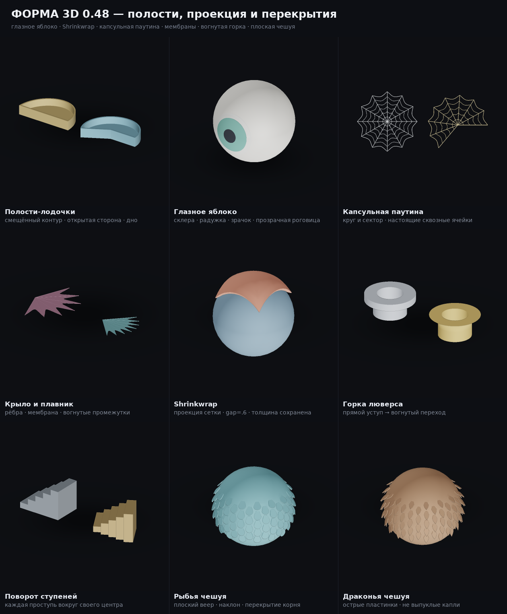

### Полости-лодочки и вогнутый люверс

У `полуовал` и `pie` появились `wall` и `cavity_depth`. Внутренний контур
получается настоящим смещением исходного силуэта на `wall`, а не масштабной
копией или рисунком. Полость открыта с лицевой стороны, снизу остаётся дно;
`cavity_depth ≤ thickness-wall`. Независимые `edge` и `hole` сохранены.

У люверса `transition=прямой|вогнутая` выбирает наружный переход от трубки к
бортику. Вогнутый вариант — четверть эллипса высотой `transition_h`, с
вертикальной касательной у трубки и горизонтальной у бортика. Это не `fill`:
заполнение верхнего отверстия по-прежнему задаётся отдельно.

```forma
лодочка = полуовал width=160 height=90 thickness=24 wall=3 cavity_depth=19 plane=плашмя
сектор = pie diameter=140 angle=180 thickness=24 wall=3 cavity_depth=18 at=[180,0,0]
люверс = grommet diameter=12 height=10 wall=1.6 flange=4 transition=вогнутая transition_h=5 at=[260,0,0]
```

### Глазное яблоко и капсульная паутина

`eyeball` (`глазное_яблоко`) не заменяет лицевой `глаз`. Новый примитив создаёт
четыре отдельных объёма: склеру, сферические диски радужки и зрачка и выпуклую
роговицу с `transmission=1`. Внутренние слои немного перекрываются, оптические
поверхности разнесены: нет щелей и совпадающих мерцающих граней. Оптическая
ось смотрит в `−Y`; размеры `diameter`, `iris`, `pupil`, `cornea`, выпуклость
`bulge` и толщина кромки `cornea_t` задаются числами.

`web` (`паутина`) строит настоящие капсульные нити круглого сечения. Доступны
`shape=круг|сектор|угол|треугольник|крыло|плавник`, число `radials/rings`,
диаметры `wire/ring_wire`, провисание `sag`, изгиб `bend` и наружный `frame`.
По умолчанию ячейки сквозные. `membrane=да` добавляет тонкую перепонку;
`scallop` вдавливает её край между рёбрами, как у крыла дракона или плавника.

```forma
глаз = eyeball diameter=24 iris=11 pupil=4.6 bulge=.6 iris_color=#4b8b7b
паутина = web shape=круг radius=70 radials=12 rings=5 wire=.8 sag=.14 at=[100,0,0]
крыло = web shape=крыло radius=90 angle=145 radials=7 scallop=.38 membrane=да at=[220,0,0]
плавник = web shape=плавник radius=70 angle=105 radials=8 scallop=.3 at=[360,0,0]
```

### Настоящий Shrinkwrap

`shrinkwrap [цель, объект]` деформирует вершины именно второго объекта по
сетке первого. `direction=ближняя|нормаль|вверх|вниз|±X|±Y` задаёт лучи,
`detail` — шаг дробления исходной сетки. `gap>0` приподнимает над целью,
`gap<0` погружает; это не команда посадки `на_границе`.

Замкнутая пластина не схлопывается: толщина измеряется двусторонними пробами
вдоль проекционного луча, включая боковые рёбра. `amount` управляет силой,
`transition` плавно оставляет удалённые вершины в исходной форме.
`join=нет|слить|сгладить` выбирает раздельный результат, булево объединение
или объединение со скруглением вогнутого стыка радиусом `weld`.

```forma
цель = sphere radius=20
плёнка = box size=[20,20,2] at=[0,0,20]
color цель #6686a0
color плёнка #d7765f
плёнка = shrinkwrap [цель,плёнка] gap=.6 direction=вниз detail=2
```

### Поворот ступеней и новая плоская чешуя

У `stairs` параметр `turn` вращает каждую ступень вокруг её собственного
центра в плане. Исходный марш сначала разрезается на ступени с сохранением
выбранных скруглений, затем они соединяются; слишком большой угол на узком
марше явно отклоняется, если разрывает соседние проступи.

Старая чешуя из выпуклых капель удалена. Новый `scales` использует плоские
наклонные пластинки: `kind=рыба` — округлый веер, `kind=дракон` — острый лист.
Корень погружён в тело, свободный конец приподнят на угол `tilt`. Верхний
конечный сектор перекрывает корень следующей нижней чешуйки; шаг рядов строго
`length·(1-overlap)`. `thick` задаёт толщину пластины, а не раздувание сферой.

```forma
марш = stairs steps=7 rise=18 run=28 width=120 turn=30
рыба = sphere radius=30 at=[0,0,150]
scales рыба kind=рыба rows=8 per_row=12 length=6 tilt=18 overlap=.45
дракон = sphere radius=30 at=[0,0,150]
scales дракон kind=дракон rows=8 per_row=12 length=6 tilt=28 overlap=.45
```

### Дополнение 0.48: объёмы, канавки и контроль бюджета

* `ring` получил реальную полость и канавки с независимыми глубиной, шириной,
  числом, профилем и стороной. `disc/oval` имеют непрерывный вогнутый или
  выпуклый бортик с регулируемыми отступами; старый контур `outline=вогнутая4`
  сохранён для совместимости и доступен в карточке.
* `heart`, `lightning`, `star` и `crescent` строят настоящие объёмы. Fireball
  `yin_yang` остаётся цельным, имеет сферу, плавный хвост и выпрямление до
  конуса. У `tee/yoke` режим `овалы` сохраняет прежнюю форму, а `капсулы`
  использует настоящие капсулы.
* `barrel` — выпуклое тело с плоскими верхом и дном: четыре профиля борозд и
  наростов, сплошной/пунктирный режимы и независимые верхний/нижний бортики.
  В `scales` добавлены варианты черепицы.
* `shave` выполняет канавку выбранного профиля по периметру, а полное
  отсечение материала делает отдельный `cut_plane`. `cube_hole` управляет
  отверстиями по осям и шестигранной формой; `screw` умеет строить только головку.
* `ingot` и `tri_prism` получили слепые полости сверху/снизу. Сфера, капсула и
  эллипсоид — расширенную половину; гиперболоид — песочные часы и отверстие
  пересечения; седло и гипар — явное число граней `nu/nv`.
* Складка рукава затрагивает наружную и противоположную внутреннюю стенки.
  Плотность `spikes/hair` до 100% учитывает запрет пересечений; длинные волосы
  огибают носитель и свисают. Добавлены пряди, водоросли и варианты черепицы.
* Перед построением, превью, кадром и морфингом суммарная оценка выше
  **500 000 треугольников** ставит действие на паузу. Можно отменить последнее
  действие без запуска расчёта или явно продолжить. Скрытый viewport и
  невидимые превью не выполняют бесполезную работу.
* Исправлены направления камер `front/back/iso`: перёд смотрит со стороны `−Y`,
  зад — со стороны `+Y`, право остаётся `+X`.

---

## 3. Что нового в 0.47

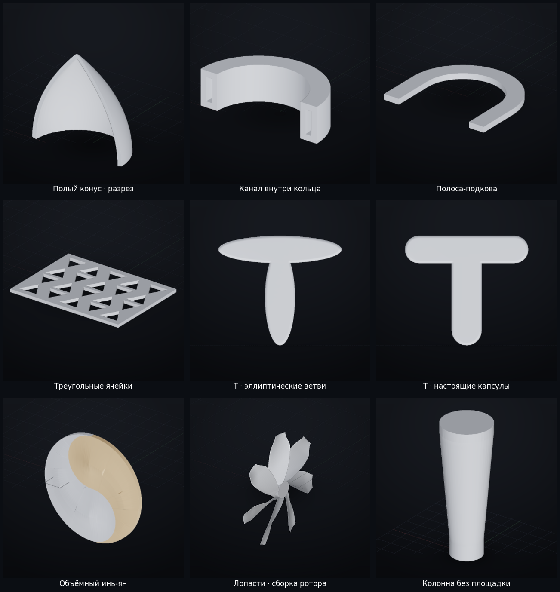

### Профили, стенки и скрытые каналы

У `cone` есть три разных радиальных профиля: `form=прямой`, `парабола` и
`холмик`. `wall>0` делает полый конус с открытым низом и закрытой вершиной,
`smooth` сглаживает его без подмены выбранного профиля. `cylinder wall>0`
строит несквозную полость с `cavity=верх` или `низ`, у `pyramid wall>0` полость
открыта только снизу. `ring cavity>0` создаёт закрытый канал внутри материала
обода, а не увеличивает центральное отверстие.

```forma
конус = cone radius=45 height=90 form=парабола wall=4 smooth=1
цилиндр = cylinder radius=40 height=90 wall=5 cavity=верх
пирамида = pyramid sides=4 radius=55 height=90 wall=5
кольцо = ring diameter=30 width=12 thickness=6 cavity=2 round=0
```

### Полосы, решётки и отверстия

`strip path=подкова` строит непрерывную подкову; независимые `path` и `path_z`
сохраняют два контура, а у прямой полосы доступно ровное центральное отверстие.
`grating pattern=круги|треугольники` добавляет настоящие сквозные ячейки этих
форм. У `cavity_frame` квадратная и овальная полости не зависят от внешнего
контура. Отверстия удалены из `box`: для центральных сквозных каналов служит
`cube_hole`.

```forma
подкова = strip length=200 width=14 thickness=5 path=подкова curve=40
решётка = grating width=150 height=110 pattern=треугольники cols=5 rows=4
блок = cube_hole size=[90,70,60] hole=24 axis=z
```

### Кромки и скругление без деформации граней

`disc` и `oval` имеют независимые `edge/edge_band`. У `pie`, `полуовал` и
`arch` истончается только круглая часть, радиальные плоскости и прямые торцы
сохраняют толщину. Пирамида и колонна используют радиусное скругление рёбер,
а не Loop-стягивание широких граней. У сектора шара убраны угловые выступы.

### Отдельные овалы и капсулы, объёмный инь-ян

У `tee` и `yoke` режимы `shape=овалы` и `shape=капсулы` различаются геометрией:
первый строит цельные эллиптические ветви, второй — прямые стороны с
полукруглыми торцами. Оба сохраняют точные габариты и остаются одним телом.
У капсульной Т ножка не проходит сквозь перекладину. `yin_yang` по умолчанию
имеет `form=объёмная`; ровная пластина остаётся доступна через `form=плоская`.

```forma
тавр = tee arm=90 bar=20 stem=22 leg=60 shape=капсулы round=2
рогатка = yoke height=110 spread=64 arm=16 shape=овалы
инь = yin_yang diameter=120 thick=16 form=объёмная side=левый
```

### Механика и мелкие детали

* `spring hole>0` — полость по всей винтовой длине проволоки; у `worm_shaft`
  есть профили и окончания витка, осевой `bore` и `channel` внутри червяка.
* `lever knob=линза|вогнутая` — выпуклая линза либо чаша только снаружи;
  стык остаётся выпуклым, палка не выступает. `grommet fill=ровно|выпуклая|
  вогнутая` заполняет верхнее отверстие одним телом с втулкой.
* У `column` отрицательный `taper` расширяет верх, `base_size=0` убирает
  площадку, `base_h` сохраняет нижнюю зону стержня, `rim_h` работает и при
  `rim=0`. Текстового переключателя площадки нет.
* `gusset` имеет независимые прямые/вогнутые/выпуклые контуры и варианты
  `*_с_пазом`; `blade kind` меняет не только название, но и силуэт, сечение и
  ложбины. `nail` — гладкий гвоздь без резьбы.
* `spikes` — инструмент над существующим объектом, а не автономная площадка.
  Исправлены сопряжение крюка, плоскость и seed облака, силуэт и кромка
  кленового листа. У `swirl` непрерывный виток сужается в остриё; `root_d`
  уменьшает начало, `base=да` скрывает его в плоском основании.

### Турбинная лопасть

`turbine_blade` строит несимметричный аэродинамический профиль с независимыми
хордой корня/конца, толщиной, кэмбером, установочным углом, круткой,
стреловидностью, осевым изгибом, корневой зоной и окончанием. Это объёмная
лопасть, а не согнутая прямоугольная пластина.

```forma
лопасть = turbine_blade length=180 chord=70 root_chord=20 tip_chord=42 thick=7 tip_thick=2.5 camber=.09 stagger=25 twist=55 sweep=28 root_h=12
```

### Дополнение: плотные вмятины, новые полости и швейная пуговица

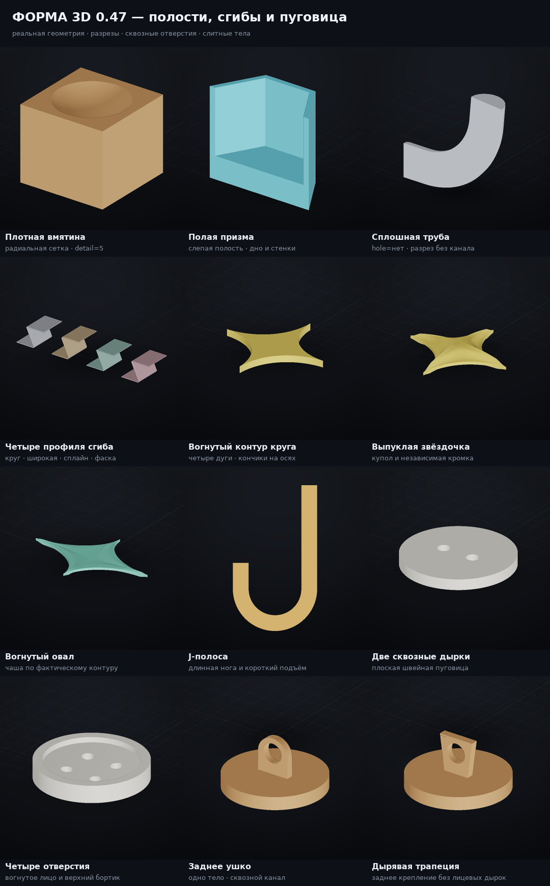

* `face_box detail=0…5` управляет радиальной тесселяцией линз и вмятин. Мелкая
  сетка сглаживает саму кривую поверхность и не создаёт диагональные заплатки;
  габарит куба сохраняется.
* `prism wall>0` вырезает слепую полость с `cavity=верх|низ` и независимой
  `cavity_depth`. Внутренний контур следует сужению, сдвигу и повороту верха.
  `pipe hole=нет` убирает внутренний канал и оставляет сплошной прямой или
  изогнутый стержень; `wall` тогда не используется.
* `fold_sheet`, `fold` и `сгиб` принимают `joint=круг|широкая|сплайн|фаска`.
  Помимо обычной дуги есть три острых, но более плавных профиля: широкий
  радиус, кривизна с мягкими концами и две дуги с промежуточной фаской.
* `disc` и `oval` с `outline=вогнутая4` получают четыре вогнутые стороны между
  кончиками на осях. `indent=0…0.8` меняет глубину дуг; плоский верх, купол,
  чаша и независимая `edge` работают по фактическому контуру.
* `strip path=J` строит одну ленту с длинной ногой, полукруглым крюком и
  коротким подъёмом. `length` — длина центральной линии, `curve` — радиус.
* Новый отдельный `sewing_button` (`пуговица`) не заменяет прежнюю кнопку из
  двух объектов. `kind=отверстия` даёт 0…8 настоящих сквозных отверстий;
  `kind=ушко|трапеция` — заднее крепление со сквозным каналом без лицевых
  дырок. `rim_side=верх|низ|нет` ставит бортик только с одной стороны,
  `top=плоская|выпуклая|вогнутая` и `sag` управляют лицевой поверхностью.

```forma
вмятина = face_box size=[60,50,40] mode=вогнутый profile=линза relief=8 margin=5 faces=верх detail=5
призма = prism sides=6 radius=35 height=60 wall=3 cavity=верх cavity_depth=40
стержень = pipe diameter=20 wall=2 hole=нет length=100 angle=75 radius=45
сгиб = fold_sheet width=90 length=180 thickness=1.2 parts=3 angle=115 joint=сплайн
звезда = disc diameter=100 thickness=5 outline=вогнутая4 indent=.35 top=выпуклая sag=5
крючок = strip length=180 width=10 thickness=4 path=J curve=24
пуговица = sewing_button diameter=30 thickness=4 holes=4 hole_d=3 pitch=8 rim_side=верх top=вогнутая
с_ушком = sewing_button diameter=30 kind=ушко top=выпуклая sag=4 eye_d=6 shank_h=11
```

---

## 4. Выставки правильных настроек

Первые четыре примера в меню — **`tools_gallery_1`…`tools_gallery_4`**:
«поры и деформация», «трещины и срезы», «лист и гармошка», «вафля, волосы и
рельеф». В каждой части 11 объектов; для каждого стенда записано, какой
инструмент, на какой заготовке и с какими параметрами применять. Все 37
внутренних проверок проходят. Суммарный бюджет четырёх сцен — 143 102
треугольника вместо одной тяжёлой общей выставки.

Всего в меню 23 проекта. Готовый LED-экран доступен как проект `clock_led`:
корпус, ниша, стекло и светящиеся цифры в нём можно редактировать независимо.
Удалённые ранее проекты и инструменты не восстанавливаются.

### Lenovo ThinkPad X1 Carbon Gen 11

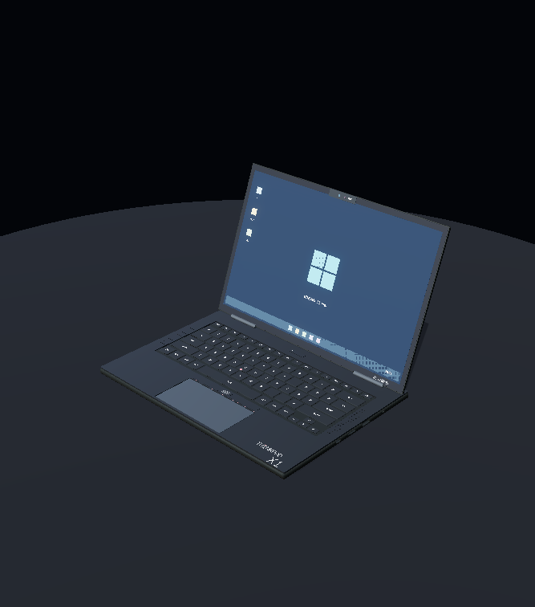

Проект `thinkpad_x1` — один цельный ноутбук, а не набор деталей. Корпус и
закрытая крышка имеют габарит **315.6 × 222.5 × 15.36 мм**; активная матрица —
14″, 16:10, **301.7 × 188.6 мм**. Смоделированы 82 клавиши с межосевым шагом
18 мм, TrackPoint и три его кнопки, тачпад 110 × 56 мм, шарниры, ножки,
динамики и настоящие углубления разъёмов. Основой послужили
[официальные характеристики Lenovo PSREF](https://psref.lenovo.com/product/ThinkPad/ThinkPad_X1_Carbon_Gen_11).

В сцене «крышка» 29 деталей дисплейного модуля вместе поворачиваются около оси
шарниров; сцена «клавиши» нажимает H, J, K, пробел и тачпад. Ниши проверены на
полном ходу, крышка — на восьми углах: пересечений с декой и днищем нет. GLB
содержит 12 animation clips. Всего **66 объектов, 74 166 треугольников**,
**22/22** встроенные проверки; после сварки по позиции все **66/66** сеток
замкнуты, без boundary/non-manifold рёбер, вырожденных и дублирующихся граней.

### Мебельная фурнитура: монтажный стенд

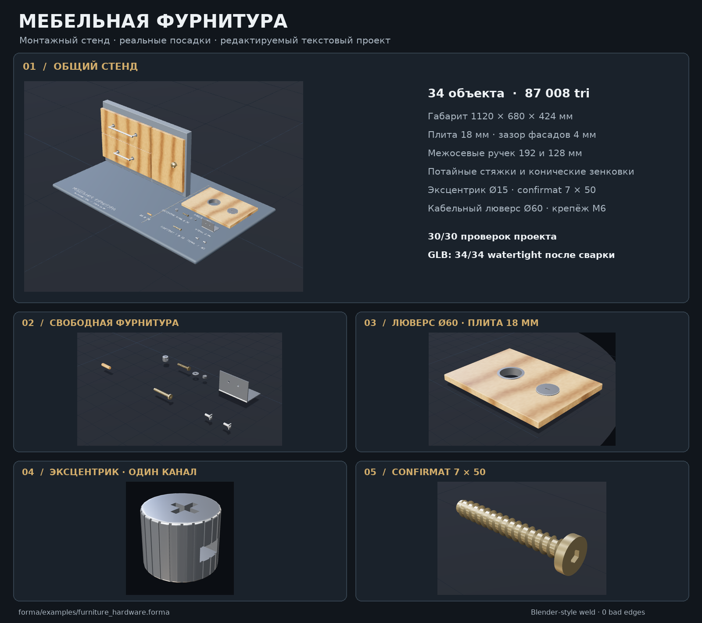

Проект `furniture_hardware` объединяет фасады с установленной фурнитурой и
отдельную рабочую зону свободных деталей. Ручки имеют фактические межосевые
192 и 128 мм, плиты — 18 мм, фасады — зазор 4 мм. Потайные стяжки сидят в
конических зенковках заподлицо; люверс Ø60 не пересекается со столешницей.
Эксцентрик имеет накатку, слепой шлиц и один монтажный канал; confirmat 7×50 —
крупную резьбу и сердечник без микропустот. В сцене 34 объекта и **87 008
треугольников**, все **30/30** встроенных проверок пройдены. При проверке копии
GLB сваркой по позиции (как Remove Doubles; UV-швы не считаются разрывами) все
**34/34** сетки замкнуты, без boundary/non-manifold рёбер и вырожденных или
дублирующихся граней.

---

## 5. Канонические стороны и посадка

Для каждого предмета однозначно заданы исходные стороны:

| сторона | направление |
|---|---|
| верх | `+Z` |
| низ | `−Z` |
| право | `+X` |
| лево | `−X` |
| перёд | `−Y` |
| зад | `+Y` |

При выделении показываются личные оси предмета. Повороты и масштабирование
обновляют их вместе с геометрией. Команда `ориентация` возвращает стороны,
центр габарита, центр массы и сведения о пустотах. Несимметричные формы и
открытые полости дополнительно описаны в карточке команды.

```forma
корпус = box size=[140,40,40]
корпус = rotate [корпус] angle=90 axis=y
крышка = cylinder radius=18 height=6
крышка = place [крышка] on=корпус side=top осями=хозяина

деталь = box size=[20,20,10]
деталь = place [деталь] on=корпус side=front face=top gap=2
```

`place` измеряет зазор от фактической границы, а не от центра. Можно посадить
свою выбранную сторону на сторону хозяина, выставить оси параллельно или
перпендикулярно и использовать размеры соседа:

```forma
ящик = box size=[80,50,30]
шайба = cylinder radius=6 height=6
шайба = translate [шайба] offset=[0.5*width(ящик),0,height(ящик)]
шайба = размер [шайба] width=0.25*width(ящик)
```

---

## 6. Основные группы команд

### Тела и заготовки

Стандартные тела, тела вращения, лофт, sweep, листы и готовые детали находятся
в упорядоченных группах «Инструментов». В карточке есть живое превью, описание
формы и настоящие параметры команды. Ползунки и выборы подставляются в текст
сценария и сохраняются вместе с проектом.

Специальные формы продолжают работать: кнопка из двух объектов, настраиваемые
лестница, рычаг и призма, объёмный слиток, бусина со сквозным каналом,
сектор тора, полости и рельефные грани.

### Булевы операции и слитные модели

```forma
итог = union [а,б]
итог = difference [а,б]
итог = intersect [а,б]
итог = fuse [а,б] radius=3 edges=все
```

`fuse` соединяет и сглаживает выбранные стыки. Для печати проверяйте не только
`NoError`, но и число частей, герметичность, толщину и саму форму.

### Массивы и градация

```forma
ряд = ряд [деталь] count=5 step=[40,0,0] grow=1.15 turn=12
круг = array [деталь] count=12 mode=radial radius=100 spin=да
```

У `ряд` можно ступенями менять размер, поворот и силу применяемого инструмента.
Размещение и зазоры можно выражать через `width()`, `height()`, `length()` и
центр массы другого объекта.

### Цепь и соединения

Оригами остаётся отдельной нишей листовых сгибов. Цепь и соединение готовых
объектов остаются самостоятельными возможностями:

```forma
ц = цепь links=8 size=26 wire=3.4 at=[0,0,80] dir=[1,0,0]
ц = соединить [первый,второй] size=16 wire=2.4 sag=.15
```

Сопряжения задают отношение деталей. После следующего преобразования
`check имя связь` пересчитывает остаток и показывает, осталась ли деталь на
месте.

### Скульпт и поверхность

Кисти вмятины, выдувания, щипка, разравнивания и разглаживания работают по
сетке. Для повторяемого текстового моделирования предпочтительны команды
`wrinkle`, `crack`, `porous`, `shave`, `point`, `corrugate`, `сгиб`, `складка`,
`hair`, `bark` и `relief`: их параметры записаны прямо в проекте.

---

## 7. Материалы, свет и рендер

```forma
color деталь #7aa2ff metal=.6 rough=.3
color стекло #7fd6e8 transmission=.72 rough=.04
color цифры #2bff72 emissive=#2bff72 emissive_strength=4.5
color пластина #b8c6d8 mirror=.35

scene bg=#eef1f4 env=studio shadows=да grid=нет
light preset=студия strength=1.1
anime mode=манга line=1.4 hatch=.5 paper_tex=.4
```

Доступны обычный рендер, скульптинг/органика и аниме/манга. Зеркальность,
стекло и LED-свечение являются свойствами материала и сохраняются в проекте.
Зеркало отражает соседние детали, свечение не проходит сквозь непрозрачный
корпус. Пресеты аниме и манга используют контуры реальной геометрии.

`pattern` назначает цвета треугольникам; `texture` задаёт процедурный материал;
`relief`, `porous` и `crack` изменяют геометрию. Это разные механизмы.

---

## 8. Проверки и отчёт

```forma
check деталь watertight
check деталь parts 1
check деталь size 79..81 59..61 39..41
check деталь wall 2..4
check деталь volume 1000..5000
check деталь связь
```

`watertight` проверяет замкнутость оболочки, `parts` — число тел,
`wall` — толщину лучами, `volume` — объём, `связь` — остаток сопряжения.
Отчёт включает предупреждения, фактические габариты, ориентацию, материалы,
треугольники и результаты проверок.

Успешное построение само по себе не доказывает правильность формы. Для новых
инструментов используются количественные проверки и визуальная приёмка:
профиль, дно отверстия, пустоты, соединения, тесселяция и отсутствие
диагональных артефактов.

---

## 9. Экспорт и Blender

```forma
/экспорт glb
/экспорт stl
/экспорт obj
/экспорт ply
/экспорт step
/экспорт 3mf
/снимки front,iso,right,top
```

* **GLB** — цвета, материалы, отдельные объекты и анимация; основной обмен с
  Blender.
* **STL / 3MF** — печать геометрии без сценового освещения.
* **OBJ / PLY** — сетки для других редакторов.
* **STEP** — обмен с CAD, если доступен соответствующий конвертер.
* **DXF** — развёртки и плоские контуры поддерживаемых листовых деталей.

Импорт GLB/OBJ/STL доступен через меню. После импорта используйте `repair`,
проверку герметичности и личные оси; не заменяйте скругление рёбер общим
Loop-сглаживанием широких граней.

---

## 10. Инструкция для нейросети

Кнопки **«Инструкция ИИ»** и **«Все команды»** копируют справочник в отдельное
поле, не затирая запрос. Полный каталог содержит каждую команду, русские
псевдонимы, параметры, ограничения, ориентацию и рабочий пример.

Рекомендуемый цикл:

1. скопировать инструкцию и все команды отдельно от запроса;
2. сформулировать предмет, размеры, стороны и допустимые пустоты;
3. построить текстовый сценарий;
4. прочитать отчёт и исправить форму, а не только сообщение об ошибке;
5. проверить сцену в обычном или нужном специальном рендере;
6. экспортировать GLB для Blender либо STL/3MF для печати.

---

## 11. Запуск

### Windows

Готовые ZIP и EXE публикуются на странице
[Releases](https://github.com/RatAndRu/Hello-program/releases). EXE собирается
только через GitHub Actions CI: локальный Windows-бинарник не подменяет
релизный. Встроенные карты, примеры, интерфейс и справка упаковываются в сборку.

### Из исходников

Требуются Python 3.11+, NumPy, `manifold3d` и PyYAML.

```bash
cd forma
python -m pip install -r requirements.txt
python -m forma.app --browser
```

Самопроверки:

```bash
python -m forma.app --selftest
python -m forma.app --uistest
python -m unittest discover -s tests -v
python -m forma.eval --out foundation-eval.json --compare docs/foundation_baseline.json
python -m forma.fuzz --cases 24 --seed 20261102 --timeout 30 --output fuzz-report.json
node --check web/js/app.js
```

Профиль отдельных команд: `python -m forma build model.forma --profile`.
Устройство benchmark, формат ответов нейросети и fuzz-repro описаны в
[docs/foundation_eval.md](docs/foundation_eval.md).

Дополнительные рецепты находятся в [docs/RECIPES.md](docs/RECIPES.md).
Развитие и ограничения — в [docs/PLAN_NEXT.md](docs/PLAN_NEXT.md) и
[docs/SELF_ANALYSIS.md](docs/SELF_ANALYSIS.md).
