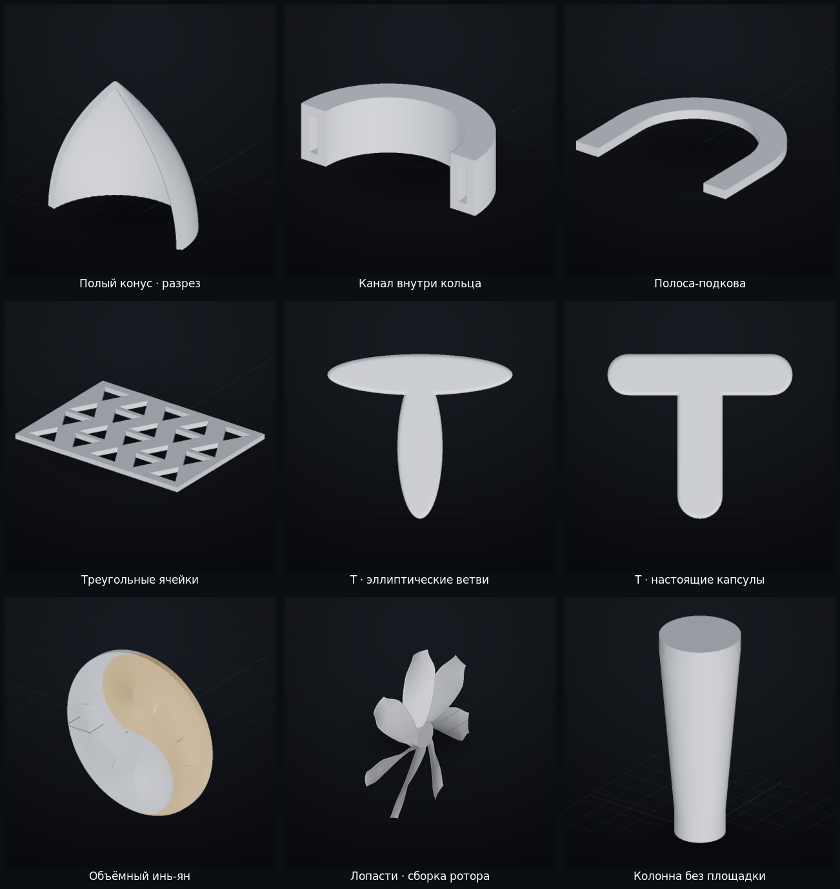
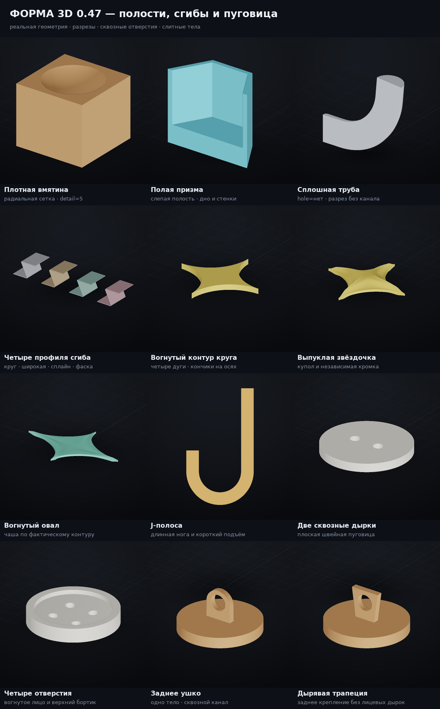
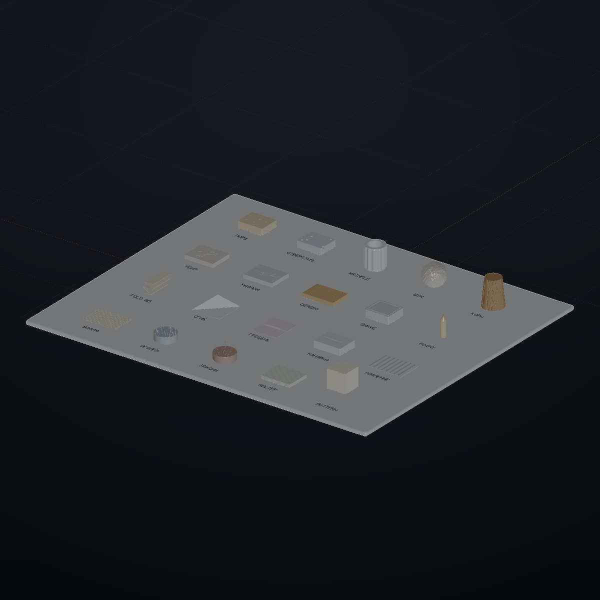

# ФОРМА 3D 0.47 — 3D-редактор, которым управляют словами

Параметрический редактор твёрдых тел для Windows. Модель описывается текстовым
сценарием: одна команда на строку. Приложение строит замкнутую геометрию,
показывает её в 3D, проверяет фактические размеры и связи и возвращает отчёт,
который можно отдать человеку или нейросети для следующей правки.

```forma
корпус = lathe points=[[0,0],[42,0],[42,95],[0,95]] segments=144 thickness=4 open=top
ручка = sweep path=[[40,0,28],[58,0,28],[67,0,42],[67,0,62],[58,0,76],[40,0,76]] width=9 height=13 smooth=10
кружка = union [корпус,ручка]
color кружка material=ceramic

check кружка watertight
check кружка height 90..100
check кружка wall 3..5
check кружка symmetric y
```

Текущий реестр: **198 команд, из них 101 примитив**. Полное описание каждой
команды, всех параметров, псевдонимов, ориентации и пример формируются из того
же реестра, которым пользуется геометрическое ядро.

---

## 1. Что нового в 0.46

### Поры с заданной формой и размером

`porous` строит сферические ямы, цилиндрические отверстия с плоским дном и
внутренние пузыри. `size` — радиус раскрытия, `width` — диаметр и имеет
приоритет; `depth` измеряется от исходной поверхности. `count` и `seed`
повторяемы. Раскрытия разводятся без перекрытий; невозможный `count` явно
отклоняется. `smooth`, `uneven` и `rough` меняют саму геометрию стенок и кромки.

```forma
камень = box size=[100,80,30] round=4
камень = porous [камень] mode=поры size=5 depth=2.5 count=24 smooth=.35 uneven=.12 rough=.08 seed=3

плита = box size=[100,80,30]
плита = porous [плита] mode=отверстия width=10 depth=6 count=18 smooth=.2 seed=8
```

### Плоский срез и канавка по его периметру

`shave` снимает материал плоскостью под произвольным углом. По контуру нового
среза можно пройти прямоугольной, овальной или треугольной канавкой. Это не
второй срез и не текстура: профиль имеет собственные ширину, глубину и отступ.

```forma
деталь = box size=[90,70,40] round=3
деталь = shave [деталь] depth=6 groove=овальная groove_width=5 groove_depth=2.5 groove_offset=4
```

`point` сохраняет положение вершины острия, возвращает одно корректное тело и
проверяет ошибку ядра после сборки.

### Трещины и древесные ложбинки

Новый `crack` вдавливает линии в существующую поверхность. `удар` создаёт
ветвящиеся лучи, `разлом` — длинную трещину с ответвлениями, `дерево` — ровные
продольные ложбинки. Лучи проецируются на настоящую сетку, поэтому инструмент
работает не только на плоскости.

```forma
плита = box size=[120,90,16]
плита = crack [плита] mode=удар at=[0,0,16] dir=[0,0,1] count=8 radius=43 width=2 depth=1.2 seed=4

доска = box size=[140,70,16]
доска = crack [доска] mode=дерево count=13 width=1.7 depth=.8 angle=0 seed=2
```

### Складки без диагональных артефактов

`wrinkle` автоматически разбивает сетку по длине волны. Режимы `радиус`,
`высота`, `шум`, `клетка`, `трещины` деформируют объёмное тело, а не добавляют
декорации. У рукава `surface=наружная` сохраняет внутреннюю стенку;
`surface=вся` деформирует обе. Угловые режимы плавно затухают у торцов и не
образуют звезду на торцевом веере.

```forma
наружная = cylinder radius=40 height=90 segments=64
внутренняя = cylinder radius=28 height=90 segments=64
рукав = difference [наружная,внутренняя]
delete наружная
delete внутренняя
рукав = wrinkle [рукав] mode=радиус amp=2.5 freq=12 axis=z surface=наружная
```

### Сгибы исходной поверхности

* `fold` и `fold_sheet` делят оставшуюся после дуг длину на равные плоские
  полотнища; каждая вторая складка больше не шире остальных.
* `сгиб` непрерывно отображает собственную сетку листа на прямые участки и
  дуги. Поддерживаются диагональ, линия через угол и `parts=3…12` для гармошки.
* `складка` в режимах `гребень` и `канавка` перемещает вершины исходной
  поверхности. Не добавляет полукольцо и не подставляет вторую плоскость.

```forma
лист = sheet width=105 length=240 thickness=1
гармошка = fold [лист] parts=5 angle=150 gap=.8 sharp=.15 axis=x

квадрат = sheet width=120 length=120 thickness=1
угол = сгиб [квадрат] at=[0,0,1] dir=45 angle=120 gap=.5

основа = sheet width=120 length=100 thickness=1
гребень = складка [основа] from=[-50,0,1] to=[50,0,1] r=6 depth=5 mode=гребень taper=.3
```

### Рифление, вафля, кора и рельеф

`corrugate mode=рифление` зависит только от одной координаты и даёт прямые
параллельные рёбра. `mode=вафля` зависит от двух координат и даёт двумерную
клетку. Плотность сетки — не меньше двенадцати рёбер на шаг.

`bark` строит нерегулярные извилистые борозды разной ширины и глубины,
вторичные трещины и мелкие пластины. Узор бесшовный по окружности и повторяется
по `seed`.

`relief` без `image` использует встроенную `docs/pattern.png`. Карта доступна
из любой рабочей папки и включается в однофайловую Windows-сборку.

```forma
рельеф = box size=[120,100,12]
рельеф = relief [рельеф] depth=2 mode=плоскость
```

### Наращивание на выбранном объекте

`hair` требует существующий объект. Иголки, волоски, локоны и мех начинаются
внутри поверхности и свариваются с ней в одно тело; автономной основы не
создаётся. `surface` выбирает каноническую сторону или всю поверхность,
`at+radius` может ограничить пятно.

```forma
основа = cylinder radius=43 height=28 segments=56
иголки = hair [основа] style=иголки surface=верх count=65 length=22 thick=1.6 spread=.18 seed=4
```

### Покраска узором

`pattern` остаётся покраской, а не рельефом. Перед назначением цветов сетка
автоматически разбивается под размер фигуры с ограничением бюджета, поэтому
круги и ромбы не превращаются в несколько крупных цветных заплаток. Форма,
габарит и объём не меняются.

```forma
куб = box size=[70,70,70]
color куб #f0e6cf
pattern куб #b44b3e shape=круги size=10 step=20
```

---

## 2. Что нового в 0.47



### Профили, стенки и скрытые каналы

У `cone` есть три разных радиальных профиля: `form=прямой`, `парабола` и
`холмик`. `wall>0` делает полый конус с открытым низом и закрытой вершиной,
`smooth` сглаживает его без подмены выбранного профиля. `cylinder wall>0`
строит несквозную полость с `cavity=верх` или `низ`, у `pyramid wall>0` полость
открыта только снизу. `ring cavity>0` создаёт закрытый канал внутри материала
обода, а не увеличивает центральное отверстие.

```forma
конус = cone radius=45 height=90 form=парабола wall=4 smooth=1
цилиндр = cylinder radius=40 height=90 wall=5 cavity=верх
пирамида = pyramid sides=4 radius=55 height=90 wall=5
кольцо = ring diameter=30 width=12 thickness=6 cavity=2 round=0
```

### Полосы, решётки и отверстия

`strip path=подкова` строит непрерывную подкову; независимые `path` и `path_z`
сохраняют два контура, а у прямой полосы доступно ровное центральное отверстие.
`grating pattern=круги|треугольники` добавляет настоящие сквозные ячейки этих
форм. У `cavity_frame` квадратная и овальная полости не зависят от внешнего
контура. Отверстия удалены из `box`: для центральных сквозных каналов служит
`cube_hole`.

```forma
подкова = strip length=200 width=14 thickness=5 path=подкова curve=40
решётка = grating width=150 height=110 pattern=треугольники cols=5 rows=4
блок = cube_hole size=[90,70,60] hole=24 axis=z
```

### Кромки и скругление без деформации граней

`disc` и `oval` имеют независимые `edge/edge_band`. У `pie`, `полуовал` и
`arch` истончается только круглая часть, радиальные плоскости и прямые торцы
сохраняют толщину. Пирамида и колонна используют радиусное скругление рёбер,
а не Loop-стягивание широких граней. У сектора шара убраны угловые выступы.

### Отдельные овалы и капсулы, объёмный инь-ян

У `tee` и `yoke` режимы `shape=овалы` и `shape=капсулы` различаются геометрией:
первый строит цельные эллиптические ветви, второй — прямые стороны с
полукруглыми торцами. Оба сохраняют точные габариты и остаются одним телом.
У капсульной Т ножка не проходит сквозь перекладину. `yin_yang` по умолчанию
имеет `form=объёмная`; ровная пластина остаётся доступна через `form=плоская`.

```forma
тавр = tee arm=90 bar=20 stem=22 leg=60 shape=капсулы round=2
рогатка = yoke height=110 spread=64 arm=16 shape=овалы
инь = yin_yang diameter=120 thick=16 form=объёмная side=левый
```

### Механика и мелкие детали

* `spring hole>0` — полость по всей винтовой длине проволоки; у `worm_shaft`
  есть профили и окончания витка, осевой `bore` и `channel` внутри червяка.
* `lever knob=линза|вогнутая` — выпуклая линза либо чаша только снаружи;
  стык остаётся выпуклым, палка не выступает. `grommet fill=ровно|выпуклая|
  вогнутая` заполняет верхнее отверстие одним телом с втулкой.
* У `column` отрицательный `taper` расширяет верх, `base_size=0` убирает
  площадку, `base_h` сохраняет нижнюю зону стержня, `rim_h` работает и при
  `rim=0`. Текстового переключателя площадки нет.
* `gusset` имеет независимые прямые/вогнутые/выпуклые контуры и варианты
  `*_с_пазом`; `blade kind` меняет не только название, но и силуэт, сечение и
  ложбины. `nail` — гладкий гвоздь без резьбы.
* `spikes` — инструмент над существующим объектом, а не автономная площадка.
  Исправлены сопряжение крюка, плоскость и seed облака, силуэт и кромка
  кленового листа. У `swirl` непрерывный виток сужается в остриё; `root_d`
  уменьшает начало, `base=да` скрывает его в плоском основании.

### Турбинная лопасть

`turbine_blade` строит несимметричный аэродинамический профиль с независимыми
хордой корня/конца, толщиной, кэмбером, установочным углом, круткой,
стреловидностью, осевым изгибом, корневой зоной и окончанием. Это объёмная
лопасть, а не согнутая прямоугольная пластина.

```forma
лопасть = turbine_blade length=180 chord=70 root_chord=20 tip_chord=42 thick=7 tip_thick=2.5 camber=.09 stagger=25 twist=55 sweep=28 root_h=12
```

### Дополнение: плотные вмятины, новые полости и швейная пуговица



* `face_box detail=0…5` управляет радиальной тесселяцией линз и вмятин. Мелкая
  сетка сглаживает саму кривую поверхность и не создаёт диагональные заплатки;
  габарит куба сохраняется.
* `prism wall>0` вырезает слепую полость с `cavity=верх|низ` и независимой
  `cavity_depth`. Внутренний контур следует сужению, сдвигу и повороту верха.
  `pipe hole=нет` убирает внутренний канал и оставляет сплошной прямой или
  изогнутый стержень; `wall` тогда не используется.
* `fold_sheet`, `fold` и `сгиб` принимают `joint=круг|широкая|сплайн|фаска`.
  Помимо обычной дуги есть три острых, но более плавных профиля: широкий
  радиус, кривизна с мягкими концами и две дуги с промежуточной фаской.
* `disc` и `oval` с `outline=вогнутая4` получают четыре вогнутые стороны между
  кончиками на осях. `indent=0…0.8` меняет глубину дуг; плоский верх, купол,
  чаша и независимая `edge` работают по фактическому контуру.
* `strip path=J` строит одну ленту с длинной ногой, полукруглым крюком и
  коротким подъёмом. `length` — длина центральной линии, `curve` — радиус.
* Новый отдельный `sewing_button` (`пуговица`) не заменяет прежнюю кнопку из
  двух объектов. `kind=отверстия` даёт 0…8 настоящих сквозных отверстий;
  `kind=ушко|трапеция` — заднее крепление со сквозным каналом без лицевых
  дырок. `rim_side=верх|низ|нет` ставит бортик только с одной стороны,
  `top=плоская|выпуклая|вогнутая` и `sag` управляют лицевой поверхностью.

```forma
вмятина = face_box size=[60,50,40] mode=вогнутый profile=линза relief=8 margin=5 faces=верх detail=5
призма = prism sides=6 radius=35 height=60 wall=3 cavity=верх cavity_depth=40
стержень = pipe diameter=20 wall=2 hole=нет length=100 angle=75 radius=45
сгиб = fold_sheet width=90 length=180 thickness=1.2 parts=3 angle=115 joint=сплайн
звезда = disc diameter=100 thickness=5 outline=вогнутая4 indent=.35 top=выпуклая sag=5
крючок = strip length=180 width=10 thickness=4 path=J curve=24
пуговица = sewing_button diameter=30 thickness=4 holes=4 hole_d=3 pitch=8 rim_side=верх top=вогнутая
с_ушком = sewing_button diameter=30 kind=ушко top=выпуклая sag=4 eye_d=6 shank_h=11
```

---

## 3. Выставка правильных настроек

Первый пример в меню — **`tools_gallery`**: 20 стандов, 41 объект и 29
внутренних проверок. Для каждого стенда в сценарии записано, какой инструмент,
на какой заготовке и с какими параметрами применять. Рядом стоят пары для
сравнения: ямы/отверстия, удар/разлом/дерево, гребень/канавка,
вафля/рифление, иголки/локоны.



Всего в меню 24 проекта. Готовый LED-экран доступен как проект `clock_led`:
корпус, ниша, стекло и светящиеся цифры в нём можно редактировать независимо.

---

## 4. Канонические стороны и посадка

Для каждого предмета однозначно заданы исходные стороны:

| сторона | направление |
|---|---|
| верх | `+Z` |
| низ | `−Z` |
| право | `+X` |
| лево | `−X` |
| перёд | `−Y` |
| зад | `+Y` |

При выделении показываются личные оси предмета. Повороты и масштабирование
обновляют их вместе с геометрией. Команда `ориентация` возвращает стороны,
центр габарита, центр массы и сведения о пустотах. Несимметричные формы и
открытые полости дополнительно описаны в карточке команды.

```forma
корпус = box size=[140,40,40]
корпус = rotate [корпус] angle=90 axis=y
крышка = cylinder radius=18 height=6
крышка = place [крышка] on=корпус side=top осями=хозяина

деталь = box size=[20,20,10]
деталь = place [деталь] on=корпус side=front face=top gap=2
```

`place` измеряет зазор от фактической границы, а не от центра. Можно посадить
свою выбранную сторону на сторону хозяина, выставить оси параллельно или
перпендикулярно и использовать размеры соседа:

```forma
ящик = box size=[80,50,30]
шайба = cylinder radius=6 height=6
шайба = translate [шайба] offset=[0.5*width(ящик),0,height(ящик)]
шайба = размер [шайба] width=0.25*width(ящик)
```

---

## 5. Основные группы команд

### Тела и заготовки

Стандартные тела, тела вращения, лофт, sweep, листы и готовые детали находятся
в упорядоченных группах «Инструментов». В карточке есть живое превью, описание
формы и настоящие параметры команды. Ползунки и выборы подставляются в текст
сценария и сохраняются вместе с проектом.

Специальные формы продолжают работать: кнопка из двух объектов, настраиваемые
лестница, рычаг и призма, объёмный слиток, бусина со сквозным каналом,
сектор тора, полости и рельефные грани.

### Булевы операции и слитные модели

```forma
итог = union [а,б]
итог = difference [а,б]
итог = intersect [а,б]
итог = fuse [а,б] radius=3 edges=все
```

`fuse` соединяет и сглаживает выбранные стыки. Для печати проверяйте не только
`NoError`, но и число частей, герметичность, толщину и саму форму.

### Массивы и градация

```forma
ряд = ряд [деталь] count=5 step=[40,0,0] grow=1.15 turn=12
круг = array [деталь] count=12 mode=radial radius=100 spin=да
```

У `ряд` можно ступенями менять размер, поворот и силу применяемого инструмента.
Размещение и зазоры можно выражать через `width()`, `height()`, `length()` и
центр массы другого объекта.

### Цепь и соединения

Оригами остаётся отдельной нишей листовых сгибов. Цепь и соединение готовых
объектов остаются самостоятельными возможностями:

```forma
ц = цепь links=8 size=26 wire=3.4 at=[0,0,80] dir=[1,0,0]
ц = соединить [первый,второй] size=16 wire=2.4 sag=.15
```

Сопряжения задают отношение деталей. После следующего преобразования
`check имя связь` пересчитывает остаток и показывает, осталась ли деталь на
месте.

### Скульпт и поверхность

Кисти вмятины, выдувания, щипка, разравнивания и разглаживания работают по
сетке. Для повторяемого текстового моделирования предпочтительны команды
`wrinkle`, `crack`, `porous`, `shave`, `point`, `corrugate`, `сгиб`, `складка`,
`hair`, `bark` и `relief`: их параметры записаны прямо в проекте.

---

## 6. Материалы, свет и рендер

```forma
color деталь #7aa2ff metal=.6 rough=.3
color стекло #7fd6e8 transmission=.72 rough=.04
color цифры #2bff72 emissive=#2bff72 emissive_strength=4.5
color пластина #b8c6d8 mirror=.35

scene bg=#eef1f4 env=studio shadows=да grid=нет
light preset=студия strength=1.1
anime mode=манга line=1.4 hatch=.5 paper_tex=.4
```

Доступны обычный рендер, скульптинг/органика и аниме/манга. Зеркальность,
стекло и LED-свечение являются свойствами материала и сохраняются в проекте.
Зеркало отражает соседние детали, свечение не проходит сквозь непрозрачный
корпус. Пресеты аниме и манга используют контуры реальной геометрии.

`pattern` назначает цвета треугольникам; `texture` задаёт процедурный материал;
`relief`, `porous` и `crack` изменяют геометрию. Это разные механизмы.

---

## 7. Проверки и отчёт

```forma
check деталь watertight
check деталь parts 1
check деталь size 79..81 59..61 39..41
check деталь wall 2..4
check деталь volume 1000..5000
check деталь связь
```

`watertight` проверяет замкнутость оболочки, `parts` — число тел,
`wall` — толщину лучами, `volume` — объём, `связь` — остаток сопряжения.
Отчёт включает предупреждения, фактические габариты, ориентацию, материалы,
треугольники и результаты проверок.

Успешное построение само по себе не доказывает правильность формы. Для новых
инструментов используются количественные проверки и визуальная приёмка:
профиль, дно отверстия, пустоты, соединения, тесселяция и отсутствие
диагональных артефактов.

---

## 8. Экспорт и Blender

```forma
/экспорт glb
/экспорт stl
/экспорт obj
/экспорт ply
/экспорт step
/экспорт 3mf
/снимки front,iso,right,top
```

* **GLB** — цвета, материалы, отдельные объекты и анимация; основной обмен с
  Blender.
* **STL / 3MF** — печать геометрии без сценового освещения.
* **OBJ / PLY** — сетки для других редакторов.
* **STEP** — обмен с CAD, если доступен соответствующий конвертер.
* **DXF** — развёртки и плоские контуры поддерживаемых листовых деталей.

Импорт GLB/OBJ/STL доступен через меню. После импорта используйте `repair`,
проверку герметичности и личные оси; не заменяйте скругление рёбер общим
Loop-сглаживанием широких граней.

---

## 9. Инструкция для нейросети

Кнопки **«Инструкция ИИ»** и **«Все команды»** копируют справочник в отдельное
поле, не затирая запрос. Полный каталог содержит каждую команду, русские
псевдонимы, параметры, ограничения, ориентацию и рабочий пример.

Рекомендуемый цикл:

1. скопировать инструкцию и все команды отдельно от запроса;
2. сформулировать предмет, размеры, стороны и допустимые пустоты;
3. построить текстовый сценарий;
4. прочитать отчёт и исправить форму, а не только сообщение об ошибке;
5. проверить сцену в обычном или нужном специальном рендере;
6. экспортировать GLB для Blender либо STL/3MF для печати.

---

## 10. Запуск

### Windows

Готовые ZIP и EXE публикуются на странице
[Releases](https://github.com/RatAndRu/Hello-program/releases). EXE собирается
только через GitHub Actions CI: локальный Windows-бинарник не подменяет
релизный. Встроенные карты, примеры, интерфейс и справка упаковываются в сборку.

### Из исходников

Требуются Python 3.11+, NumPy, `manifold3d` и PyYAML.

```bash
cd forma
python -m pip install -r requirements.txt
python -m forma.app --browser
```

Самопроверки:

```bash
python -m forma.app --selftest
python -m forma.app --uistest
python -m unittest discover -s tests -v
node --check web/js/app.js
```

Дополнительные рецепты находятся в [docs/RECIPES.md](docs/RECIPES.md).
Развитие и ограничения — в [docs/PLAN_NEXT.md](docs/PLAN_NEXT.md) и
[docs/SELF_ANALYSIS.md](docs/SELF_ANALYSIS.md).
