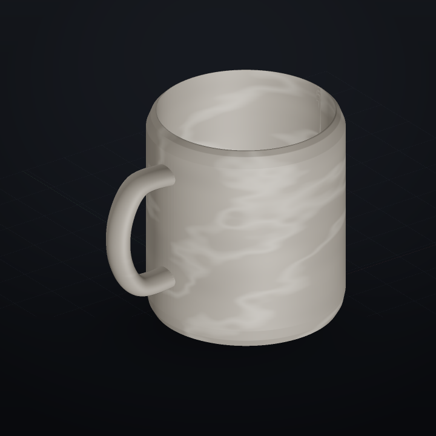
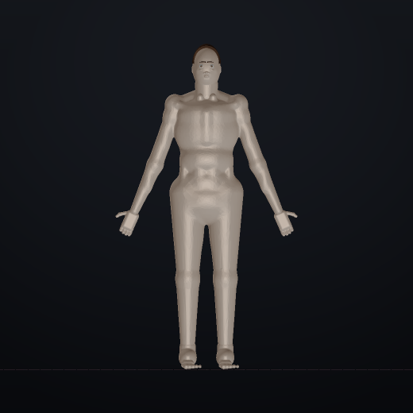

# ФОРМА 3D — 3D-редактор, которым управляют словами

Параметрический редактор твёрдых тел для Windows. Модель описывается **текстовым
сценарием** (одна команда на строку), приложение строит настоящую геометрию
(замкнутые тела, булевы операции), показывает её в 3D, **словами проверяет**
результат и отдаёт готовый отчёт для следующей правки — человеку или нейросети.

```
корпус = lathe points=[[0,0],[42,0],[42,95],[0,95]] segments=144 thickness=4 open=top
ручка  = sweep path=[[40,0,28],[58,0,28],[67,0,42],[67,0,62],[58,0,76],[40,0,76]] width=9 height=13 smooth=10
кружка = union [корпус, ручка]
color кружка material=ceramic

check кружка watertight
check кружка height 90..100
check кружка wall 3..5
check кружка symmetric y
```

Такой сценарий строит ровную керамическую кружку с полостью стенкой 4 мм,
проверяет герметичность, высоту, толщину стенок и симметрию — и пишет отчёт
с фактическими числами.

---

## Как это выглядит

Примеры из папки `examples/` — построены этим же приложением, снимки сделаны
встроенным рендерером (4 вида для проверки результата):

| Кружка (10/10 проверок) | Кузов (9/9) |
|---|---|
|  |  |
| **Ваза (5/5)** | **Анатомическая фигура (3/3)** |
|  |  |
| **Кружка со студией** | **Фигура, лицо и кисти** |
|  |  |

## Что нового в 0.8 — приложение стало в разы легче и быстрее

* **EXE похудел примерно втрое (80 МБ → около 25 МБ).** Из сборки убраны
  библиотеки, которые приложению не нужны: scikit-image и scipy (≈130 МБ
  распакованных) и Pillow (≈22 МБ). Поверхность из поля расстояний теперь
  извлекает свой мешер `forma/mesher.py` (surface nets на numpy), а PNG
  пишет и читает свой кодек. Функции остались те же: капли, SDF-формулы,
  фигура человека, свои текстуры, экспорт GLB с текстурами и анимацией.
* **Быстрее запуск.** Однофайловый EXE при старте распаковывается во временную
  папку; объём распаковки уменьшился втрое — окно появляется заметно раньше.
* **Свой мешер вместо marching cubes.** На гладких полях он даёт более гладкую
  поверхность и меньше треугольников: у пришельца 17 890 вместо 47 504,
  у капли — 16 974 вместо 67 768 при том же объёме (расхождение 0,3 %).
* **Симметрия не считается «на всякий случай».** Это самая дорогая метрика
  (две булевы операции): теперь она считается по тем осям, которые просят
  проверки (`check имя symmetric x`) или по всем трём, если сетка небольшая.
  Кузов 2,16 → 0,83 с, манекен 1,74 → 1,07 с, человек 2,55 → 1,90 с.
* **Не считаем одно и то же дважды.** Толщина стенки и симметрия кэшируются
  по объекту, поэтому проверка не повторяет работу анализа.
* Итог по 15 примерам: 29,3 с (0.6) → 17,3 с (0.7) → **12,4 с (0.8)**.

## Что было в 0.7

* **Скругление рёбер по-настоящему.** `fillet` теперь умеет выбирать кромки:
  `edges=convex` (наружные), `edges=concave` (внутренние стыки) или `all` (по
  умолчанию). Новый `chamfer` снимает кромку плоской фаской 45°:
  `плита = chamfer [плита] width=2 edges=convex`. Размер детали не меняется,
  объём меняется только там, где сняли/добавили материал.
* **Математические поверхности быстрее в 3–4 раза.** Поле SDF считается
  массивами numpy, поверхность извлекает свой мешер (surface nets):
  «капля» 5,8 → 1,4 с, `blob` 3,9 → 0,6 с. Формула проверяется один раз,
  «плохие» точки не роняют процесс, поверхность на границе области
  закрывается крышкой, а не остаётся дырой.
* **Меньше лишних треугольников без потери формы.** Результат SDF
  упрощается на 0,06 шага сетки с контролем объёма (±3 %): у пришельца
  47 504 → 17 432 треугольника, у капли 67 768 → 18 838 при том же объёме.
* **Метрики дешевле.** Толщина стенки считается по упрощённой копии
  (допуск 0,05–0,2 мм) и не считается дважды для одного объекта: сборка
  кружки 1,45 → 0,36 с, человека 5,70 → 1,9 с, все 15 примеров 29,3 → 12,3 с.
* **`tri_quality` честнее.** «Иглой» считается треугольник с углом меньше 3°
  (веерные торцы цилиндров больше не считаются браком): цилиндр и сфера — 0 %,
  плита с фаской — 28 % (это правда про minkowski, см. «Что не сделано»).
* **Шестерня и пробка.** У шестерни настоящий зубчатый венец из 20 зубьев
  (было почти гладкое кольцо), у пробки бутылки — 32 глубокие ложбины и
  поясок; 22 регрессионных теста.

## Что было в 0.6

* **Мышь как в 3D-редакторе.** Левая кнопка — вращение, колесо — масштаб,
  **правая кнопка — перемещение по сцене**. В режиме «выбор» левая кнопка
  **тянет рамку**: всё, что попало внутрь, подсвечивается и описывается
  (площадь, число треугольников, координаты). Shift добавляет область,
  Ctrl+клик убирает.
* **Файлы — в «Загрузки».** Экспорт GLB/STL/OBJ/PLY/3MF/BLEND/ZIP, снимки и
  сохранение проекта кладут файл в `Downloads` и показывают полный путь.
* **Свои текстуры.** Кроме готовых (дерево, мрамор, металл, ткань, кожа,
  керамика, клетка, кирпич, шум) появились пользовательские:
  `texture кружка kind=своя pattern=волны color1=#1f6f8b color2=#d7e6ea`.
  Узоры: полосы, клетка, волны, градиент, шум, камень, точки, сетка.
* **Швов нет.** Рисунок генерируется бесшовным по построению, а UV-развёртка
  по-треугольно сшивает край цилиндра — полоса на стыке исчезла.
* **Экономия треугольников.** Число сегментов примитивов и тел вращения
  считается по размеру и допуску: куб — 12 треугольников, сфера Ø400 —
  меньше 20 тысяч, объём держится в пределах 0,6 %.
* **Свет без провалов.** Добавлена минимальная освещённость: внутренние
  полости и нижние грани видны, чёрных «дыр» нет.
* **Честные инструменты.** `bevel` теперь настоящая фаска с радиусом в мм
  (размер детали не меняется), `bend`/`twist` дробят сетку по длине ребра,
  `box round=` разрешает скругление в половину толщины, `simplify` проверяет
  отклонение, `from_sdf` не падает на плохих точках формулы.
* **Импорт без сюрпризов.** `unit=auto` больше не угадывает масштаб,
  `repair` по умолчанию выключен и предупреждает, если починка меняет объём.
* **Понятные ошибки.** Повторное имя объекта, деление на ноль, `fillet [нет]` —
  вместо молчаливой замены и «неизвестной команды» объяснение и подсказка.
* **Новые проверки.** `sharp_edge`, `tri_quality`, `wall_min` (с координатой
  самого тонкого места), `clearance` как синоним `gap`.
* **Консоль.** `forma diff a.forma b.forma`, `forma doctor`,
  `forma build --strict` (код 3 при невыполненной проверке), `--json`,
  `--digest`, `--trace`, экспорт `--format 3mf`.
* **Запрос к нейросети** теперь содержит таблицу метрик прошлой сборки:
  габариты, объём, массу, треугольники, стенку, список невыполненных проверок.

## Что нового в 0.3

* **Командная строка.** Внизу окна — строка, куда пишется команда сценария.
  Enter дописывает её в сценарий и сразу собирает модель; ошибки показываются тут же.
  Работают и быстрые действия: `/снимки`, `/отчёт`, `/справка`, `/очистить`.
* **Режим «выбор».** Кнопка «выбор» включает выделение областей: клик по модели
  подсвечивает треугольники вокруг точки и показывает координаты центра, размер
  области, площадь и число треугольников. Ползунок меняет радиус выделения.
* **Замечания к областям.** В карточке выделения можно словами сказать, что не так
  («здесь тонко», «слишком остро»). Замечание вместе с координатами попадает
  в отчёт, в журнал и в запрос для нейросети.
* **Вырезать выделенное.** Кнопка дописывает в сценарий сферу и `difference`,
  то есть правка остаётся параметрической и повторяемой.
* **Журнал действий.** Приложение помнит, что собрано, что снято, что не выполнено
  из-за ошибок команд, — и включает это в отчёт («сделано / не сделано»).
* **Координаты без тонн текста.** В отчёте есть центр и границы каждого объекта;
  для выделенной области — её собственные координаты и площадь.
* **Справочник один раз.** Подробные правила команд прикладываются к запросу
  по галочке (первый раз), дальше идут только конкретные отчёты по модели.
* **Человек ближе.** Переработаны голова, веки, брови, нос и губы, стопа и торс.

## Что было в 0.2

* **Свет, фон и рендер.** `scene` и `light` задают студию, солнце, ночь, контражур,
  экспозицию, тени и фон. Всё видно и в окне, и в PNG-снимках.
* **Материалы и текстуры.** `texture` накладывает процедурные дерево, мрамор,
  металл, ткань, кожу, кирпич, клетку — картинка генерируется математически
  и записывается в GLB вместе с UV-развёрткой.
* **Анимация.** `animate` — вращение, формирование из нуля и разлёт на части.
  Анимация встраивается прямо в GLB (её проигрывает окно и Blender).
* **Анатомический человек.** `human` строит фигуру математическим полем (SDF):
  рост, пол, телосложение, поза, детализация, волосы, глаза, рельеф мышц.
* **Открытие чужих файлов.** GLB, GLTF, OBJ, STL, PLY, 3MF и `.blend`
  (через установленный Blender) — файл можно перетащить прямо в окно.
* **Экспорт для Blender.** GLB с материалами и анимацией, BLEND, OBJ, STL, PLY,
  ZIP со всем сразу.
* **Полигонаж и статистика.** Показ каркаса поверх поверхности, счётчик
  треугольников, вершин, объектов и кадров в секунду.

## Что внутри

| Слой | Файлы | Назначение |
|---|---|---|
| Геометрия | `forma/geometry.py` | сетки, профили, лофт, развёртка, экспорт GLB/STL/OBJ |
| Ядро | `manifold3d` | надёжные булевы операции над замкнутыми телами |
| Команды | `forma/ops_*.py` | реестр команд DSL (примитивы, вращение, лофт, деформации, SDF) |
| Язык | `forma/dsl.py`, `forma/values.py` | разбор сценария, выражения, диапазоны, ошибки с подсказками |
| Проверки | `forma/checks.py`, `forma/metrics.py` | измерения и словесные вердикты |
| Рендер | `forma/render.py` | собственный офлайн-рендерер (4 вида в PNG) |
| Интерфейс | `forma/webui.py`, `web/**` | локальный сервер + окно (pywebview) или браузер |
| Сборка | `packaging/forma.spec`, `.github/workflows/build-forma-windows.yml` | EXE + ZIP в GitHub Releases |

## Запуск из исходников

```bash
cd forma
pip install -r requirements.txt
python run_forma.py            # окно приложения
python run_forma.py --browser  # в браузере
```

Командная строка (удобно и мне, и скриптам):

```bash
python -m forma build examples/mug.forma
python -m forma render examples/car.forma --out renders --size 700
python -m forma export examples/vase.forma --format stl --out vase.stl
python -m forma selftest
python -m forma reference --out СПРАВКА.md
```

## Windows EXE

Собирается автоматически в GitHub Actions
(`Actions → «Собрать Windows EXE — Форма 3D»`): PyInstaller делает один
`Forma3D.exe`, рядом публикуется `Forma3D-<версия>-windows.zip` (программа,
справка, примеры). Файлы лежат в **Releases** — скачиваются одним кликом.

## Язык сценария (кратко)

* Единицы — миллиметры, ось Z вверх, пол на `z = 0`.
* `имя = команда параметр=значение …` — строит объект.
* `параметр = 95` — число, `набор = [[0,0],[40,0]]` — данные.
* Выражения: `2*pi*40`, `высота/2`, `sqrt(2)*100`.
* Комментарии — `#`, строки можно переносить в скобках или через `\`.

| Категория | Команды |
|---|---|
| Примитивы | `box`, `sphere`, `cylinder`, `cone`, `torus`, `prism`, `capsule`, `hull` |
| Вращение и развёртки | `lathe` (с `thickness`), `extrude`, `sweep`, `loft` |
| Булевы | `union`, `difference`, `intersect`, `shell`, `offset`, `fillet` |
| Массивы и преобразования | `array`, `translate`, `rotate`, `scale`, `place`, `mirror`, `twist`, `taper`, `bend`, `refine`, `simplify` |
| Математические поверхности | `from_sdf`, `blob` (метаболы), `human` (анатомическая фигура) |
| Сцена и материал | `color`, `texture`, `scene`, `light`, `animate`, `import`, `show`, `hide` |
| Проверки | `check` |

### Человек

```
человек = human height=1780 sex=м build=спортивный pose=a detail=средний hair=да eyes=да
color человек #e2b79b rough=0.58
texture человек kind=кожа scale=0.8
animate kind=spin seconds=12
check человек height 1770..1790
check человек watertight
```

`sex` — `м`/`ж`, `build` — `худой`, `обычный`, `спортивный`, `плотный`, `полный`
или число `0.82…1.45`, `pose` — `a`, `t`, `relaxed`, `detail` — `низкий`,
`средний`, `высокий`. Рост и все ориентиры — в миллиметрах, фигура стоит на `z = 0`.

### Свет, текстуры и анимация

```
scene bg=#10151c env=studio exposure=1.05 shadows=да
light preset=портрет strength=1.1
texture кружка kind=мрамор scale=1.3
animate kind=spin axis=z seconds=10 loop=да
```

Пресеты света: `студия`, `солнце`, `ночь`, `мягкий`, `контражур`, `портрет`.
Текстуры: `дерево`, `мрамор`, `металл`, `ткань`, `кожа`, `клетка`, `шум`,
`кирпич`, `керамика`. Развёртка (`uv`) — `cylinder`, `planar` или `box`.
Анимации: `spin`, `formation` (сборка из нуля), `explode` (разлёт на части).

### Открытие и обмен с Blender

* `import скульптура file=модель.glb unit=auto` — открыть чужой файл объектом сцены.
* Поддерживаются GLB, GLTF, OBJ, STL, PLY, 3MF, DAE. Файл можно перетащить в окно.
* `.blend` открывается и сохраняется, если на компьютере установлен Blender
  (приложение находит его само и конвертирует через командную строку).
* Экспорт: GLB (материалы + анимация), BLEND, OBJ, STL, PLY, PNG, ZIP.
  GLB открывается в Blender, Maya, 3ds Max, Unity, Unreal, Godot — без конвертеров.

Полный справочник с параметрами и примерами — кнопка «Справка» в приложении,
либо `python -m forma reference`.

### Правила проверок `check`

```
check имя watertight        # оболочка замкнута
check имя parts 1           # одно связное тело
check имя genus 1           # одно сквозное отверстие (ручка)
check имя height 90..110    # высота
check имя size 80..100 80..100 90..110   # X, Y, Z
check имя volume 300..500   # объём, см³
check имя mass 200..400     # масса, г (по плотности материала)
check имя wall 3..5         # толщина стенок (для полых тел)
check имя flat_bottom 5..   # доля площади плоского дна, %
check имя overhang ..20     # доля нависаний, %
check имя symmetric y 1     # допуск симметрии, %
check имя gap другой 0.5..2 # зазор между объектами
check имя inside другой     # целиком внутри
check имя tris ..200000     # число треугольников
```

## Отчёт

После построения приложение возвращает:

* габариты, объём материала, массу, площадь поверхности;
* число частей и сквозных отверстий (род);
* медиану и разброс толщины стенок;
* долю плоского дна и нависаний, оценку симметрии по осям;
* результаты всех проверок ✓/✗ с фактическими значениями;
* замечания (тонкие стенки, отдельные части, модель ниже пола, перегруз сетки);
* сравнение с предыдущей версией (объём, масса, габариты).

Плюс PNG четырёх видов (изометрия, спереди, справа, сверху) — их можно
посмотреть глазами, не полагаясь только на числа.

## Работа с нейросетью

Вкладка «Помощник» собирает запрос: текущий сценарий + отчёт + справочник
команд + правила ответа (сначала словами, что не так, затем полный новый
сценарий и новые проверки). Это замыкает цикл:

```
описание словами → сценарий → построение → отчёт и снимки → правка → …
```

## Куда развиваемся

Форма, материалы, свет, анимация и обмен файлами уже работают. Дальше:

1. **Карты нормалей и шероховатости** — уже есть базовые PBR-текстуры;
   следующие — normal/roughness/metallic и triplanar-развёртка без швов.
2. **Анимация механизмов** — параметрические шарниры, шестерни, сборка по шагам,
   ключи по параметрам сценария (сейчас есть вращение, формирование и разлёт).
3. **Анатомия** — больше ориентиров (лопатки, ключицы, фасции), мимика,
   скелет и позы из команд.
4. **Собственный трассировщик** — мягкие тени, глубину резкости и HDRI-окружение
   для финальных картинок (сейчас — растровый рендер и PBR в окне).

## Разработка

```bash
cd forma
python -m unittest discover -s tests -v   # 53 теста ядра
python -m forma selftest                  # мини-сценарии с проверками
```

Тесты покрывают примитивы, булевы операции, вращение с толщиной стенки,
лофт, массивы, деформации, SDF, все виды проверок, ошибки и подсказки,
экспорт GLB/STL/OBJ, а также сборку всех примеров с прохождением проверок.
