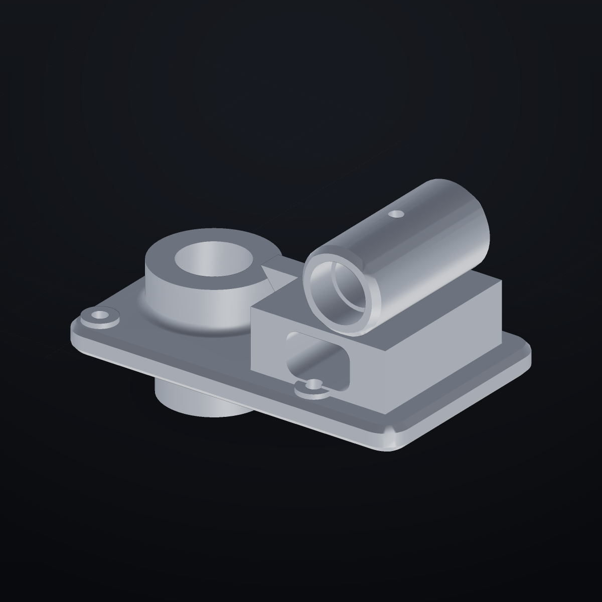
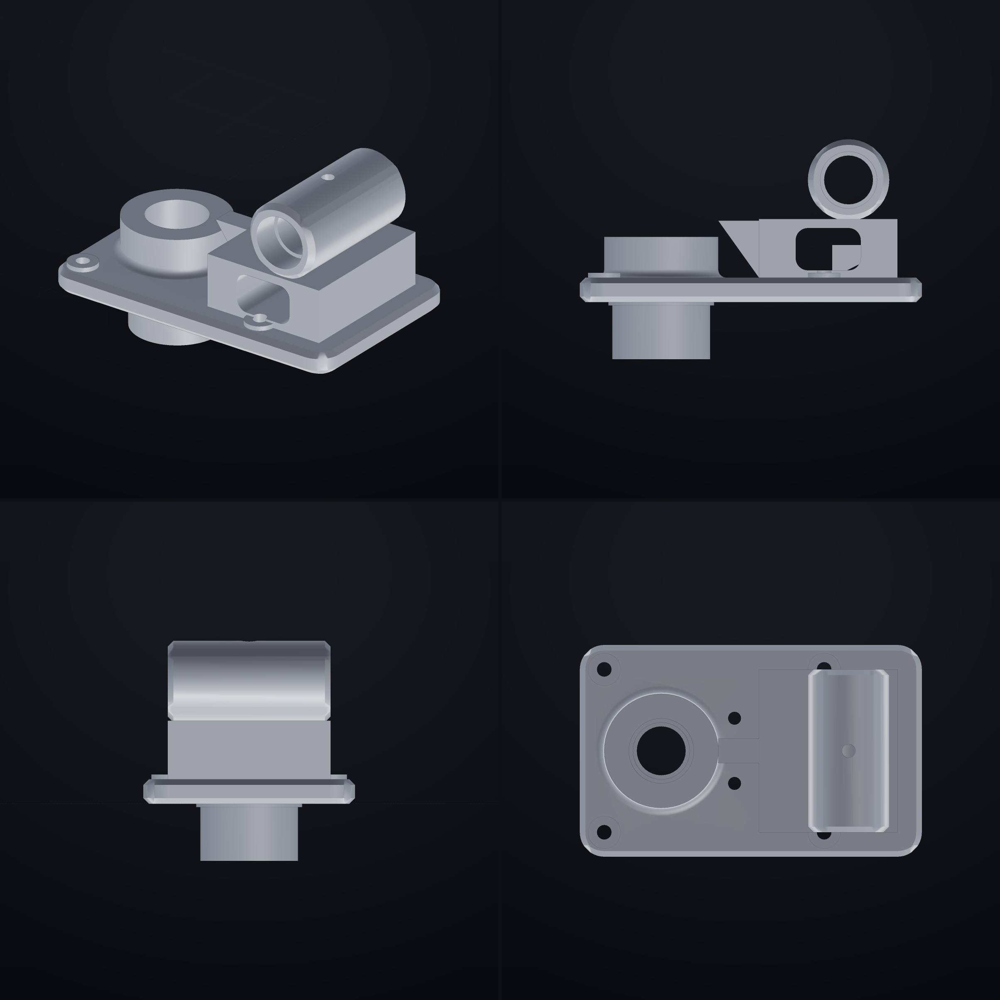

# Кронштейн правый 00.039: сборка по чертежу А2

Разбор второго чертежа — того, что подробный. Здесь всё наоборот по сравнению
с прошлым разом: не «слепить похоже», а **взять каждое число с листа и
проверить его в модели**.



*Собрано: плита 210×130×15 с четырьмя цековками Ø20×3, центральная бобышка
Ø70 с галтелью R5 и расточкой Ø40×20 → Ø35H7×38 → Ø30×18, нижний прилив Ø60
с буртиком Ø65×2, стойка с окном R7.5, патрубок Ø50 с Ø30 насквозь и
цековками Ø35H7×18, ребро под 15.*

---

## 1. Сначала честно про прошлый результат

Вы правы, и вот в чём именно была ошибка — по пунктам, а не «старался».

| Что было не так в Porsche | Почему получилось | Что сделано здесь иначе |
|---|---|---|
| силуэт «примерно», обводы на глаз | 24 сечения снимались с растровой картинки, точность ±5–10 мм | все числа взяты из проставленных размеров, ни одного «на глаз» |
| детали навешены: стёкла, спойлер, бамперы | собирались отдельными примитивами и ставились сверху | всё — одно тело: ноль навешенных деталей, `parts 1` |
| нет галтелей и фасок | их не было в сценарии вообще | R5 и R7.5 заложены в профили, фаски 2×45° сняты |
| «мешанина примитивов» | проверялись только 6 габаритных чисел | 7 проверок: 4 центра отверстий по ±0.2, габарит, замкнутость, число частей |
| глазу не за что зацепиться | не было ни одной посадки с натягом/зазором | цековки, пояса Ø35H7×18 с двух сторон, буртик Ø65×2 |

Разница в подходе одна: **чертёж — это не картинка, это список чисел с
допусками**. Работа начинается с выписывания чисел, а не с рисования силуэта.

---

## 2. Что выписано с листа

Деталь читается как пять групп. Ниже — каждая с пометкой, куда она пошла.

### 2.1 Плита и крепёж

| Размер с чертежа | Значение | Куда пошло |
|---|---|---|
| габарит плиты | 210 × 130 | контур `extrude` |
| толщина плиты | 15 | высота `extrude` |
| R15 | 15 | скругление углов, концентрично болтам |
| 4 отв. Ø9 | Ø9 | сверление насквозь |
| Ø20×3 | Ø20, глубина 3 | цековки под головки |
| 135±0.2, 100±0.02 | шаг между отверстиями | координаты 15/150 и 15/115 |
| 2 отв. Ø8H7 | Ø8 | штифты, 95 от торца |

### 2.2 Центральная бобышка

| Размер | Значение | Куда пошло |
|---|---|---|
| Ø70 | 70 | тело вращения `lathe` |
| 25 | высота над плитой | профиль бобышки |
| Ø40×20 | цековка сверху | расточка |
| Ø35H7, 38 | точная расточка | расточка глубиной 38 |
| Ø30×18 | расточка снизу | расточка от прилива |
| R5 | галтель у основания | **заложена в профиль**, а не `fillet` |

### 2.3 Нижний прилив

| Размер | Значение | Куда пошло |
|---|---|---|
| Ø60 | 60 | цилиндр под плитой |
| Ø65×2 | буртик 65 шириной 2 | отдельный цилиндр |
| 35 | высота прилива | низ детали на Z = −35 |

### 2.4 Патрубок и стойка

| Размер | Значение | Куда пошло |
|---|---|---|
| Ø50 | 50 | наружный диаметр патрубка |
| Ø30 | 30 | расточка насквозь |
| Ø35H7×18, 2отв. | две цековки по 18 с торцов | два кольцевых выреза |
| 100−0.2 | длина патрубка | длина цилиндра |
| 75±0.1 | высота оси | ось на Z = 75 |
| M10-H7 | резьба сверху | отверстие Ø8.4×12 |
| 165 | ось патрубка от торца | X = 165 |
| 60±0.2 | положение стойки | плоскость стойки на X = 110 |
| 15 | толщина стойки и ребра | 15 по X и по Y |
| 35H7 | высота стойки | 35 |
| R7.5 | окно в стойке | скругление углов окна |
| 25, 40 | ножки стойки | окно шириной 40 по X |
| 40 | вылет ребра | катет ребра |

### 2.5 Чего в геометрии нет и почему

* **√Ra5 и √Ra1.25** — шероховатость, требование к обработке. Форму не меняет.
* **H7, ±0.2, ±0.02** — допуски контроля. Вместо них стоят `check … center`
  с теми же числами: если центр уедет больше ±0.2, проверка упадёт.
* **М10 — резьба**: витки на чертеже не читаются (там просто «M10-H7»),
  поэтому отверстие Ø8.4. Настоящая резьба командой `thread` дала бы
  ~200 тысяч треугольников на отверстие.
* **Материал АЛ9** — в отчёте стоит плотность 1.24 г/см³ (значение по
  умолчанию). Команды «плотность» в 0.67 нет, поэтому масса 1.05 кг —
  это масса «при плотности 1.24», а не алюминиевая (при 2.7 было бы ≈2.3 кг).

---

## 3. Что получилось в числах

| Проверка | Норма | Факт |
|---|---|---|
| центр болта 1 | (15 ± 0.2, 15 ± 0.2) | (15, 15) |
| центр болта 2 | (15 ± 0.2, 115 ± 0.2) | (15, 115) |
| центр болта 3 | (150 ± 0.2, 15 ± 0.2) | (150, 15) |
| центр болта 4 | (150 ± 0.2, 115 ± 0.2) | (150, 115) |
| габарит | 210 × 130 × 135 | 210 × 130 × 135 |
| замкнутость | герметично | герметично |
| число частей | 1 | 1 |

**7 из 7.** Плюс паспорт: объём 898 см³, 4 248 треугольников, минимальная
стенка 15.0 мм (это и есть толщина стойки — она держится ровно), сборка 1.5 с.

Высота 135 = 100 (верх патрубка) + 35 (прилив под плитой). Плита на Z = 0.



*Изометрия, вид сбоку, спереди и сверху — сравнение с листом по видам.*

---

## 4. Где модель отличается от чертежа — прямо

Честный список, без «в целом соответствует».

| Место | Что на чертеже | Что в модели | Почему |
|---|---|---|---|
| окно в стойке | R7.5, ножки 25 и 40 | окно 40 × 26, ножки по 22.5 | ширина окна на разрезе не проставлена, взята по пропорции |
| ребро слева от стойки | видно на изометрии, размеров нет | наклонная плоскость от плиты к верху стойки | размер выведен из картинки, а не с размера |
| 2 отв. Ø8H7 | «2отв.» без привязки | 95 от торца, шаг 40 | привязки на листе нет; взято между бобышкой и стойкой |
| M10-H7 | резьба | гладкое отверстие Ø8.4 | витки не читаются; см. §2.5 |
| фаски 2×45° | на торце патрубка и на плите | сняты там же, но не на всех кромках | глобальная фаска на собранном теле отказывается работать (см. §5) |
| шероховатость | √Ra1.25 на Ø35H7 | не моделируется | это не геометрия |
| масса | АЛ9 (2.7 г/см³) | 1.05 кг при 1.24 г/см³ | команды плотности нет |

---

## 5. Что этот чертёж показал про саму ФОРМУ

Три вещи, которые придётся починить, если такие детали делать регулярно.

1. **`fillet` по собранному телу не работает.** На этой детали он падает с
   сообщением «слишком подробная сетка после closing (397 140
   треугольников)». Причина понятна: галтель применяется ко всей сетке, а не
   к выбранным рёбрам. Пришлось закладывать R5 и R7.5 прямо в профили — это
   даже точнее, но требует ручной работы. **Нужно:** выбирать рёбра (по
   индексам или по признаку «вогнутое ребро») и скруглять только их.
2. **`chamfer` после объединения — та же история** («слишком подробная сетка
   для фаски»). Фаски пришлось снимать на деталях до объединения.
3. **Нет плотности материала.** Отчёт всегда считает массу при 1.24 г/см³;
   для алюминиевой отливки это занижает массу вдвое. **Нужно:** одна строка
   `плотность 2.7` или `материал АЛ9`, влияющая на `mass` в отчёте.

Ни одна из трёх не мешает сделать деталь — но каждая добавляет ручной работы,
и именно из-за них прошлая модель выглядела «мешаниной»: вместо скруглений
там оставались острые кромки.

---

## 6. Файлы

| Файл | Что внутри |
|---|---|
| `examples/bracket_00039.forma` | сценарий: 122 строки, собирается и в 0.58, и в 0.67 |
| `docs/make_bracket_00039.py` | генератор: все числа чертежа в одном месте, `python3 docs/make_bracket_00039.py` |
| `docs/bracket/bracket_00039_{iso,front,right,top,all}.png` | рендеры (0.67) |
| `docs/bracket/bracket_00039.stl` | сетка для печати/просмотра |
| `docs/bracket/bracket_00039.dxf` | обратный чертёж: контур + размеры (экспорт 0.67) |
| `tests/test_bracket_00039.py` | тесты: габарит, центры отверстий, единое тело, профили, окно |

## 7. Как повторить

```bash
python3 docs/make_bracket_00039.py            # пересобрать сценарий
python -m forma build examples/bracket_00039.forma
python -m forma render examples/bracket_00039.forma --out docs/bracket --prefix bracket_00039
python -m forma export examples/bracket_00039.forma --format drawing --out docs/bracket/bracket_00039.dxf
```

Проверки те же, что на листе: `check … center` с допуском 0.2 — они падают,
если отверстие уедет.
