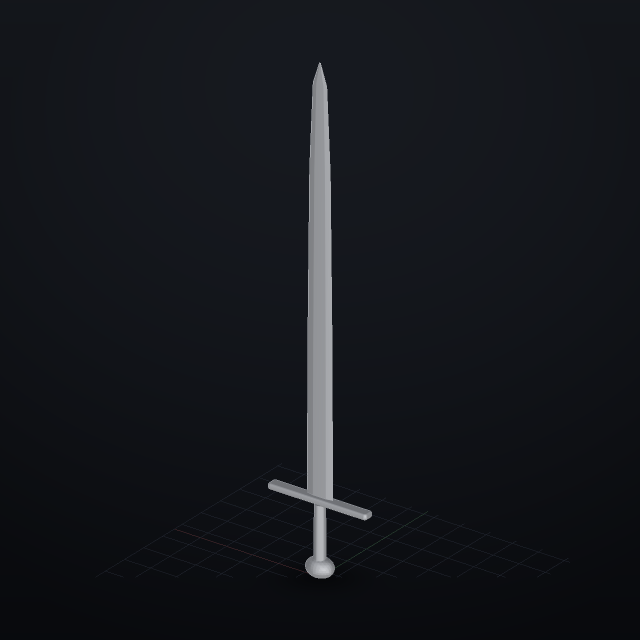
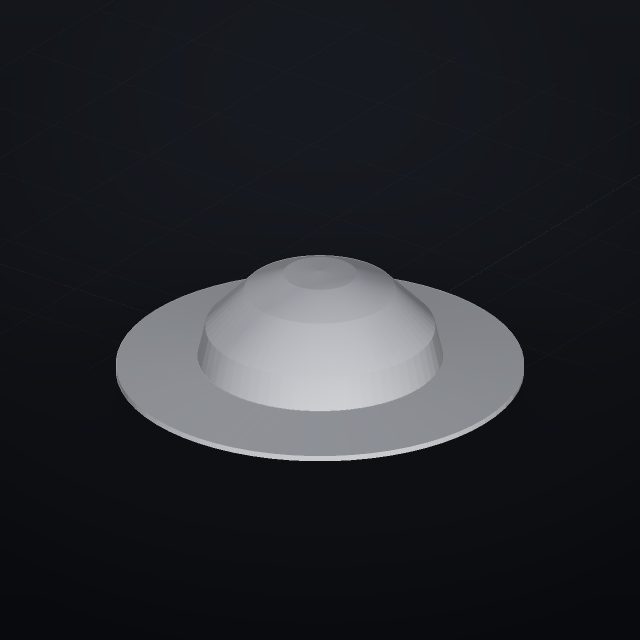
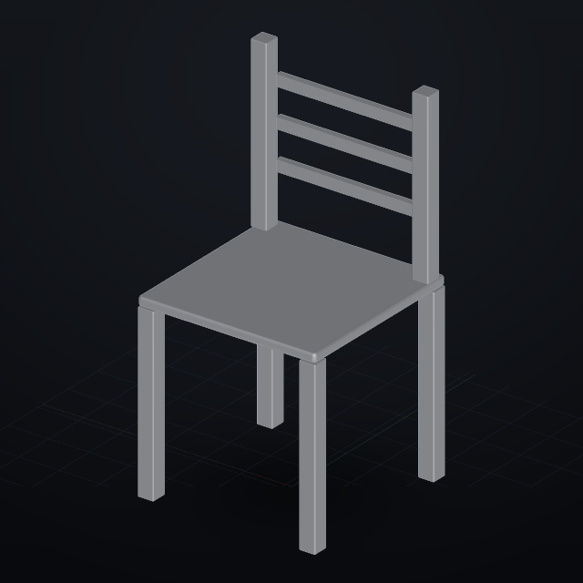
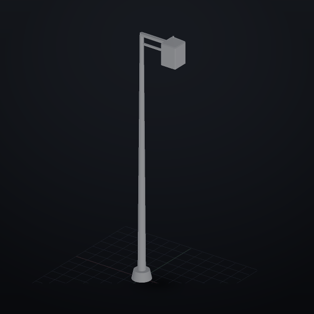

# CC0-объекты как референсы: что именно есть и что мы из этого построили

Правило отбора жёсткое: **CC0 / public domain** — коммерция, правка, перепродажа,
**без указания автора**. Всё, что требует хотя бы строки атрибуции (CC-BY),
хранения текста лицензии (MIT/BSD) или запрещает коммерцию (CC-BY-NC), здесь
не приводится. Проверено 2026-11-03 по первоисточникам.

Как проверялось: списки файлов — через публичное зеркало паков Quaternius
(`chibifire-stages/quaternius-stage`, лицензия репозитория **CC0-1.0**), страницы
паков на itch.io/poly.pizza, каталог Poly Haven, страницы Smithsonian и Kenney.
Где стоит «по заявлению сайта» — это значит, что лицензия написана на странице
источника, а не выведена из общих слов.

---

## 1. Оружие и броня Средневековья — да, есть, и это CC0

**Quaternius «LowPoly Medieval Weapons»** (22–24 модели, CC0) — список файлов
проверен по зеркалу:

| Оружие | Файлы |
|---|---|
| мечи | `S_Sword`, `S_Sword_2`, `S_SwordBig`, `S_SwordGolden`, `S_Claymore` |
| кинжалы | `S_Dagger`, `S_Dagger_2` |
| топоры | `S_Axe`, `S_AxeDouble`, `S_AxeSmall` |
| молоты | `S_HammerDouble`, `S_HammerSmall` |
| древковое | `S_Spear`, `S_Scythe` |
| луки | `S_BowWooden`, `S_BowWooden2`, `S_BowEvil`, `S_BowGolden`, `S_Arrow` |
| щиты | `S_ShieldHeater`, `S_ShieldHeater_2`, `S_ShieldRound`, `S_ShieldRound_2`, `S_ShieldCelticGolden` |

**Quaternius «Knight Character»** (9 файлов, CC0): `SK_KnightCharacter`,
`S_Helmet1`, `S_Helmet2`, `S_Helmet3`, `S_ShoulderPads`, `S_Katana`,
`S_ShortSword`, `S_Club`.

**Quaternius «Ultimate RPG»** (106 файлов, CC0), из них броня:
`S_ArmorBlack`, `S_ArmorMetal`, `S_ArmorMetal2`, `S_ArmorLeather`, `S_ArmorGolden`;
плюс `S_Bone`, `S_Shield*`, `S_Helmet*`-подобные элементы в других паках.

**Smithsonian Open Access** (3d.si.edu, CC0): настоящие музейные шлемы и доспехи,
у каждого объекта опубликованы размеры. Пример: *French Adrian Helmet* —
159 × 210 × 286 мм, CC0 и модель, и метаданные.

---

## 2. Базовые предметы, мебель, фонарь

**Quaternius «Furniture»** (23 файла, CC0): `S_Chair`, `S_ChairCushioned`,
`S_ChairHandle`, `S_Stool`, `S_Table`, `S_CoffeeTable`, `S_CoffeeTable2`,
`S_Sofa`, `S_SofaDouble`, `S_SofaLong`, `S_Bed`, `S_BedKing`, `S_BookCase`,
`S_BookCaseBooks`, `S_BookCaseLarge`, `S_Closet`, `S_Closet2`, `S_Lamp`,
`S_Lamp2`, `S_Plant`, `S_Vase`, `S_Vase2`.

**Quaternius «Ultimate Home Interior»** (123 файла, CC0): `S_Chair_1…4`,
`S_ColumnRound1…3`, `S_ColumnSquareBig/Small`, `S_CouchLarge1…3`,
`S_Bathroom*` (ванна, унитаз, раковина, стиральная машина), ковры, кровати.

**Kenney «Furniture Kit»** (140 моделей, CC0 — «Public Domain» на странице пака):
Chair, Chair Rounded, Desk Chair, Bench, Lounge Chair, Bookcase Closed/Open,
Kitchen Cabinet, Lamp Square Floor, Lamp Square Table, Lamp Square Ceiling,
Rug, Side Table, Desk, Bed Single/Double/Bunk, Coat Rack Standing.

**Kenney «Building Kit»** (~100 деталей, CC0): Wall, Wall Half, Wall Window
(Square/Round/Wide), Wall Doorway, Column, Column Thin/Wide, Stairs Open/Closed,
Roof Flat (Center/Side/Corner), Border High/Corner, **Corrugated Iron Sheet**,
Wooden/Red/White/Modern Door.

**Kenney «City Kit»** (31 модель, CC0): Low Building, Small/Large Building,
Skyscraper, Low Wide, Sign Hospital, вывески и детали фасадов.

**Poly Haven** (521 модель, CC0, у каждой опубликован реальный масштаб и
полигонаж): **Street Lamp 01**, **Street Lamp 02** (настенный викторианский,
1.7 м, 39 × 81 × 168 см, 20k трис), Bench Vice 01, Side Table 01, Sofa 03,
Modular Street Seating, бочки, ящики, фонари, лестницы, кашпо, деревья.

---

## 3. Механические и строительные детали

**Free Parts Library (innerscene.com)** — 3512 деталей, «everything is public
domain (CC0)» по заявлению сайта: подшипники `Ball bearing 6000…6205`, `608`,
`625`, звёздочки `ANSI #25/#40`, `Hex bolt M5…M20`, `Hex nut #4-40…`, валы,
шкивы, линейные направляющие, корпуса. Отдельно 1335 чертежей (DWG/DXF):
блоки, планы, строительные узлы. **Оговорка:** это агрегатор — у каждой
карточки указан источник, его и надо смотреть.

**Строительные детали из паков:** Kenney Building Kit (стены, колонны, кровля,
профлист), Quaternius «Medieval Village» (44 файла: `S_House_1…4`, `S_Inn`,
`S_Mill`, `S_BellTower`, `S_Blacksmith`, `S_Fence`, `S_DoorStraight`,
`S_DoorRound`, `S_Cart`, `S_Barrel`, `S_Crate`), Quaternius «Modular Medieval
Buildings» (30: `S_Wall`, `S_TallWall`, `S_Tower`, `S_PointyTower`,
`S_WindowGothic`, `S_WindowSquare`, `S_Well`, `S_Bridge`).

**И у нас уже есть свои примитивы этой группы** — их проще параметризовать,
чем переносить чужой меш: `gear`, `bolt`, `nut`, `washer`, `spring`, `pulley`,
`pipe`, `bracket`, `column`, `table`, `stairs`, `door`, `window`, `ladder`,
`profile2020`, `bricks`.

---

## 4. Органика и человеческое тело — самые сильные CC0-наборы

**Blender Studio «Human Base Meshes»** — 17 мешей, **CC0**, бесплатно с
blender.org (49 МБ, `.blend`): тело мужское и женское (реалистичное и
стилизованное), **голова**, **кисти рук**, **ступни**, **челюсть**, **глазные
яблоки**, **череп**. Копии в STL лежат на Wikimedia Commons (тоже CC0):
`Hand realistic by Dan Ulrich (CC0).stl`, `Head (Sculpting) - Realistic (CC0).stl`,
`Skull - Realistic (CC0).stl`, `Blender Foot realistic (CC0).stl`,
`Body male/female realistic/stylized (CC0).stl`.

**Quaternius** (CC0): `AnimatedMan`, `AnimatedWoman`, `AnimatedMen`,
`AnimatedWomen`, `UltimateModularCharacters`, `UltimateModularWomen`,
`BackgroundPosedHumans`, `ModularCharacterOutfitsFantasy` — тело и одежда
отдельными модулями.

**Череп и кости:** OpenGameArt «Human Skull» (CC0, 4538 трис, OBJ/DAE/FBX/BLEND);
Smithsonian Open Access — палеонтология и анатомия (черепа, конечности, позвонки),
CC0 по метаданным каждого объекта.

**Природа (CC0):** Quaternius `SimpleNature` (`S_Tree1…4`, `S_Bush1…3`,
`S_Grass1…3`, `S_Rock1…3`), `UltimateNature`, `TexturedFantasyNature`,
`AnimatedFish`, `FarmAnimal`; Poly Haven — деревья, кусты, трава, камни.

---

## 5. Что из этого уже построено нашими сценариями

Метод один: **берём размеры и пропорции из референса, а геометрию собираем
своими примитивами** — тогда каждый размер становится параметром.

| Объект | Референс (CC0) | Наши параметры | Что получилось |
|---|---|---|---|
| **Меч** | Quaternius `S_Sword`, `S_SwordBig`, `S_Claymore`; типология Оукшотта X–XIV | `blade=750 width=50 thickness=5 grip=110 guard=190 pommel=50` | 190 × 39 × 889.5 мм, 204 см³ (≈1.6 кг стали), 930 трис |
| **Шлем** | Smithsonian «French Adrian Helmet» 159 × 210 × 286; Quaternius `S_Helmet1…3` | `head=580 dome=105 brim=70 wall=2.5` | 350 × 350 × 94.9 мм, 1 664 трис |
| **Стул** | Kenney Furniture Kit `Chair`; Quaternius `S_Chair`, `S_Stool` | `seat_h=450 seat=440 seat_t=25 back=420 leg=40 slats=3` | 440 × 440 × 870 мм, 1 880 трис |
| **Фонарный столб** | Poly Haven `Street Lamp 01/02` (1.7 м, 20k трис) | `height=4000 base_d=300 pole_d=120 top_d=60 arm=700 lantern=260` | 922.8 × 405.6 × 4114 мм, 1 950 трис |






Команды:

```bash
forma lib sword  blade=800 guard=210 --save меч.forma --check
forma lib helmet head=600 brim=90  --check
forma lib chair  seat_h=430 slats=4 --check
forma lib lamp   height=4500 arm=900 --check
forma lib                          # полный список библиотек
```

---

## 6. Что из этого стоит брать дальше (и сколько это работы)

| Объект | Референс | Сложность | Почему |
|---|---|---|---|
| Щит (heater/round) | Quaternius `S_ShieldHeater`, `S_ShieldRound` | низкая | `loft` по контуру + выпуклость; параметры — размер, кривизна, толщина |
| Топор, молот | `S_AxeDouble`, `S_HammerDouble` | низкая | древко + `loft` головы |
| Кинжал, тесак | `S_Dagger`, `S_ShortSword` | низкая | тот же генератор, что меч, с другими числами |
| Стол, табурет | Quaternius `S_Table`, `S_Stool`; Kenney `Bench` | низкая | ножки + столешница, как у стула |
| Шкаф, комод | `S_Closet`, `S_BookCase` | средняя | корпус + фасады + ручки |
| Колонна | `S_ColumnRound1…3`, Kenney `Column` | низкая | `lathe` с профилем базы и капители |
| Стык строительных деталей | Kenney Building Kit | средняя | модульная сетка 1 м: стена/окно/дверь как параметры |
| Череп | Blender Studio `Skull`, OpenGameArt `Human Skull` | **высокая** | скульптурная форма: процедурно только общая оболочка + глазницы |
| Кисть, стопа | Blender Studio `Hand`, `Foot` | **высокая** | мелкая пластика; параметризуется разве что размер и поза |
| Тело человека | Blender Studio `Body male/female` | **высокая** | у нас есть `human`, но это стилизованная фигура, не скульптура |

---

## 7. Честные границы этого раунда

1. **Меши не скачивались.** Сеть песочницы закрыта для kenney.nl, polyhaven.com,
   quaternius.com; доступны github/api. Поэтому «референс» здесь — опубликованные
   списки объектов и размеры, а не трассировка конкретного файла. Для меча,
   стула, шлема и столба этого достаточно — там решают числа.
2. **Для органики чисел мало.** Голова, кисть, череп — это скульптура: параметр
   «обхват головы» даёт болванку, а не портрет. Такие референсы годятся как
   основа для лепки, а не как источник формулы.
3. **Построено четыре объекта, а не двадцать.** Остальное — список на следующий
   шаг, и я специально не выдаю его за сделанное.
4. **Проверки — по числам, не по красоте.** Габарит и герметичность проверяются
   автоматически (`check size`, `check watertight`), сетка у шлема и столба
   имеет по паре стяжек на кромках — они видны в отчёте `forma build`.
