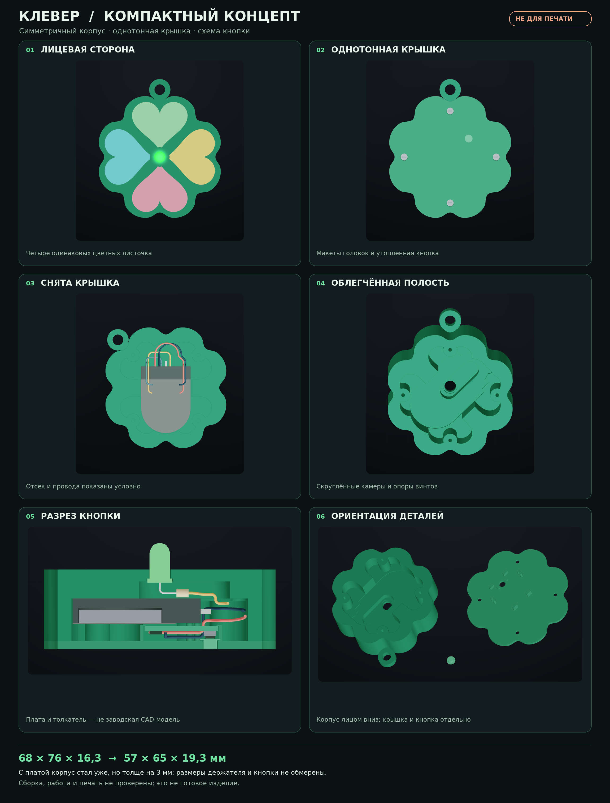
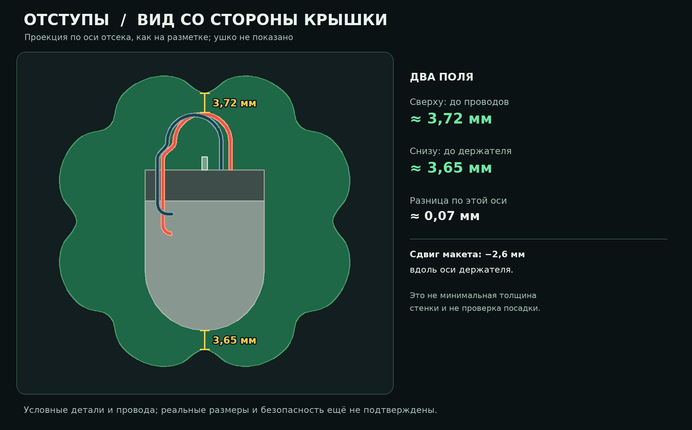
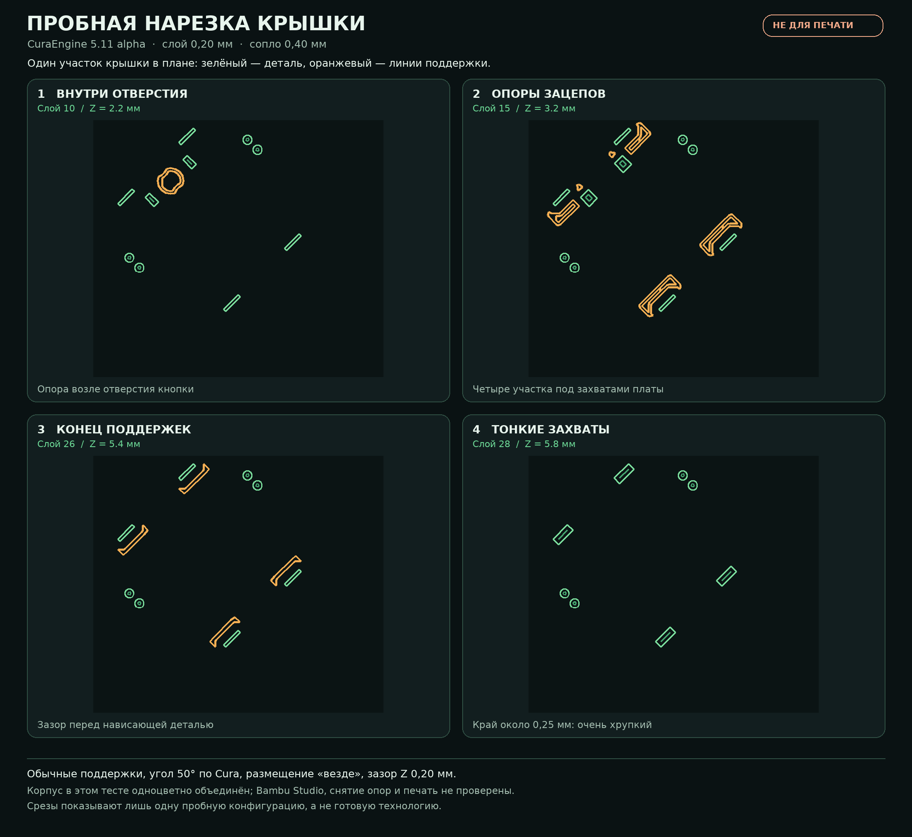

# Компактный симметричный клевер с LED — проверяемая концепция



**Это концепт, не готовый файл для печати, сборки или продажи.** Настоящие держатель, LED и модуль не обмерены; показанные провода и элементы платы условны. Зацепы платы и кнопки, монтаж, электрическая работа, изоляция, прочность и безопасность батарейки не подтверждены. Не печатайте сборочную сцену целиком: вместе с корпусом в экспорт попадут макеты батарейки, электроники, проводов и головок винтов.

## Как посмотреть

- [Сборочная сцена Forma](../examples/clover_keychain_led_compact_concept.forma) — 28 видимых тел, включая условную электронику. В Forma 0.76.6 откройте `.forma` как текст, скопируйте содержимое в панель «Сценарий» и нажмите «Собрать»; кнопка «Открыть файл» предназначена для импорта 3D-моделей, а не текстовых сценариев.
- [Схема ориентации для исследования печати](../examples/clover_keychain_led_compact_print_layout.forma) скрывает электронику и содержит семь видимых тел: корпус с четырьмя цветными вставками, крышку и отдельную кнопку. Это **тоже не готовый печатный файл**. Первые пять тел должны оставаться совмещёнными при многоцветной печати, а не печататься как пять отдельных предметов.
- Отдельные виды: [лицо](clover_compact_front.png), [лицо под углом](clover_compact_iso.png), [задняя сторона](clover_compact_back.png), [со снятой крышкой](clover_compact_open.png), [с условной батарейкой](clover_compact_battery.png), [пустая полость](clover_compact_empty.png), [внутренняя сторона крышки](clover_compact_lid.png), [макет платы](clover_compact_board.png), [разрез](clover_compact_section.png), [ориентация деталей](clover_compact_layout.png). На задних видах свечение LED отключено только ради наглядности.
- В конце сборочного сценария можно включить 11 закомментированных строк `hide`: скрываются внешняя крышка с кнопкой и головками, а также плата и её компоненты. Это **не анимация разборки**: в реальности плата предположительно снимается вместе с крышкой, а неподвижные на рисунке провода должны сгибаться. Дополнительные команды скрывают штатную крышечку и макет держателя.

[Предыдущий симметричный вариант](clover_led_symmetric_concept.md) сохранён для сравнения; его цветок был больше. Отклонённый пользователем [перекошенный вариант](clover_led_integrated_concept.md) не является основой этой версии. Исходный плоский клевер и его 3MF не изменены.

## Контур и отмеченные поля

Цветок без ушка — **57 × 57 мм**. Корпус и одноцветная задняя крышка получены из одного четырёхкратно симметричного контура; ушко находится по центру сверху и является единственным внешним исключением из вращательной симметрии. Четыре лицевых сердечка одинаковы. Выборочная проверка в плане даёт не менее 2,1 мм от края каждого сердечка до общего контура; это не расчёт прочности.

| Габарит с ушком и крышкой, без выступа LED и металлического кольца | Ш × В × Т |
| --- | ---: |
| Предыдущий симметричный вариант | 68 × 76 × 16,3 мм |
| **Компактный вариант** | **57 × 65 × 19,3 мм** |

С платой компоновка стала на 11 мм уже и короче, но на 3 мм толще. Вся сцена с условным выступающим LED занимает примерно **57 × 65 × 25,8 мм**. Это не доказанный минимально возможный размер. Само ушко толщиной 3,8 мм с номинальным отверстием Ø5 мм не проверено нагрузкой или реальным кольцом.



Макет держателя вместе с зоной проводов сдвинут на **−2,6 мм** вдоль своей локальной оси по сравнению с предыдущим положением. В проекции со стороны крышки, на центральной линии отсека, расстояние от контура цветка до верхней петли условных проводов — около **3,72 мм**, до нижнего конца условного держателя — около **3,65 мм**; разница около **0,07 мм**. Измерение включает проекцию держателя, его крышечки и ползунка и двух выходящих проводов. Это именно сравнение полей, отмеченных на присланном изображении, **не** минимальная толщина стенки и не гарантия посадки реальных частей.

## Нажатие: возможное решение, не собранный механизм

Для чередования «короткое нажатие — включить, следующее короткое — выключить» обычный штатный ползунок держателя не подходит. В сцене показан **отдельный приобретаемый электронный модуль Pololu 2808 LV**: у него есть собственная моментальная кнопка; также можно подключить внешнюю моментальную кнопку между A и B. Производитель описывает последовательное включение и выключение [1](https://www.pololu.com/product/2808). Внешний толкатель в макете должен нажимать на кнопку платы. **Ни рабочий ход, ни возврат, ни усилие не подтверждены.**

После проверки, что в одном держателе действительно находится одна подходящая CR2032, принципиальная цепь для примера:

```text
+ держателя ── VIN модуля       VOUT ── 1 кОм ── анод зелёного LED
− держателя ── GND модуля       GND ───────────── катод зелёного LED
                                кнопка модуля: очередное нажатие меняет состояние
```

Штатный ползунок держателя в этой идее должен оставаться в положении **ON**; иначе он обесточит модуль. Провода нужно подключить к модулю и LED, проверив маркировку VIN/VOUT/GND и полярность на настоящих деталях; положение контактов в 3D-сцене **не является распиновкой**. Не заклеивать штатную крышку батарейки или выключатель. При открывании корпусной крышки плату придётся перемещать вместе с ней: нужны проверенный запас провода, разгрузка натяжения, защита от защемления и, возможно, разъём. Удобство замены батарейки пока неизвестно.

Модуль указан размером **15,24 × 17,78 × 3,05 мм** без дополнительных разъёмов [2](https://www.pololu.com/product/2808/specs); на чертеже допуск края платы **±0,3 мм** [3](https://www.pololu.com/file/0J1101/mini-pushbutton-power-switch-with-reverse-voltage-protection-dimension-diagram.pdf). В нашей схеме размеры компонентов, место кнопки и пайки вымышлены. Номинальный продольный зазор в направляющих — **0,25 мм на сторону**, меньше указанного допуска края; при сдвиге макета на 0,27 мм появляется пересечение с направляющими. Прямое движение жёсткой макетной платы через зацепы также пересекает их. Значит, **посадка и способ установки не доказаны**; защёлки толщиной всего **0,25 мм** необходимо переработать под реальные детали и материал.

Для макетного толкателя приняты зазор до условной кнопки **0,15 мм** и ограничение хода корпусом около **0,60 мм**. После контакта остаётся лишь условная разница около **0,45 мм**; неподвижный 3D-макет не моделирует сжатие кнопки, и прямой ввод плунжера через фиксированные ограничители также требует проверки. По этим числам нельзя утверждать, что настоящий переключатель сработает.

Модуль рассчитан на рекомендуемое питание **2,2–16 В**, в выключенном состоянии потребляет около **0,01 мкА**, а во включённом — приблизительно **210 мкА/В**, главным образом на собственный индикатор [1](https://www.pololu.com/product/2808). При 3 В это около **0,63 мА** сверх тока LED. Если предположить зелёный LED с падением 2,0–2,2 В и резистор 1 кОм, начальный ток LED составляет приблизительно **0,8–1,0 мА**, а суммарный — порядка **1,4–1,6 мА**. Это не прогноз автономности: напряжение CR2032 снижается под нагрузкой, яркость и реальное Vf неизвестны, модуль может выключаться при просадке примерно до 2 В. OFF не является полной электрической изоляцией. Для расхода и работоспособности нужна проверка свежей и разряженной батарейкой и измерение до принятого порога яркости.

## Что проверено в геометрии и что осталось рискованным

- Условный держатель **31 × 23 × 6 мм** опирается на подложку; четыре выступа на корпусной крышке касаются его неподвижной части в численной пробе, а не условной заводской крышечки. В исходной карточке встречались и CR2032, и «CR2033»; нужно подтвердить настоящую маркировку, число элементов и открывание крышки.
- Четыре предполагаемых винта показаны **только головками**. Отверстия крышки номинально Ø2,2 мм, пилоты корпуса Ø1,7 мм, зенковки конические. Конкретные винты, длина, резьба, прочность и многократное открывание не проверены.
- В нескольких выбранных горизонтальных сечениях расширение самой большой полости на 2 мм остаётся в цветочном контуре; пилоты окружены материалом до радиуса 3 мм в проверенных сечениях. Это не глобальный минимум толщины, не расчёт ушка и не проверка падений.
- В номинальной сборке значимых попарных пересечений нет, кроме малого намеренного пересечения **0,000184 мм³** условного соединения минуса LED с катодом. Это лишь геометрия: соединения, изоляция, зазоры, места пайки и запас провода не установлены.
- По дискретным точкам 3D-осей минимальный радиус изгиба макетных проводов составляет примерно **0,73–0,97 мм**. Это очень тесные изгибы, **не рекомендация для настоящего провода**. Маршрут и радиусы нужно перепроектировать после измерения провода; проверить изоляцию соединений, доступ к пайке и удержание.
- Между условным LED Ø5 мм и отверстием Ø5,3 мм остаётся радиальный зазор 0,15 мм; отверстие кнопки также имеет зазор. Ни LED, ни кнопка не герметизированы, и защита от пыли и воды не заявляется.

## Ориентация и пробная нарезка FDM



В ориентационном макете корпус и цветные вставки лежат **лицом к столу**, совместно; наружная поверхность крышки лежит на столе отдельно, как и кнопка. Плоские первые слои цветного лица поэтому не опираются на съёмную поддержку. Прочность связи материалов, зазоры и качество первого слоя необходимо проверить на реальном принтере.

Для ориентировочной проверки выполнена **отдельная одноцветная** нарезка корпусного объёма, крышки и кнопки в CuraEngine **5.11.0-alpha.0** через WASM-пакет `@mosaicslicer/curaengine` 0.0.3. Профиль общий, не профиль Bambu: слой **0,2 мм**, сопло **0,4 мм**, две стенки, условное заполнение 20%, обычные поддержки «везде», угол **50°** по настройке Cura и зазор по Z **0,2 мм**. Корпус и четыре вставки предварительно объединены в один одноцветный объём **только для этой проверки**. Детали рассматривались по отдельности.

- В этой конфигурации движок не сгенерировал сегментов `SUPPORT` для объединённого корпуса и отдельной кнопки. Это не доказательство, что любая их печать обойдётся без поддержек.
- У крышки получены поддержки возле отверстия кнопки и под четырьмя захватами платы: 2239 линейных сегментов `SUPPORT` на слоях 1–26 из 31. На первом слое также есть малый контур `SKIRT` у отверстия при включённом ободке поддержки. В реальном слайсере формы, число и необходимость опор могут отличаться.
- Кромки захватов и ограничителей имеют толщину около **0,25 мм**: при слое 0,2 мм это экспериментально очень хрупкая геометрия. Удаление опор, возможность монтажа и прочность не проверены. [Схема возможных поддержек](clover_compact_supports.png) отдельно показывает места свесов; это не модель опор.
- Данные нескольких срезов сохранены в [JSON без машинных команд](clover_compact_cura_probe.json), по ним построена картинка выше. G-code и готовый 3MF не опубликованы. Независимая проверка экспериментального 3MF через lib3mf прочитала семь замкнутых сеток без предупреждений, но **Bambu Studio, многоцветная нарезка и физическая печать не проверялись**.

## ЕС и РФ/ЕАЭС

Вопросы применимости требований, маркировки, батарей, ЭМС, RoHS/ТР ЕАЭС 037/2016, игрушек, РОП и перевозки разобраны в [предварительном обзоре для обоих рынков](clover_led_integrated_concept.md#продажа-в-ес-и-рфеаэс-ориентир-на-21102026), на дату **21.10.2026**. Это не юридическое заключение. Новый вариант содержит **активную электронную плату**, поэтому нельзя автоматически полагаться на исключение для батарейного оборудования без активных цепей; классификацию и оценку ЭМС нужно проверить для итогового изделия. В ЕС общие требования статьи 11 Регламента о батареях к извлечению и замене портативных батарей применяются с **18 февраля 2027 года** с предусмотренными исключениями [4](https://eur-lex.europa.eu/eli/reg/2023/1542/oj/eng). Картинка с четырьмя винтами не доказывает выполнение требований или защиту от детей.

Батарейка-таблетка опасна при проглатывании. Держите элемент и макет вне доступа детей; при подозрении на проглатывание немедленно обратитесь за неотложной медицинской помощью. До производства и продажи нужны фактические детали, безопасный батарейный отсек, испытания готового товара и оценка компетентной лабораторией.

## Воспроизведение проверок

Из корня репозитория с установленными зависимостями Forma, NumPy, Manifold3D и Pillow:

```bash
python forma/tools/make_clover_led_compact_print_layout.py --check
PYTHONPATH=forma python forma/tests/test_clover_led_compact_concept.py -v
PYTHONPATH=forma python forma/tools/render_clover_led_compact.py
python forma/tools/render_clover_led_compact_slice.py
```

Для повторения именно **диагностической** нарезки на Linux с Node.js 22, npm, `gh` и доступом к GitHub/npm (временные STL содержат только экспериментальную геометрию, не печатайте их):

```bash
WORK="$(mktemp -d)"
PYTHONPATH=forma python forma/tools/export_clover_led_compact_probe.py --output "$WORK"
npm install --prefix "$WORK" @mosaicslicer/curaengine@0.0.3
mkdir "$WORK/defs"
gh api 'repos/Ultimaker/Cura/contents/resources/definitions/fdmprinter.def.json?ref=5.11.0' --jq .content | base64 -d > "$WORK/defs/fdmprinter.def.json"
gh api 'repos/Ultimaker/Cura/contents/resources/definitions/fdmextruder.def.json?ref=5.11.0' --jq .content | base64 -d > "$WORK/defs/fdmextruder.def.json"
node forma/tools/slice_clover_led_compact_probe.mjs \
  "$WORK/node_modules/@mosaicslicer/curaengine/dist/CuraEngine.js" "$WORK/defs" \
  "$WORK/compact_lid_probe.stl" "$WORK/lid.json" on
python forma/tools/render_clover_led_compact_slice.py --input "$WORK/lid.json" --output "$WORK/layers.png"
```

Скрипт точечно дополняет отсутствующий `default_value` настройки `reset_flow_duration` её же числовым значением `2` из определения Cura. Исходный G-code остаётся только в памяти WASM; сохраняются лишь обезличенные двумерные отрезки и счётчики, без управляющих команд принтеру. Для корпуса и кнопки подставьте соответствующий STL; для сравнения крышки без поддержек замените `on` на `off`.

## Что нужно для следующей итерации

1. Фото держателя с линейкой с четырёх сторон и видео открытия штатной крышки; измерения выступов, точек выхода и диаметра проводов; подтверждение типа и количества батареек.
2. Выбранный реальный LED, резистор, модуль 2808 LV либо согласованный другой работающий переключатель, и их размеры/чертежи. Заменить условные модели проверенными и пересчитать компоновку, посадку, изоляцию и доступ к контактам.
3. Переработать крепление платы и толкателя так, чтобы их действительно можно было установить, усилить тонкие элементы, подобрать реальные винты и проверить зазоры на маленьких тестовых деталях.
4. Проверить многоцветную ориентацию и поддержки в целевом слайсере, напечатать и собрать прототип; испытать работу на свежей и разряженной батарейке, замену, удержание элемента, короткое замыкание, прочность, падения и безопасность в сценарии применения.
