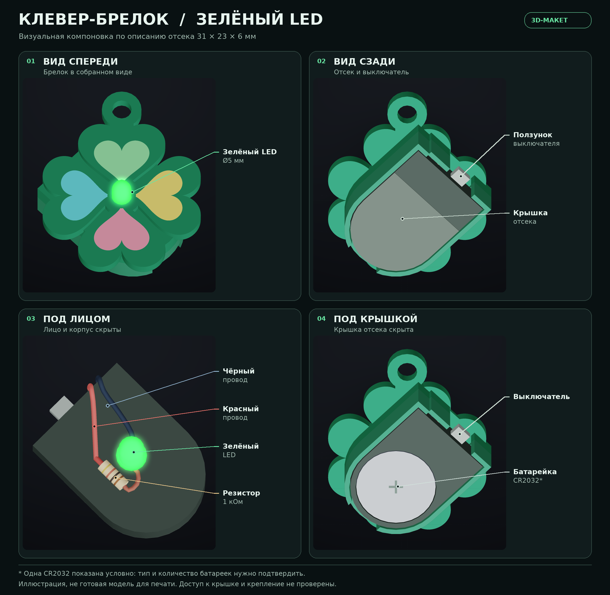
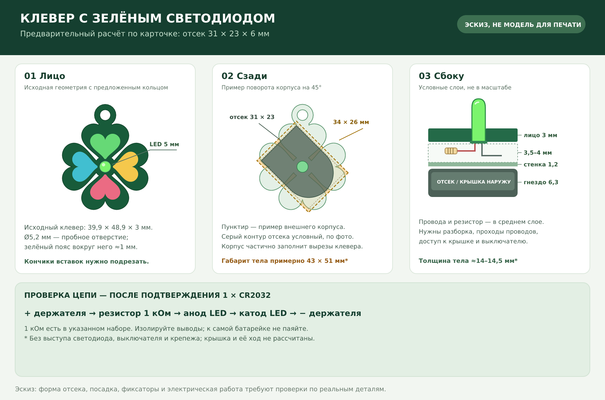

# Клевер с зелёным светодиодом: прежняя визуализация и предварительная оценка

> **Обновление:** для варианта со скрытым внутри батарейным отсеком смотрите [новую 3D-концепцию](clover_led_integrated_concept.md). Сцена ниже — прежний вариант для сравнения; она не содержит нового внутреннего крепления.



## Предыдущий сценарий с электроникой

[Клевер с зелёным LED — сценарий Forma](../examples/clover_keychain_led_visual.forma) показывает **предполагаемый внешний вид и расположение** зелёного светодиода, резистора, проводов, выключателя, держателя и условной батарейки. Снимки получены из этой сцены: [лицо](clover_led_front.png), [задняя сторона](clover_led_rear.png), [проводка под лицом](clover_led_wiring.png), [отсек со скрытой крышкой](clover_led_battery.png).

Откройте файл сценария как текст, скопируйте его содержимое в панель «Сценарий» в Forma и нажмите «Собрать». В версии Forma 0.76.6 кнопка «Открыть файл» предназначена для импорта 3D-моделей, а не файлов `.forma`. Чтобы увидеть проводку, в конце сценария уберите `#` перед шестью строками `hide` для лица, вставок и заднего корпуса и пересоберите сцену. Чтобы увидеть батарейку сзади, верните эти шесть `#`, уберите `#` перед `hide макет_крышки` и снова соберите; вид меняется перетаскиванием модели мышью.

Это **иллюстрация, а не готовая деталь для печати**. Светодиод, резистор, провода, батарейка, отсек и выключатель являются условными моделями, которые попадут в общий экспорт: **не отправляйте всю сцену на печать**. Фиксаторы, открывание крышки, доступ к ползунку, реальные габариты, посадка и электрическая работоспособность не проверены. Одна CR2032 показана только для примера; фактические тип и количество элементов в отсеке следует подтвердить.

Для скруглённого корпуса непосредственно в 3D-макете габариты примерно **41,2 × 48,9 × 14,5 мм** без выступа линзы, ползунка и металлического кольца. Задняя часть в локальных осях имеет габарит примерно 34,7 × 26 мм, включая условный защитный выступ. Скругление и вырезы оценены на глаз по фото. Цифры не гарантируют посадку выбранного товара; размеры ниже получены для другого, прямоугольного приближения и потому отличаются.

## Расчётный эскиз



Исходный цветной [сценарий](../examples/clover_keychain_3mf.forma) и [3MF](../examples/clover_keychain_3mf.3mf) не изменены и не содержат ни отверстия под светодиод, ни отсека. Геометрия держателя, открывание крышки, фиксаторы и посадка реальных деталей ещё не проверены.

## Исходные данные

Из последнего описания пользователя:

- Отсек: **31 × 23 × 6 мм**, длина проводов **14,5 см**. На фотографиях — округлый корпус с открываемой крышкой и выключателем; точный контур и выступы фотографии не задают. Неизвестно, включены ли выступ выключателя и место выхода проводов в размеры 31 × 23 × 6 мм.
- В списке номиналов набора резисторов есть **1 кОм**. Габариты и мощность конкретных резисторов не указаны.
- Набор светодиодов содержит зелёные светодиоды номинального типоразмера **5 мм**. Точное прямое напряжение, высота корпуса, бортик и размеры выводов не указаны.
- В названии ранее указанной карточки упоминается **CR2032**, но в присланном описании написано **CR2033**. Вероятна опечатка, но совместимость следует подтвердить по маркировке или у продавца. «3 шт.» в комплекте относится к количеству отсеков, но не подтверждает, сколько батареек устанавливается в один отсек. На фото видно одно круглое посадочное место; этого недостаточно, чтобы надёжно исключить установку батареек стопкой.

По исходному сценарию габариты клевера **39,88 × 48,94 × 3 мм**, включая ушко. Держатель толщиной 6 мм не поместится целиком в неизменённую пластину толщиной 3 мм.

## Одна возможная компоновка в плане

Это не глобальный минимум и не утверждение, что в первоначальном силуэте невозможны другие положения держателя. Для наглядности берём **прямоугольный габарит**, хотя сам отсек на фото округлый:

1. Держатель: 31 × 23 мм.
2. Начальный технологический зазор **0,3 мм с каждой стороны**: прямоугольное гнездо 31,6 × 23,6 мм. Это припуск для первого пробного образца, не гарантия посадки.
3. Стенки по **1,2 мм** вокруг условного гнезда: габарит прямоугольной задней части **34 × 26 мм**. В местах доступа к выключателю и проводам стенки придётся прервать или дополнительно сформировать; фиксация и усиления не спроектированы.
4. При повороте этого прямоугольника на **45°** и размещении его центра в центре клевера объединённая проекция исходного контура и прямоугольника занимает примерно **42,43 × 50,21 мм**. Можно округлить до **43 × 51 мм** для ориентира по печатному корпусу.

В этом конкретном положении прямоугольная задняя часть занимает около **85,37 мм² вне исходного контура**: главным образом в вырезах между лепестками, а также немного за внешними габаритами. При этом на расчётной проекции она не пересекает отверстие ушка; минимальный зазор от прямоугольника до него около **1,47 мм**. Геометрия реального округлого отсека, его переключатель, выход проводов, крепления и ход крышки в этот тест **не входили**. Более компактное исполнение возможно при уточнении формы; дополнительный доступ, напротив, может потребовать больше места. Новый корпус будет виден в части вырезов исходного клевера.

## Пример толщины корпуса

При заднем расположении держателя и условной двухчастной сборке:

| Слой | Расчётная толщина |
| --- | ---: |
| Исходная лицевая пластина | 3,0 мм |
| Место для ножек, резистора и изолированных соединений | 3,5–4,0 мм |
| Перегородка между проводкой и держателем | 1,2 мм |
| Глубина открытого сзади гнезда под держатель: 6,0 + 0,3 мм | 6,3 мм |
| **Итого условное тело** | **14,0–14,5 мм** |

Это предварительное сложение размеров, **без выступа линзы, выключателя, крепёжных элементов и пространства для открытия крышки**. Гнездо должно оставаться доступным сзади. Толщина зависит от реальной изоляции, формы выводов и способа крепления; монтажное пространство нельзя просто замуровать внутри цельной печатной детали. Две части с доступной при сборке полостью — один из вариантов, но их соединение ещё не спроектировано.

Крышку отсека нужно ориентировать наружу, фиксировать его неподвижную часть и не заклеивать крышку. Дать возможность открыть или снять крышку и двигать переключатель; по одной фотографии нельзя установить точный ход. Выход проводов и края отверстий должны быть гладкими, а провода — без натяжения и защемления.

## Светодиод, резистор и провода

- На лице предлагается пробное отверстие **Ø5,2 мм** под номинальный LED Ø5 мм и проверка на отдельном маленьком печатном образце. В исходной модели до кончиков цветных вставок при таком отверстии остаётся всего около **0,073 мм**. На эскизе предлагается чуть подрезать вставки по окружности Ø7,2 мм, получив пояс около **1 мм**. Точный диаметр бортика светодиода и способ его удержания не заданы.
- Для ориентира, в **другом** наборе указан корпус резистора 6 × 2,5 мм без выводов [1](https://duino.ru/nabor-rezistorov/). Условное пространство под его тело — около **10 × 4 × 3,5 мм**; изолированные выводы, изгибы и места пайки требуют дополнительного места. Реальные размеры резистора из набора неизвестны.
- Два провода длиной по описанию 14,5 см не обязательно укладывать полностью: после примерки их можно укоротить, оставив запас для монтажа и обслуживания. Для примера канал **4 × 2 мм** может быть отправной точкой для двух проводов рядом только при наружном диаметре каждого в изоляции не более приблизительно 1,5 мм; фактический диаметр, изгибы и утолщения изоляции необходимо проверить. Для изолированных соединений нужны отдельные расширения, а не только узкий канал.

## Проверка электрической цепи

После подтверждения типа и **одной** батарейки CR2032 и её выходного напряжения около 3 В можно начать проверку зелёного LED с резистора **1 кОм**, который указан в присланном списке:

```text
+ держателя → 1 кОм → анод зелёного LED → катод LED → − держателя
```

У нового двухвыводного светодиода длинная ножка обычно анод; полярность конкретной детали и проводов держателя лучше проверить. Прямое напряжение и яркость этого LED неизвестны; среди других зелёных 5-мм светодиодов встречаются типы 1,9–2,0 В и 3,0–3,2 В при 20 мА [4](https://microteh.ck.ua/index.php?path=294&route=product%2Fcategory). При малом токе прямое напряжение меняется, поэтому свечение и время работы от одной CR2032 нельзя гарантировать. К самой батарейке не паять, соединения изолировать и не допускать короткого замыкания.

Батарейка-таблетка опасна при проглатывании. Защёлка отсека на фото не подтверждена как защита от детей: готовое изделие следует держать вне их доступа.

## Проверки и ограничения

- Контур клевера получен из сечения исходной геометрии на Z=1 мм; расчёт для прямоугольника выполнен на этом сечении. Форма округлого отсека на картинке — схематическая, не обмер по фото.
- Геометрическая проба лица: основа с кольцом и отверстием остаётся одной связной частью; четыре подрезанные вставки — по одной связной части, объём их пересечения с основой в пределах численного шума. Это не новый опубликованный 3MF.
- Фиксаторы, проверка хода крышки, печатный тест посадки, импорт в Bambu Studio, нарезка и физическая сборка не выполнялись.
