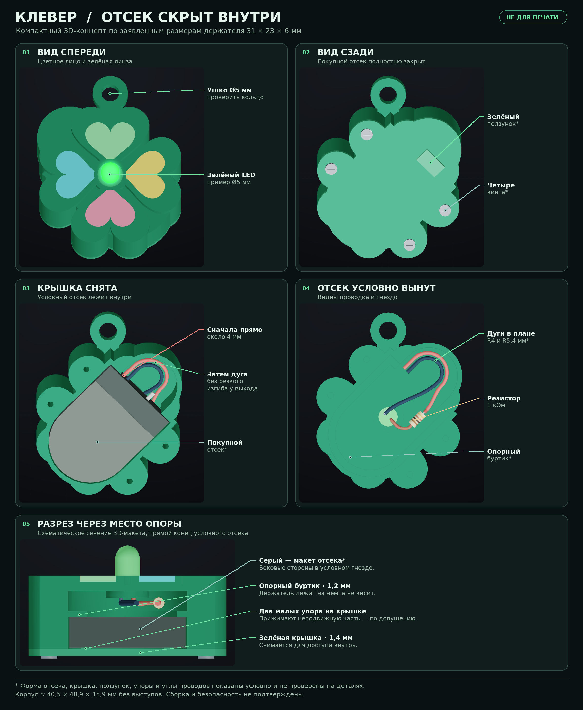

# Клевер со скрытым батарейным отсеком — предыдущая 3D-концепция

> **Обновление:** этот вариант сохранён для сравнения; его несимметричный силуэт был отвергнут. Следующие итерации — [симметричная концепция](clover_led_symmetric_concept.md) и [компактная симметричная концепция](clover_led_compact_concept.md). Они тоже не готовы к печати.



**Это иллюстративная сцена, не файл для печати и не заключение о безопасности.** В ней показаны условные покупной держатель, батарейка, провода, винты, светодиод и привод. Они попадут в экспорт наряду с корпусом, а посадка, сборка, переключение и безопасность настоящих деталей не подтверждены.

## Просмотр

- [Сценарий Forma с внутренним отсеком](../examples/clover_keychain_led_integrated_concept.forma).
- Отдельные изображения: [лицо](clover_integrated_front.png), [закрытая задняя сторона](clover_integrated_rear.png), [со снятой зелёной крышкой](clover_integrated_open.png), [с условно скрытой штатной крышкой и видимой батарейкой](clover_integrated_battery.png), [без макета отсека](clover_integrated_cradle.png), [внутренняя сторона зелёной крышки](clover_integrated_cover.png), [разрез](clover_integrated_section.png). На задних видах свечение LED выключено только для наглядности.
- `.forma` — текстовый сценарий: откройте его в текстовом редакторе, скопируйте содержимое в панель «Сценарий» программы Forma и нажмите «Собрать». В Forma 0.76.6 кнопка «Открыть файл» служит для импорта 3D-моделей, не для этих сценариев. Модель можно вращать мышью.
- В конце сценария есть шесть закомментированных команд `hide`: если убрать `#` и пересобрать, станут невидимыми зелёная крышка, четыре условные головки и зелёный привод. Для просмотра условной батарейки дополнительно включите только `hide макет_крышки_отсека`. Если же включить все следующие четыре `hide`, то будут скрыты макеты отсека, его крышки, батарейки и выключателя; так удобнее рассмотреть буртик и проводку. Это изменение видимости, а не физическая анимация разборки.

Более ранний [визуальный вариант и расчётный эскиз](clover_led_concept.md) также сохранены для сравнения. Последняя итерация со скрытым отсеком — [компактная симметричная концепция](clover_led_compact_concept.md).

## Что изменено и какие размеры приняты

- Макет отсека повёрнут на 45° и спрятан под съёмной зелёной крышкой с четырьмя условными винтами. При виде прямо сзади крышка вместе с наружной кнопкой закрывает его проекцию. С лица провода закрыты зелёной подложкой и ободком светодиода.
- Отсек **опирается на буртик толщиной 1,2 мм**, а не висит на проводах. Два небольших упора на крышке задуманы так, чтобы прижимать неподвижную часть макета, а не макет заводской крышки. Зазор к бокам D-образного макета принят 0,3 мм. Реальная геометрия в этой точке неизвестна.
- Наружная зелёная кнопка условно передаёт движение на выключатель покупного отсека. Возможность работы на настоящем выключателе и фиксация самого привода пока не проверены.
- Замысел доступа: отвернуть крепёж, снять зелёную крышку с приводом и открыть штатную крышку отсека. **Её реальный ход и выступы неизвестны**, поэтому неизвестно, получится ли заменить батарейку, не вынимая держатель. При необходимости его придётся осторожно вынуть; хватит ли провода и как он будет сгибаться, тоже нужно проверить. Заводскую крышку и выключатель не заклеивать.
- В модели оба провода диаметром условно 1 мм идут первые 4 мм прямо от выхода, а затем плавными дугами. Их радиусы в плане — 5,4 и 4 мм; минимум пространственного радиуса по дискретным точкам оси составляет около 5,14 и 3,76 мм соответственно. Это геометрия макета, не минимально допустимый радиус для реального кабеля. Не защемлять и не натягивать провода; оставить проверенный запас для обслуживания.
- Зелёный корпус с задней крышкой занимает приблизительно **40,5 × 48,9 × 15,9 мм**, без выступающих светодиода, ползунка, головок и кольца для ключей. Условная вся сцена с выступами — около **40,5 × 48,9 × 22,7 мм**. Исходный плоский клевер — 39,88 × 48,94 × 3 мм. Крышка в модели толщиной 1,4 мм; кольцо LED показано без технологического зазора.

### Что проверено именно в цифровом макете

Сценарий собран, каждое видимое тело геометрически корректно и связно. В номинальном положении значимые объёмные пересечения корпуса, задней крышки, зелёного привода и декоративного кольца с другими телами не обнаружены. Плоские проекции показывают, что подложка закрывает макеты проводов с лица, а зелёная задняя часть — макет держателя сзади. Малым виртуальным сдвигом проверен контакт держателя с буртиком и двух упоров с держателем.

Макеты крышки с приводом и держателя проверены на пересечения при нескольких прямых движениях от задней стороны; это **не** моделирует реальный механизм штатной крышки, демонтаж винтов или деформацию проводов. Условное совместное перемещение привода и ползунка на −1, 0 и +1 мм проверено на пересечения. Пробный прямой цилиндр Ø4,8 мм проходит через отверстие ушка Ø5 мм. Эти проверки не доказывают работоспособность настоящего выключателя, удобство обслуживания, прохождение реального разрезного кольца или прочность ушка при нагрузке. Тесты: `forma/tests/test_clover_led_integrated_concept.py`.

### Что ещё нужно до версии для печати

1. Сверить реальный отсек: фото с линейкой или штангенциркулем сверху, снизу, сбоку и с прямого торца; измерить контур, выступы, положение и ход выключателя, точку выхода и толщину проводов. Нужны фото/видео **открытия заводской крышки**.
2. Подтвердить тип и число элементов в **одном** отсеке. В названии товара указано CR2032, в описании встречается «CR2033»; это не доказательство совместимости. Три штуки в наборе обозначают три отсека, не число батареек в одном отсеке.
3. Измерить выбранный LED и его буртик, резистор с изоляцией, диаметр реального кольца и доступный запас проводов. Спроектировать посадочные зазоры, крепление зелёного кольца LED, удержание и ход привода, реальные винты и конструкцию безопасного повторного открытия.
4. Сделать пробные детали и физическую сборку, проверить лёгкость замены без повреждения проводов, прочность ушка, крепежа и крышки, падения, защемление, короткое замыкание и другие риски. Сцена не проверялась печатью или в Bambu Studio.

## Автономность: только пример для одной CR2032

Для одной CR2032 при **допущении** 3 В и зелёного LED с прямым напряжением в рабочей точке 2,0–2,2 В:

```text
+ держателя → резистор 1 кОм → анод LED → катод LED → − держателя
I ≈ (3,0 − 2,0…2,2) / 1000 ≈ 0,8…1,0 мА
```

Если формально разделить 210–225 мА·ч на этот постоянный ток, получится **210–281 часов**, или примерно **9–12 суток непрерывно**. Это не прогноз и не гарантированные границы времени пригодной яркости: батарейка разряжается, её напряжение и ток меняются, а даташит задаёт ёмкость при других условиях. Например, Panasonic указывает 225 мА·ч и стандартный непрерывный ток 0,2 мА [3](https://api.pim.na.industrial.panasonic.com/file_stream/main/fileversion/250011), а у Maxell 220 мА·ч до 2,0 В при 0,2 мА [1](https://biz.maxell.com/en/primary_batteries/CR2032_DataSheet_20e.pdf). Реальный светодиод может иметь иное прямое напряжение; если оно близко к 3 В, свечение от одной батарейки может оказаться очень слабым или отсутствовать. Фактические ток и время **до заранее выбранной минимальной полезной яркости** измеряют на настоящем образце при комнатной температуре и повторяют на нескольких элементах. При исправном механическом выключателе цепь разомкнута, но остаются саморазряд и возможные утечки.

Не паять к самой батарейке; проверить полярность и изолировать соединения. **Батарейка-таблетка опасна при проглатывании**: держать батарейку и изделие вне доступа детей, а при подозрении на проглатывание немедленно обратиться за неотложной медицинской помощью [1](https://cgon.rospotrebnadzor.ru/naseleniyu/zdorovyy-obraz-zhizni/batareyki-predstavlyayut-opasnost-dlya-detey/).

## Продажа в ЕС и РФ/ЕАЭС: ориентир на 21.10.2026

Это не готовое юридическое заключение: применимые акты и документы зависят от фактической конструкции, назначения, комплектации, роли продавца, страны и классификации товара. **Продавать показанный макет как готовое безопасное изделие нельзя** без разработки, проверки и соответствующей оценки реального образца.

### ЕС

- Подготовить описание готового изделия, состав материалов, оценку рисков и доказательства безопасности; проверить применимость [GPSR 2023/988](https://eur-lex.europa.eu/eli/reg/2023/988/oj/eng), правил маркировки, предупреждений, контактов изготовителя и ответственного экономического оператора. GPSR дополняет специальное законодательство для неохваченных рисков. Проверить требования к карточке онлайн-продажи и языкам конкретной страны [1](https://eur-lex.europa.eu/eli/reg/2023/988/oj/eng).
- Световая функция использует электричество, поэтому проверить применимость RoHS 2011/65/EU и при необходимости подготовить документацию, декларацию ЕС и CE для **готового изделия**. Само питание от 3 В не освобождает автоматически; CE или декларации купленных деталей не заменяют проверку итогового продукта [1](https://eur-lex.europa.eu/legal-content/EN/TXT/?uri=CELEX%3A32011L0065). GPSR сам по себе не является основанием наносить CE.
- Оценить применимость директивы EMC 2014/30/EU: исключение зависит одновременно от характеристик излучения и устойчивости и не устанавливается только по простоте схемы [1](https://eur-lex.europa.eu/eli/dir/2014/30/2018-09-11/eng).
- Регламент о батареях EU 2023/1542 распространяется и на батареи внутри товаров; проверить текущую маркировку, документы поставщика и обязанности в отношении самой батареи. Статья 11 о доступном извлечении и замене портативной батареи пользователем в общем случае применяется с **18 февраля 2027 г.**, с предусмотренными исключениями и более строгими правилами безопасности. Съёмная крышка на картинке не является доказательством соблюдения статьи [2](https://eur-lex.europa.eu/eli/reg/2023/1542/oj/eng), [1](https://eur-lex.europa.eu/legal-content/EN/ALL/?uri=CELEX%3A52025XC00214).
- Проверить регистрацию и расширенную ответственность производителя (EPR/РОП) по батарейкам, электрическому оборудованию и упаковке в каждой стране продаж, включая вложенные батарейки. Например, для Литвы вопросы регистрации и отчётности разъясняет Агентство по охране окружающей среды [1](https://aaa.lrv.lt/lt/veiklos-sritys/atliekos/gamintojams-ir-importuotojams/).
- Если по назначению и внешнему виду это игрушка, применяются дополнительные правила игрушек; надпись «не игрушка» сама по себе классификацию не решает. На дату обзора действует директива 2009/48/EC; новый регламент 2025/2509 в основном применяется с 1 августа 2030 г. [1](https://eur-lex.europa.eu/EN/legal-content/summary/ensuring-the-safety-of-toys-on-the-eu-market.html).

### Россия и другие страны ЕАЭС

- Для самостоятельного устройства только на 3 В без сетевого питания ориентировочно не подходит диапазон ТР ТС 004/2011, рассчитанного на 50–1000 В переменного или 75–1500 В постоянного тока. Наличие сетевого блока в комплекте требует отдельной проверки [1](https://eec.eaeunion.org/upload/iblock/1ec/842-Otchet-po-NIR-2-etap-elektro-i-gaz.pdf).
- ТР ТС 020/2011 об ЭМС содержит исключение для батарей и питаемого ими оборудования **без активных электронных цепей**; определять по одной фразе, входит ли именно эта LED-схема в исключение, нельзя. Нужна идентификация изделия и схемы. Действующая формулировка п. 3 приложения 1 приведена в редакции с изменением от 2022 года [2](https://en-res.ru/wp-content/uploads/2020/10/tr-ts-020-2011.pdf).
- Проверить ТР ЕАЭС 037/2016 по категориям приложения 1 и исключениям, например в зависимости от того, классифицируется ли товар как световое оборудование. Электрические игрушки и сами батареи, в том числе внутри изделия, указаны среди исключений из **этого** регламента; это не освобождение готового изделия от других требований [3](https://cepportal.ru/regulations/1054/). Знак EAC наносят по результатам требуемой оценки применимых регламентов, а не автоматически на любой брелок.
- Если изделие квалифицировано как игрушка, ТР ТС 008/2011 предусматривает обязательную сертификацию игрушек; проверить действующую редакцию, переходные положения и возможные исключения [1](https://eec.eaeunion.org/upload/medialibrary/419/TR-TS-Toys.pdf).
- Для самих первичных батареек отдельно проверить национальный перечень РФ по постановлению № 2425, актуальные документы поставщика и то, как оформляется батарейка в данном комплекте. Наличие декларации другого поставщика CR2032 не подтверждает соответствие выбранной партии или готового брелока; один из примеров такой декларации [2](https://cdn-01.iek.ru/media/original/75c4272f24bc643fb9f8d2848dc282457534c76a2e83cf37f6119c7b90f3cd03.pdf).

Крышку для CR2032 следует спроектировать с учётом недоступности батарейки детям, затем испытать готовый товар, включая повторное открывание, падение, прочность крышки и мелких деталей, короткое замыкание и заявленный сценарий использования. Винты на изображении не подтверждают защищённость от детей. Конкретную программу испытаний и документы согласовать с компетентной лабораторией/органом оценки.

### Перевозка

Если используется CR2032 внутри изделия, это литиевая металлическая батарейка; перед отправкой следует согласовать с перевозчиком классификацию, упаковку, защиту от короткого замыкания и случайного включения. Для воздушной перевозки устанавливаемая батарейка обычно рассматривается по UN 3091 / PI 970; при выполнении условий Section II посылки только с установленными кнопочными элементами могут не требовать lithium battery mark. Это не отменяет остальные транспортные требования и применимые испытания UN 38.3; у обязанности предоставлять test summary для установленных кнопочных элементов есть исключение. Отдельно вложенные или запасные батареи имеют иные условия [1](https://www.iata.org/contentassets/05e6d8742b0047259bf3a700bc9d42b9/lithium-battery-guidance-document.pdf).
