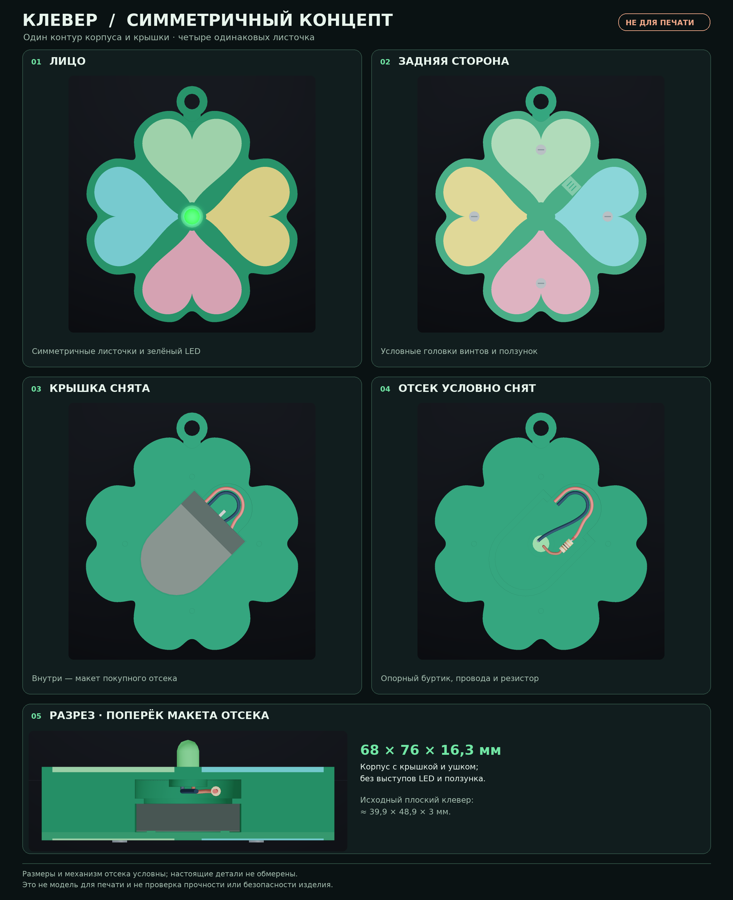

# Симметричный клевер со скрытым отсеком — исправленный 3D-концепт

> **Новая итерация:** [компактная симметричная концепция](clover_led_compact_concept.md) уменьшает контур и рассматривает однотонную крышку и переключение последовательными нажатиями. Она тоже не готова к печати или продаже; приведённый ниже вариант оставлен для сравнения.

**Это иллюстративная сцена, а не модель, готовая к печати или продаже.** Макеты держателя, батарейки, проводов, резистора, светодиода, головок винтов и переключателя попадут в экспорт вместе с корпусом. Реальные размеры и посадка деталей, удержание привода, крепёж, сборка, прочность и безопасность не подтверждены. Не отправляйте всю сцену на печать.

## Просмотр

- [Сценарий Forma — симметричный клевер](../examples/clover_keychain_led_symmetric_concept.forma).
- Отдельно: [лицо](clover_symmetric_front.png), [вид лица под углом](clover_symmetric_iso.png), [задняя сторона](clover_symmetric_back.png), [тыл под углом](clover_symmetric_rear_iso.png), [со снятой крышкой](clover_symmetric_open.png), [условная батарейка](clover_symmetric_battery.png), [гнездо без макета отсека](clover_symmetric_cradle.png), [внутренняя сторона крышки](clover_symmetric_cover.png), [разрез](clover_symmetric_section.png) и [вид сбоку](clover_symmetric_side.png). На задних видах и разрезе свечение LED выключено только для наглядности.
- `.forma` — текстовый сценарий. В Forma 0.76.6 его следует открыть как текст, скопировать в панель «Сценарий» и нажать «Собрать». Кнопка «Открыть файл» в этой версии предназначена для импорта 3D-моделей, а не текста сценария. Модель можно вращать мышью.
- Для открытого вида уберите `#` перед всеми **десятью** строками `hide` в конце файла: скрываются задняя крышка, четыре её цветные вставки, четыре головки и зелёный ползунок. Затем можно дополнительно скрыть `макет_крышки_отсека`, чтобы увидеть батарейку, либо включить все четыре следующие команды `hide`, чтобы увидеть гнездо и проводку без макета отсека. Это только переключение видимости, не анимация настоящего демонтажа.
- Снимки можно воспроизвести из сценария командой `python forma/tools/render_clover_led_symmetric.py`; нужны зависимости Forma и Pillow, а также шрифт с кириллицей.

[Предыдущий вариант со смещённой задней частью](clover_led_integrated_concept.md) сохранён только для сравнения: его силуэт был отвергнут. Исходная плоская [сцена](../examples/clover_keychain_3mf.forma) и исходный 3MF не изменены.

## Что исправлено и насколько изменилась модель

Вместо добавленного сбоку выступа задней части **корпус и крышка получены выдавливанием одного и того же контура**. Он построен из четырёх поворотов одинакового участка; четыре цветных сердечка тоже одинаковы и повёрнуты вокруг центра. Это устраняет прежний перекос. Симметрия относится к цветку без ушка: ушко расположено по центру сверху и является частью корпуса, а не крышки. Внутри условный отсек по-прежнему повёрнут на 45° и закрыт задней крышкой.

| Габариты, без выступов LED, кнопки и металлического кольца | Ширина × высота × толщина |
| --- | ---: |
| Исходный плоский клевер с ушком | 39,88 × 48,94 × 3 мм |
| Отклонённый вариант с отсеком | около 40,5 × 48,9 × 15,9 мм |
| **Новый корпус с крышкой и ушком** | **68 × 76 × 16,3 мм** |

Без ушка цветок занимает 68 × 68 мм. Со всеми условными выступами LED и ползунка сцена занимает около 68 × 76 × 23,25 мм; настоящее металлическое кольцо не показано. **Новая версия примерно на 70% шире исходного клевера и на 55% выше с ушком.** Это выбранная геометрия для сохранения симметричного контура вокруг условной внутренней компоновки, а не доказанный минимально возможный размер. Уместность такого большого брелока и возможность уменьшения нужно согласовать после обмера настоящих деталей. Масса и расход материала не рассчитаны.

## Что находится в концепте

- Передние сердечки толщиной 1,2 мм и задние цветные области толщиной 0,4 мм размещены заподлицо. Их способ крепления, технологические зазоры и изготовление не проработаны. Кольцо вокруг LED также показано без зазора и без готового фиксатора.
- Ушко корпуса толщиной 3,8 мм имеет номинальное отверстие Ø5 мм. Проход пробного цилиндра не подтверждает прочность ушка и возможность установки конкретного разрезного кольца.
- Макет держателя имеет принятые габариты **31 × 23 × 6 мм**; D-форма, выступы, расположение выключателя и его крышка не обмерены. Гнездо условно больше на 0,3 мм с каждой стороны, глубина от плоскости корпуса около 6,3 мм. Держатель опирается на буртик толщиной 1,2 мм. Два небольших упора на задней крышке условно касаются неподвижной части макета, а не его заводской крышки. Это не расчёт силы прижима.
- На задней поверхности показаны четыре **головки** винтов. Винтовые стержни и резьба не построены: номинальный диаметр пилотных отверстий корпуса 1,7 мм, отверстий крышки 2,2 мм. Реальные винты, длина, глубина захода и прочность соединения не выбраны.
- Кнопка находится между задними листочками. Принятый для макета ход — **±0,5 мм** вдоль локальной оси держателя. Внешняя кнопка находится на 0,15 мм над плоскостью крышки; в крайних положениях она перекрывает цветную вставку **в проекции**, но на проверенных положениях не пересекает её по объёму. Окно закрыто кнопкой при взгляде прямо сзади, но это **не герметизация**. Фиксатор привода от выпадения не спроектирован. Реальные место, направление, ход и усилие переключателя неизвестны.
- Провода показаны диаметром 1 мм: сначала 4 мм прямо от выхода макета, далее дуги радиусами 5,4 и 4 мм в плане. Минимальный пространственный радиус по дискретным точкам их осей — около 5,14 и 3,76 мм. Это не паспортный допустимый изгиб настоящего провода. Запас длины для обслуживания, защиту от защемления и изоляцию необходимо проверить на деталях.

## Что проверено в цифровом макете

Автоматические проверки находятся в `forma/tests/test_clover_led_symmetric_concept.py`. Сцена собрана, все 34 видимых тела геометрически корректны и связны. Среди попарных объёмных пересечений оставлены только намеренные пересечения условных электронных контактов, изоляции и цветных полос резистора. Основные проверенные положения:

- Контуры крышки и корпуса на выбранных высотах совпадают; по сравнению с поворотом на 90°, 180° и 270° контур цветка совпадает с точностью сеточной геометрии. Ушко выделено как единственное внешнее исключение. Цветные сердечки равны после поворота на 90°.
- В нескольких сечениях расширение большой внутренней полости на 2 мм остаётся в пределах наружного контура; расширение цветных вставок на 1,8 мм также помещается в контуре в проверенных сечениях. Это **не** полный расчёт минимальной толщины всех 3D-стенок или механической прочности.
- В четырёх местах Ø1,6-мм пробный цилиндр проходит через крышку, её цветные вставки и пилотные отверстия корпуса; вокруг пилота в выбранном сечении есть материал до радиуса 3 мм. Через отверстие ушка проходит прямой цилиндр Ø4,8 мм.
- Малый виртуальный сдвиг подтверждает контакты условного держателя с буртиком и каждого из двух упоров с держателем. Привод и макет выключателя проверены на столкновения при совместном перемещении на −0,5, 0 и +0,5 мм. Это не проверка реального усилия, удержания или работы выключателя.
- Проверены отдельные прямые виртуальные перемещения деталей крышки и макета держателя наружу. Движение настоящей заводской крышки, демонтаж винтов, изгиб и натяжение проводов, руки и инструмент не моделируются. Поэтому эти проверки не доказывают удобство сборки или замены батарейки.

## Прежде чем делать версию для печати

1. Сверить фотографии с линейкой или штангенциркулем: отсек со всех сторон, выступы, толщину и место выхода проводов, точное положение и полный ход ползунка. Нужны фото или видео **открытия штатной крышки**.
2. Подтвердить тип и количество элементов в **одном** отсеке: в ранее присланном описании встречается «CR2033», а в названии товара — CR2032. Набор из трёх отсеков не означает три батарейки в одном отсеке.
3. Обмерить LED, его бортик, резистор, изоляцию и кольцо. Спроектировать рабочее удержание и сборку привода, винты, зазоры, крепление кольца LED и цветных вставок, доступ к штатной крышке, защиту проводов и безопасное удержание батарейки.
4. Сделать физическую пробную сборку, проверить посадки, переключение, замену, прочность ушка и крышки, падения, возможное короткое замыкание и другие риски. Bambu Studio, нарезка и печать этой сцены не проверялись.

Батарейка-таблетка опасна при проглатывании; держите её и изделие вне доступа детей. При подозрении на проглатывание немедленно обратитесь за неотложной медицинской помощью. Предварительный расчёт LED с резистором 1 кОм, ограничения автономности и ориентиры по требованиям для ЕС и РФ/ЕАЭС приведены в [документации предыдущей концепции](clover_led_integrated_concept.md#автономность-только-пример-для-одной-cr2032); их необходимо сверить с фактической конструкцией и действующими требованиями.
