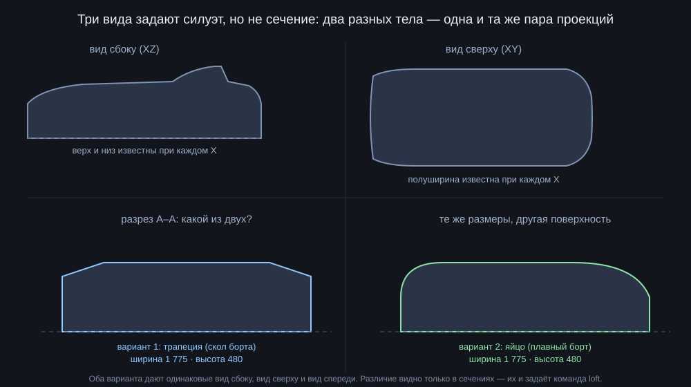
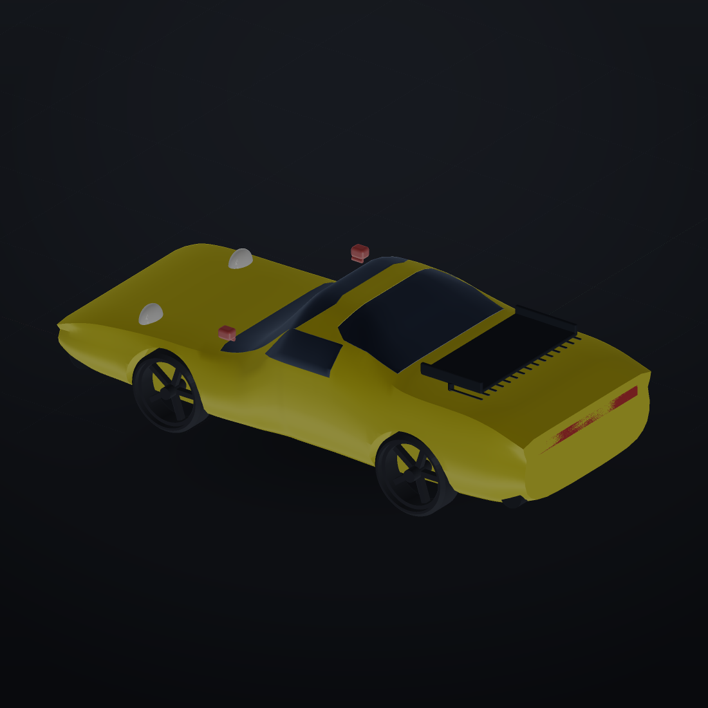
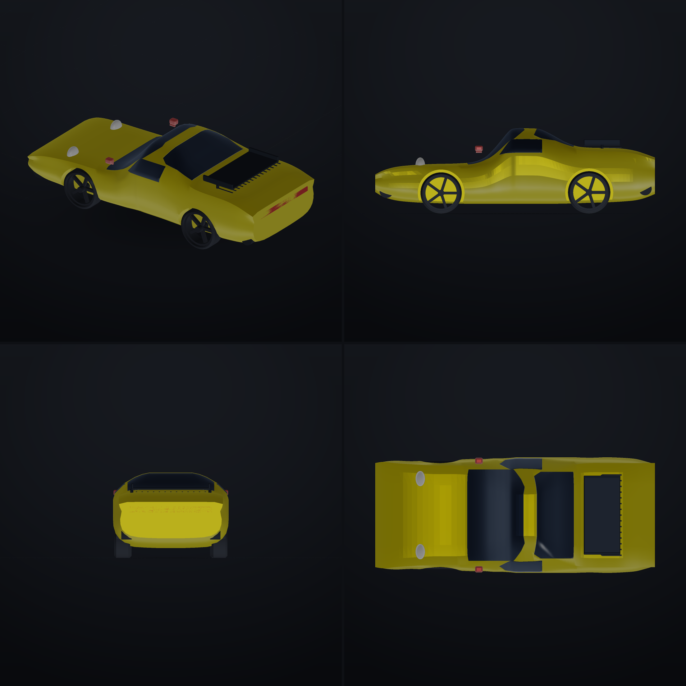

# Чертёж → модель: что он даёт, чего не даёт, и как из него собрать машину

Короткий ответ на два вопроса:

1. **«Если есть готовый чертёж, можно собрать любую фигуру довольно точно?»**
   Почти. Чертёж задаёт **габариты и несколько размеров**, а поверхность между
   проекциями оставляет на догадку. На листе Porsche 911 Turbo напечатано
   **6 размеров**, а чтобы собрать кузов, понадобилось **около 120 чисел**.
   Остальные 95 % — это прочитанный по масштабу силуэт, то есть чертёж
   работает как **фотография, у которой известен масштаб**.
2. **«Можно ли чертёж на органическую модель — человека, дракона?»**
   Обычный машиностроительный чертёж — нет: у органики нет прямых рёбер и
   плоскостей, которые он описывает. Но есть **теоретический чертёж**
   (набор сечений), которым в кораблестроении и авиации описывают именно
   органические обводы. Он у нас уже работает — это команда `loft`.

Ниже — как это проверено: одна и та же машина собрана из листа журнала
«Моделар» (Porsche 911 Turbo 930), результат лежит в `examples/porsche_930.forma`.

---

## 1. Что на самом деле содержит чертёж

Возьмём лист, с которого собиралась модель. Все числа, которые на нём
напечатаны:

| Размер | Значение | Что задаёт |
|---|---|---|
| длина | 4291 мм | габарит по X |
| ширина | 1775 мм | габарит по Y |
| высота | 1310 мм | габарит по Z |
| база | 2272 мм | расстояние между осями |
| колея передняя | 1432 мм | расстояние между колёсами спереди |
| колея задняя | 1492 мм | то же сзади |

Всё. Ещё на листе есть четыре вида (сбоку, сверху, спереди, сзади), четыре
разреза (А–А, Б–Б, В–В, Г–Г), рисунок колеса в разрезе, эмблема и руль — но
**без размеров**.

А теперь посчитайте, сколько чисел нужно, чтобы описать ту же машину как
тело. В нашем сценарии:

* 24 поперечных сечения по длине кузова, в каждом 8 точек и 2 координаты —
  это уже ≈ 120 чисел;
* 4 колеса: диаметр, ширина, обод, ступица, шина, положение — 24 числа;
* 4 стекла, спойлер, решётка из 15 ламелей, бамперы, фары, фонарь, надпись,
  зеркала, ручки — ещё ≈ 60.

Итого **≈ 200 чисел, из которых на листе напечатано 6**. Это не придирка к
конкретному журналу: так устроен любой чертёж. Он нормирует **то, что важно
для изготовления** (посадки, диаметры, межцентровые), а плавные обводы
задаёт линиями, которые изготовитель снимает с чертежа **в масштабе**.

> **Главный вывод.** Чертёж — это не «файл модели», а **проекция плюс
> несколько якорей**. Модель по нему строится так же, как по фотографии:
> находим масштаб (мм на пиксель) по любому известному размеру и снимаем
> остальное с силуэта.

Именно поэтому у нас уже работает `docs/photo_to_model.md`: чертёж — частный
случай фотографии, у которой **масштаб известен точно**, а не «примерно по
монетке».

### 1.1 Масштаб — единственное, что отличает чертёж от фото

```
масштаб = известный размер на листе (4291 мм) / его длина в пикселях
```

Дальше любая точка силуэта переводится в миллиметры одним умножением.
Отсюда и точность: на скане 1500 px длина машины ≈ 1300 px, значит
1 px ≈ 3,3 мм. Ошибка «на глаз» в 2 пикселя — это 6,6 мм, то есть 0,15 %
длины. Для кузова этого достаточно, для посадочного места подшипника — нет.
Вот честная граница «довольно точно»:

| Что | Точность по чертежу | Почему |
|---|---|---|
| габариты, база, колея | ±0 (напечатаны) | это и есть числа |
| крупные обводы кузова | ±5…10 мм | снято с силуэта в масштабе |
| радиусы скруглений, галтели | ±30 % и хуже | на листе не размерены |
| посадки, резьба, допуски | **не восстановить** | нужен не чертёж, а спецификация |

---

## 2. Почему трёх видов недостаточно

Классическая ловушка: три проекции **однозначно** задают только деталь из
плоских граней. Как только поверхность кривая, у трёх силуэтов появляется
бесконечное семейство тел, которые им удовлетворяют.

Проверим на нашей машине. Вид сбоку даёт профиль: при каждом X известны
верх и низ. Вид сверху — при каждом X известна полуширина. Но **как именно
борт переходит в крышу** — не знает ни один из них. Сечение может быть
трапецией, яйцом или прямоугольником со скруглением, и все три варианта
дадут одинаковые три проекции.

Поэтому на листе и нарисованы разрезы А–А, Б–Б, В–В, Г–Г — это попытка
задать недостающее. Но их всего четыре на четыре метра длины, и размеров на
них нет; реальная машина между ними — предмет догадки.



*Схема: слева и справа — два разных сечения, у которых совпадают все три
вида и все габариты. Отличить их по проекциям невозможно.*

Ровно та же проблема, что «одна проекция недоопределена» из
`photo_to_model.md` §1.1, только мягче: три проекции снимают
неопределённость по двум осям, но не по форме сечения.

---

## 3. Как это решается на практике: сечения (stations)

Приём, которым пользуются кораблестроители, авиастроители и автомобилисты:
задать тело **не проекциями, а таблицей поперечных сечений** по длине.
Такой чертёж называется **теоретическим**; в судостроении его таблица
называется **плазовой ординатой**.

У нас это одна команда — `loft`:

```
кузов_база = loft sections=сечения positions=[-2145.5, ... 2145.5] axis=x smooth=4
```

24 сечения, 24 позиции. Всё остальное — вычитание арок, проёмы под стёкла,
навесное оборудование.

**Числа, которые реально снимались с листа** (это и есть «работа чертёжника»):

| Что снималось | Откуда на листе | Как превращалось в числа |
|---|---|---|
| верх и низ кузова | вид сбоку | высота Z в 24 точках по длине |
| полуширина | вид сверху | доля от 1775/2 |
| наклон борта к крыше | вид спереди/сзади | отношение полуширины верха к низу |
| положение арок | вид сбоку | центры окружностей колёс |
| размеры шин | **не на листе** | штатные для 930: ø632/ø650 |

Последняя строка — важная: **на чертеже нет шин**, только диски в разрезе.
Их пришлось взять из спецификации модели. Это типично: чертёж детали не
содержит того, что покупается готовым.

---

## 4. А органика? Человек, дракон

### 4.1 Почему машиностроительный чертёж для неё не годится

Чертёж детали работает потому, что деталь состоит из **плоскостей, цилиндров
и конусов**, и каждый элемент можно обмерить двумя-тремя числами. У человека
нет ни одной плоскости, которую стоит размерять: плечо — не цилиндр, а
переменное сечение с мышцей, жиром и кожей.

### 4.2 Но органика описывается — другими чертежами

| Объект | Чем описывают | Что это даёт |
|---|---|---|
| корпус корабля | теоретический чертёж: три проекции + таблица ординат (шпангоуты, ватерлинии, батоксы) | поверхность восстанавливается с точностью до мм |
| фюзеляж, крыло | теоретический чертёж + плаз | то же, плюс контроль профиля |
| автомобиль | кузов задаётся поверхностями в CAD (класс А), а не чертежом | гладкость и блики |
| человек | антропометрия: размеры и обхваты (рост, обхват груди, длина стопы) + скульптура/скан | пропорции, но не поверхность |
| дракон, монстр | **чертежа нет**; есть концепт-арт, референсы и скульптура (ZBrush, Blender) | форма как скульптура, дальше — ретопология |

Вывод: **органику можно строить по «чертежу», но это будет не чертёж
детали, а набор сечений или скульптура**. В ФОРМЕ для этого уже есть:

| Команда | Что делает | Для чего в органике |
|---|---|---|
| `loft` | соединяет 2D-сечения по оси | торс, хвост, крыло — сечениями |
| `sweep` | тянет профиль по 3D-пути | конечности, шея, хвост дракона |
| `skeleton` / `human` | скелет и фигура из костей и капсул | человек по антропометрии |
| `blob` / `from_sdf` | неявные поверхности | мягкие «скульптурные» формы |
| `scales`, `spikes`, `hair` | детализация поверхности | чешуя, шипы, шерсть |

То есть на вопрос «а дракона можно?» ответ такой: **можно, но не по
чертежу**. Дракона задают либо сечениями (`loft`/`sweep` по осевой линии),
либо неявной функцией (`from_sdf`), либо скульптурой в Blender и импортом
(`import`). Чертёж тут не помогает, потому что его нет и он не нужен.

### 4.3 Человек — единственная органика, у которой есть числа

Для человека «чертёж» существует: это антропометрические таблицы. Рост,
обхват груди, длина руки, ширина плеч — 20–30 чисел, которые снимают с
живого человека. Этого хватает на **манекен с правильными пропорциями** и не
хватает на портрет: лицо так не задаётся. У нас это `human` (фигура по
пропорциям) и `skeleton_original` (206 костей) — оба в примерах приложения.

---

## 5. Что получилось: Porsche 911 Turbo (930)

### 5.1 Файлы

| Файл | Что внутри |
|---|---|
| `examples/porsche_930.forma` | сценарий: 202 строки, 119 команд, 20 разных команд |
| `docs/make_porsche_930.py` | генератор: считает 24 сечения из шести чисел чертежа |
| `docs/porsche/porsche_930_{iso,front,right,top}.png` | четыре вида, как на листе |
| `docs/porsche/porsche_930.stl` | готовая сетка для печати/просмотра |
| `tests/test_porsche_930.py` | 9 тестов: габарит, база, колея, колёса на полу, части |



*Собранный кузов: 24 сечения, стёкла утоплены в проёмы, «китовый хвост»
930-го, колёса по базе и колее с листа.*



*Сверху слева — изометрия, сверху справа — вид сбоку, снизу — спереди и
сверху. Эти четыре картинки и сравниваются с листом.*

### 5.2 Числа

| Проверяемая величина | На чертеже | В модели | Отклонение |
|---|---|---|---|
| длина | 4291 мм | 4291,0 | 0 |
| ширина | 1775 мм | 1775,5 | +0,5 мм |
| высота | 1310 мм | 1309,9 | −0,1 мм |
| база | 2272 мм | 2272 (оси на ±1136) | 0 |
| колея передняя | 1432 мм | 1432 (колёса на ±716) | 0 |
| колея задняя | 1492 мм | 1492 (колёса на ±746) | 0 |

Это не «на глаз похоже»: каждое из шести чисел листа стоит в сценарии
командой `check` или координатой, и тест падает, если оно перестанет
совпадать.

Остальные характеристики сборки: 24 570 треугольников, 19 видимых деталей,
сборка 1,1 с (сюда входит полный анализ модели), 7 проверок — все зелёные.

### 5.3 Что в модели сделано и как

| Часть | Приём | Команды |
|---|---|---|
| кузов | 24 сечения по длине, сглаживание | `loft` |
| колёсные арки | цилиндр поперёк машины вычитается из борта | `cylinder`, `rotate`, `difference` |
| стёкла | клин из кузова, проём на 4 мм шире — стекло утоплено | `intersect`, `difference` |
| «китовый хвост» 930-го | полка + бортики + стойки, собрано в одно | `box`, `union`, `place` |
| решётка моторного отсека | 15 ламелей в ряд | `array` |
| колёса | шина, обод, 5 спиц, ступица — одной командой | `wheel` |
| бамперы | цилиндр поперёк кузова | `cylinder`, `rotate` |
| надпись PORSCHE | объёмный текст на задней панели | `text plane=yz` |
| зеркала, ручки | одна деталь + отражение | `mirror` |

### 5.4 Чего в модели нет — честно

* **подвески и салона** — их нет на чертеже и они не видны снаружи;
* **точной формы сидений, приборов** — это интерьер, отдельная работа;
* **профиля шин** — взяты штатные размеры, рисунок протектора не делался;
* **гладкости класса А** — лофт по 24 сечениям даёт «гранёный» обвод, на
  рендере это видно по блику; в CAD такую поверхность строят сплайнами;
* **зазоров дверей и капота** — на чертеже они не размерены (в старом
  примере `car.forma` они были прорезаны канавками, здесь убраны, чтобы не
  выдумывать числа).

---

## 6. Рецепт: из чертежа в сценарий за шесть шагов

1. **Найти якорь.** Выбрать на листе два-три размера, которые точно
   напечатаны (обычно габарит и база). Они дадут масштаб и начало координат.
2. **Выбрать ось.** У машины — X по длине, Y поперёк, Z вверх, пол на Z=0.
   Дальше все числа — в этой системе, иначе начнётся путаница.
3. **Снять сечения.** По виду сбоку — верх и низ, по виду сверху —
   полуширину, по виду спереди — наклон борта. 20–25 сечений достаточно;
   больше — тяжелее сетка без видимой пользы.
4. **Собрать тело** одной командой `loft` и сразу проверить габарит.
5. **Добавить то, что вычитается**: арки, проёмы под стёкла, ниши.
6. **Добавить навесное** (`wheel`, `place`, `mirror`, `array`) и закрыть
   проверками: габарит, база, колея, замкнутость, число частей.

Всё это автоматизировано в `docs/make_porsche_930.py`: меняете шесть чисел в
начале — получаете другой сценарий. Так же делается любая машина, у которой
есть лист с четырьмя видами.

---

## 7. Что это значит для ФОРМЫ

| Вопрос | Ответ по итогам работы |
|---|---|
| Чертёж заменяет моделирование? | Нет. Он даёт якоря и силуэт; 95 % чисел всё равно снимаются |
| Стало ли легче, чем вручную? | Да: 6 чисел → 120 через генератор, и все проверки автоматические |
| Нужен ли импорт чертежа картинкой? | Да, это следующий шаг: загрузить скан, отметить два размера, получить масштаб — и рисовать сечения поверх картинки |
| Нужны ли органике чертежи? | Нет. Нужны сечения (`loft`), путь (`sweep`) или SDF; для человека — антропометрия |
| Где предел? | Посадки, резьба, допуски. Их не «снять с листа», их берут из спецификации |

**Практическое предложение**: в приложении не хватает режима
«подложка-чертёж» — картинка под сеткой, два маркера масштаба, привязка
точек сечения к пикселям. Это тот же механизм, что заявлен в §13
`photo_to_model.md` («Подогнать по фото»), только с точным масштабом вместо
угаданного, и он закрывает пункты 5 и 6 из §7 `cad_triad.md` (подгонка
размеров по замерам и чертёж с размерами). Объём — около 150 строк в
`web/js/viewer.js` плюс состояние в `AppState`: работа «снять 120 чисел
руками» превращается в «прощёлкать 24 сечения мышкой».
