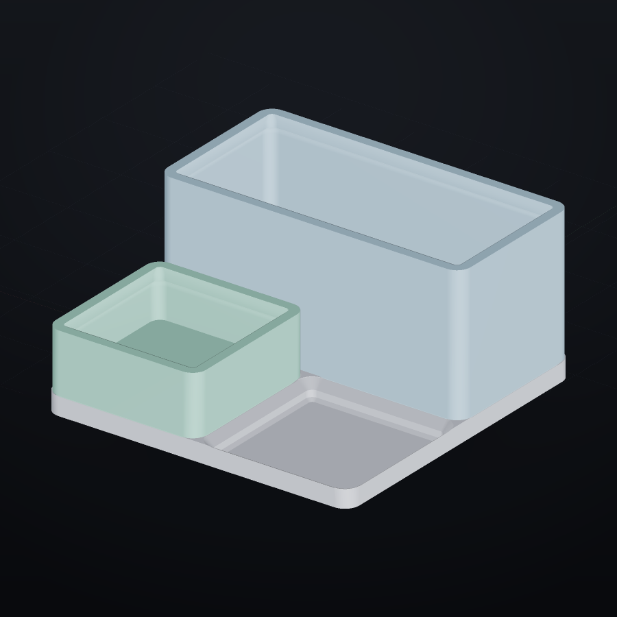

# Перенос Gridfinity: чужая библиотека как наш параметрический примитив

Gridfinity — открытая система складских ящиков с шагом 42 мм. Спецификация —
[gridfinity/gridfinity](https://github.com/gridfinity/gridfinity) (**MIT**),
эталонная реализация — [kennetek/gridfinity-rebuilt-openscad](https://github.com/kennetek/gridfinity-rebuilt-openscad)
(**MIT**). Взяты **числа** из спецификации; форма собрана нашими операциями.

Проверено 2026-11-03: лицензия MIT читалась в файле `LICENSE` репозитория
(через GitHub API у `kennetek/...` приходит `NOASSERTION` — это ошибка
определения, а не отсутствие лицензии). Условия: текст лицензии сохраняется в
исходниках, указание автора в изделии не требуется. См. `assets_catalog.md`.



*`examples/gridfinity.forma`: плита 2×2 (84 × 84 × 5) и ящики 1×1×3u и 2×1×6u,
собранные из одного и того же генератора.*

---

## 1. Зачем переносить, если есть референс

Референс — OpenSCAD. Нам нужны те же объекты **внутри ФОРМЫ**, где работают
наши `check`, `mesh`, `simplify`, отчёт и параметры. После переноса ящик — это
одна строка:

```bash
forma lib gridfinity size=2x3 height=6 dividers=2x1 --check
```

Одна команда даёт сценарий, габарит, герметичность и отчёт по сетке. Ни
OpenSCAD, ни Blender для этого не нужны.

---

## 2. Числа спецификации (сверены с референсом)

| Что | Значение, мм | Откуда |
|---|---|---|
| шаг сетки | 42 | `GRID_DIMENSIONS_MM` |
| сторона замка сверху | 41.5 | `BASE_TOP_DIMENSIONS` (зазор 0.5 между ящиками) |
| высота замка / юнита высоты | 7 | `BASE_HEIGHT`, `unit_height` |
| профиль замка | 0.8 фаска 45° → 1.8 полка → 2.15 фаска 45° | `BASE_PROFILE` |
| сторона замка снизу | 41.5 − 2·2.95 = **35.6** | производное |
| радиус угла сверху / снизу | 3.75 / 0.8 | `BASE_TOP_RADIUS`, `BASE_BOTTOM_RADIUS` |
| стенка | 0.95 | `d_wall` |
| буртик | выступ 2.6, высота 4.4 | `STACKING_LIP_SIZE` |
| профиль буртика | 0.7/45° → 1.8 прямо → 1.9/45° | `STACKING_LIP_LINE` |
| магнит | Ø6.5 × 2.4 | `MAGNET_HOLE_RADIUS`, `MAGNET_HOLE_DEPTH` |
| винт | Ø3.35 (M3) | `SCREW_HOLE_RADIUS` + зазор |
| отверстие от стенки / от низа | 8 / 4.8 | `d_hole_from_side`, `HOLE_DISTANCE_FROM_BOTTOM_EDGE` |
| плита: шаг / высота | 42 / 5 | `BASEPLATE_DIMENSIONS`, `BASEPLATE_HEIGHT` |

---

## 3. Как это собрано

Никаких треугольников из референса — только сечения и булевы операции.

* **Оболочка** — `loft` из пяти сечений: низ 35.6 (R0.8) → 37.2 (R1.6) →
  37.2 → 41.5 (R3.75) → верх. Сечения строятся генератором как
  прямоугольники со скруглёнными углами, всегда 4·(SEG+1) точек — иначе `loft`
  откажется соединять контуры с разной длиной.
* **Полость** — второй `loft`: стенка 0.95, затем воронка буртика (39.2 → 37.8
  → 34.0). Вычитается из оболочки: `тело = difference [оболочка, полость]`.
* **Перегородки** — тонкие плиты, обрезанные по полости: `intersect [рёбра, полость]`.
  Так они прилегают к стенкам при любом размере, без ручной подгонки.
* **Отверстия** — `cylinder` + наш `array mode=grid`: четыре на юнит, шаг 42.
* **Плита** — `extrude` скруглённого контура и `array` карманов; карман — тот
  же профиль замка плюс зазор 0.25 на сторону.

Пример вывода (фрагмент):

```
оболочка = loft sections=[[[17,-17.8],…]] positions=[0,0.8,2.6,4.75,21] axis=z smooth=1
полость  = loft sections=[[[17,-19.8],…]] positions=[7,15.4,16.6,17.3,19.1,21,22] axis=z smooth=1
тело = difference [оболочка, полость]
магнит = cylinder radius=3.25 height=2.4 segments=32 at=[-12.75,-12.75,0]
магниты = array [магнит] mode=grid counts=[2,2,1] spacing=[42,42,0]
тело = difference [тело, магниты, винты]
```

Сценарий читаемый: его можно открыть, поправить руками и проверить теми же
`check`, что и любую другую модель.

---

## 4. Что проверено (числа, а не «выглядит похоже»)

| Проверка | Результат |
|---|---|
| ящик 1×1×3u | 41.5 × 41.5 × **21** мм (3 × 7), объём 13.36 см³, 916 трис |
| ящик 2×3×6u | 83.5 × 125.5 × **42** мм (6 × 7), 86.9 см³, 1 578 трис |
| ящик 2×2×4u с перегородками | одно тело, объём растёт, герметичен |
| высота на юнит | +7.00 мм ровно (3→4→5 юнитов) |
| плита 2×2 | 84 × 84 × 5 мм, 6.34 см³, 1 488 трис |
| **ящик входит в плиту** | центр в ячейке (−21, −21), низ на дне кармана: нахлёст 0.00 мм³ при 0.15 / 0.5 / 1.0 мм |
| **шаг штабеля** | ровно 21 мм: нахлёст 0.00; уже при 20 мм — 19 мм³ → ящик держится кромкой |
| отверстия | 16 на 2×2, каждое 12.75 от центра юнита |

Последние две строки — главные: именно они доказывают, что перенесён **замок**,
а не похожая на него коробка. Обе проверки есть в
`tests/test_lib_gridfinity.py`.

---

## 5. Честные отличия от референса

1. **Галтель 0.6 на кромке буртика не сделана.** Кромка острая. Посадка от
   этого мельче: ящик входит в устье буртика примерно на 0.5 мм и садится
   фаской на 45° (в референсе — глубже). Устойчивость от этого не страдает,
   зазор по кромке — больше.
2. **Зазор плиты — 0.25 мм на сторону** от профиля ящика, а не отдельный
   профиль референса (0.7 / 2.5 / 4.85). Ящик садится и не качается
   (проверено пересечением), но «фирменный» прилив плиты выглядит иначе.
3. **Сетка: у одиночного ящика чисто, у многоместного — нет.** `forma mesh`:

   | модель | трис | стяжек | игл на кривизне |
   |---|---|---|---|
   | ящик 1×1×3u | 916 | **0** | 0.34 % (порог 1 %) |
   | ящик 2×3×6u | 1 578 | **9** (валентность до 24) | 0.76 % |
   | плита 2×2 | 1 488 | **0** | 0.007 % |

   У 1×1 всё в норме, и `check mesh` на нём проходит. У 2×3 полюса сидят на
   кромках замка — в точках вида (38.8, 59, 0) и (−1.2, 0, 7): это вершины
   торцов `loft`, где сходятся веером тонкие пояса. Дыр нет: границы и
   неориентированные рёбра нулевые (`boundary_edges = 0`), проверено тестом.

   Поэтому в шаблон поставлены `check size` и `check watertight`, а `check mesh`
   — нет: при некоторых размерах он бы падал на кромке, хотя деталь годная.
   Если нужна именно чистая сетка под скульпт — берите 1×1 или чистите вручную.

4. **Плита 2×2** проходит проверку сетки чисто: 0 стяжек, иглы 0.007 %.

---

## 6. Как переносить любую другую библиотеку

Порядок, который сработал здесь и переносится на BOSL2-подобные наборы:

1. **Выписать константы и их происхождение.** Не «примерно 42», а имя
   константы в источнике. Это единственное, что нельзя придумать.
2. **Понять, что это за поверхность.** Профиль × контур (свип) → у нас
   `loft` сечений; тело вращения → `lathe`; таблица деталей → `включить`.
3. **Собрать из своих операций и сверить числа.** Габарит, объём, посадка —
   в `check`; герметичность — `watertight`; качество — `forma mesh`.
4. **Записать отличия и пороги явно.** Иначе следующий читатель решит, что
   расхождение — ошибка, и «починит» его.

Ограничение языка, из-за которого появился Python-генератор: в `.f3d` есть
переменные и выражения, но **нет функций и циклов**. Таблицу размеров так
делать удобно (`forma/lib/fastener/`), а вот скруглённые сечения на 36 точек —
нет: их считает `forma/lib/gridfinity.py` и выдаёт готовый текст.

---

## 7. Файлы

* `forma/lib/gridfinity.py` — генератор (спецификация, `bin_script`, `baseplate_script`).
* `forma/lib/__init__.py` — реестр для `forma lib`.
* `forma/lib/fastener/{defaults,shapes}.f3d`, `demo.forma` — параметризация без Python.
* `forma/tests/test_lib_gridfinity.py` — 21 тест: числа, посадка, штабель, CLI.
* `forma/tests/test_lib_fastener.py` — 10 тестов: переопределение чисел, сборка.
* `forma/docs/assets_catalog.md` — что можно брать по лицензиям и почему.
