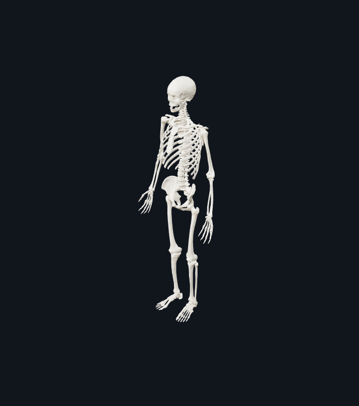

# Скелет взрослого человека — 206 костей

Готовый образовательный объект, а не схематический манекен и не монтажный стенд. В сцене находятся только кости: нет подставки, платформы, зубов, хрящей или декоративных элементов.



## Состав

- **80 осевых костей:** 22 кости черепа (8 мозговых + 14 лицевых), 6 слуховых косточек, подъязычная кость, 26 элементов позвоночного столба (7 шейных + 12 грудных + 5 поясничных позвонков + крестец + копчик), 24 ребра и одна грудина.
- **126 аппендикулярных костей:** 4 кости плечевых поясов и 60 костей верхних конечностей; 2 тазовые кости и 60 костей нижних конечностей.
- В обеих **кистях — 54 кости**: 16 запястных, 10 пястных и 28 фаланг. У каждого большого пальца две фаланги.
- В обеих **стопах — 52 кости**: 14 предплюсневых, 10 плюсневых и 28 фаланг. У каждого большого пальца стопы две фаланги.
- Две дополнительные сесамовидные кости источника `FMA45097/FMA45098` исключены из стандартного счёта 206. Грудина представлена одним объектом `FMA7371`; её три анатомические части остаются тремя связными компонентами сетки.

## Геометрия и координаты

- **206 именованных объектов**, **400 168 треугольников**.
- Номинальный рост **1750 мм**; фактический bounds после float32-экспорта — **1749,988159 мм**, низ стоп `Z=0`.
- Общие габариты: **692,427 × 262,287 × 1749,988 мм**.
- Канон Forma: `+Z` — верх, `+X` — анатомическое право, `−Y` — перёд, `+Y` — зад.
- Исходный asset хранится в метрах в glTF Y-up; команда `import … unit=m` переводит его в миллиметры и Z-up Forma.
- Каждая кость доступна отдельно по FMA ID. Пять непересекающихся групп: череп (29), позвоночник (26), грудная клетка (25), верхние конечности с плечевым поясом (64), нижние конечности с тазом (62).

## Проверки

Встроенный сценарий выполняет **412/412 проверок**: замкнутость каждой из 206 костей и число связных частей каждого объекта. Дополнительные приёмки в `tests/test_skeleton.py` проверяют:

1. стандартный состав 206/80/126 и региональные количества;
2. 54 кости кистей, 52 стоп и правильное число фаланг;
3. размеры, канонические оси, расположение правых/левых костей;
4. свободные орбиты, грудную и тазовую полости, оба запирательных отверстия — миллиметровыми зондами;
5. соседние зонды, которые наоборот обязаны содержать кость;
6. отсутствие крупных ошибочных пересечений;
7. 206 узлов и 400 168 треугольников в экспортированном Forma GLB;
8. после сварки экспортных UV/normal seams — ни boundary/nonmanifold рёбер, ни вырожденных или повторных треугольников;
9. авторство и лицензию в метаданных GLB, кэширование именованного импорта и bundled-путь внутри EXE.

Фактический аудит: `docs/human_skeleton_audit.json`; поузловой аудит исходника: `docs/human_skeleton_source_audit.json`.

Для 680 пар с пересекающимися AABB выполнен точный Boolean-анализ. Максимальное пересечение обычных костей — **200,217 мм³** на локальном контакте черепных швов; крупных ошибочных соединений нет. Более выраженные вложения относятся к слуховым косточкам внутри височной области и их взаимным сочленениям, что предусмотрено исходной анатомической моделью.

Общий регресс: **1100/1100 тестов**, все **24/24 примера** строятся, `--selftest` и `--uistest` успешны. Браузерная проверка Three.js дала 206 видимых объектов, 400 168 triangles, 412/412 checks и пустые списки console errors / failed requests.

## Виды

Сохранены в `docs/human_skeleton/` (рабочие копии также создаются в `renders/human_skeleton/`):

- `front.png`, `back.png`, `right.png`, `iso.png`;
- `skull-close.png`, `pelvis-close.png`, `hand-close.png`, `foot-close.png`.

Это снимки фактически построенной сцены, а не референсы или сгенерированные иллюстрации.

## Открытие и Blender

- В Forma выберите пример **«Скелет взрослого человека: 206 костей»** (`examples/human_skeleton.forma`).
- Для Blender используйте публикуемый релизом `human_skeleton.glb`: это обычный GLB 2.0 без Draco и внешних decoder-ресурсов, с 206 узлами FMA и метрами в исходной glTF-системе координат.
- В приложении экспортированный GLB сохраняет материал, отдельные объекты и строки `asset.copyright` / `asset.extras.license` / `asset.extras.source`.

## Воспроизводимость

Offline-препроцессор: `tools/prepare_human_skeleton.py`. Он фиксирует исходный commit, исключает две дополнительные сесамовидные кости, объединяет три узла грудины, восстанавливает hyoid, сваривает швы, проверяет winding, декимирует сетки, нормализует рост и записывает лицензионные метаданные. Эти preprocessing-зависимости **не добавлены** в runtime Forma или EXE.

Повторный запуск с сохранённой восстановленной hyoid дал байт-в-байт тот же asset:

```text
SHA-256 61628131fad0a285483f49faed46c87deda78537ed4f05c79f6a108980c393b4
Размер  16902276 байт
```

## Источник и ограничения

Основная геометрия — **AnatomyTOOL Open 3D Anatomical Model for Education / Z-Anatomy**, промежуточная адаптация `dreamrain314/human-skeleton-3d`, commit `b78fc8e711dac5809a35f16209dc27a3df9f054d`. Слуховые косточки — neurothing/McGill University audilab; hyoid и мечевидный отросток — BodyParts3D/DBCLS.

Полное авторство, ссылки и условия **CC BY-SA 4.0 / CC BY 4.0**: `examples/assets/human_skeleton.LICENSE.txt`. Модель предназначена для образования и визуализации, а не для клинической диагностики, хирургического планирования или изготовления имплантатов.
