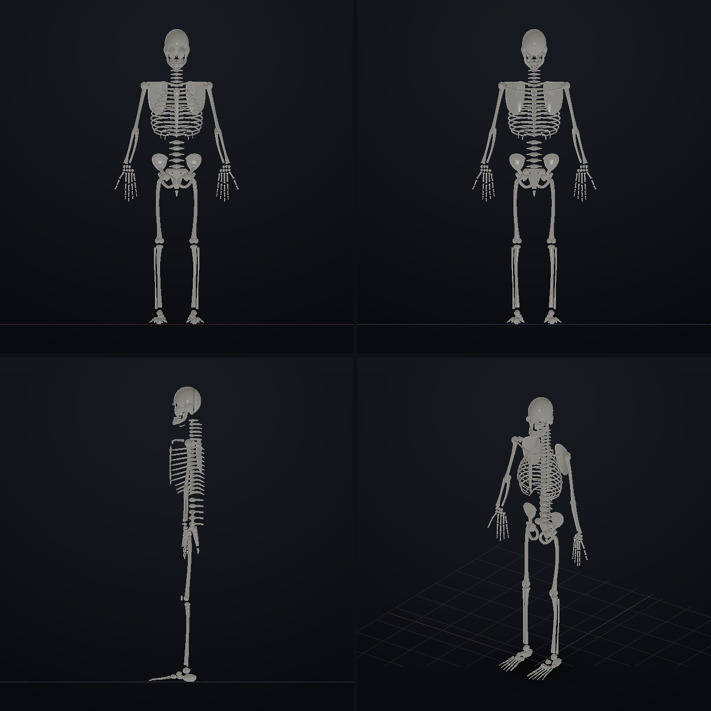
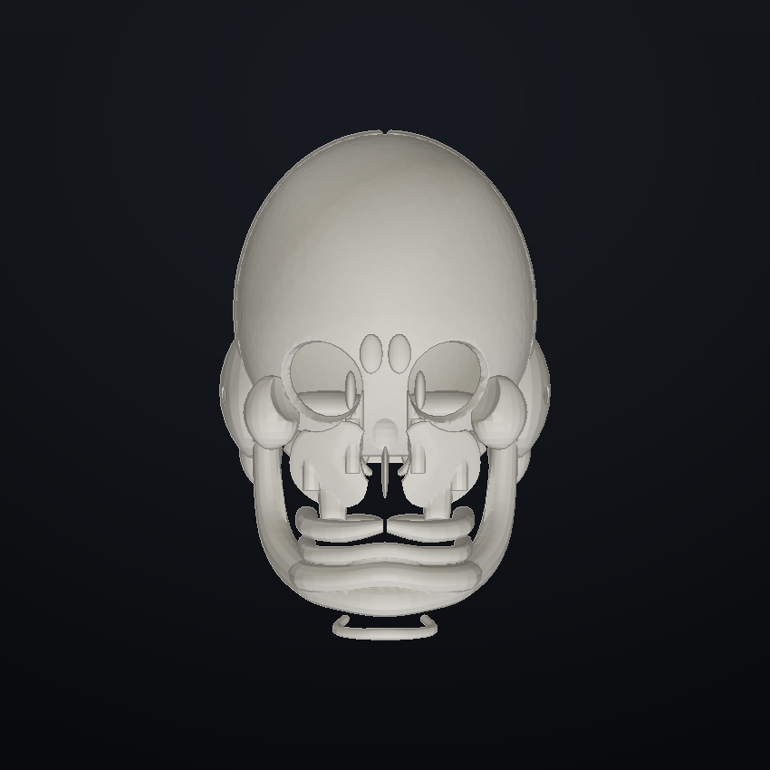
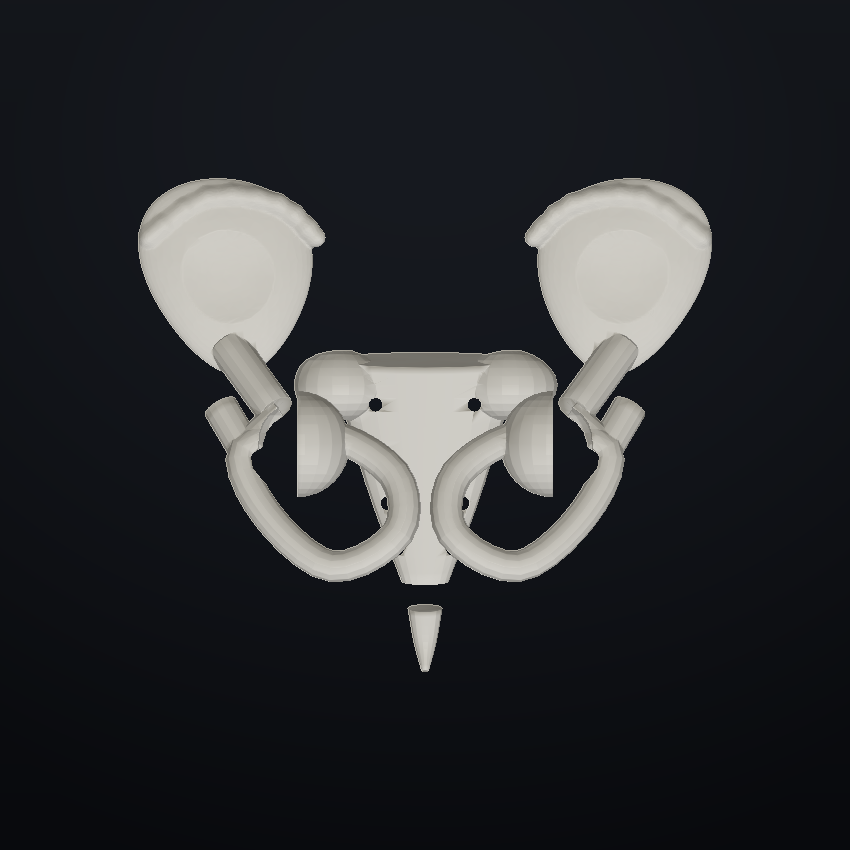
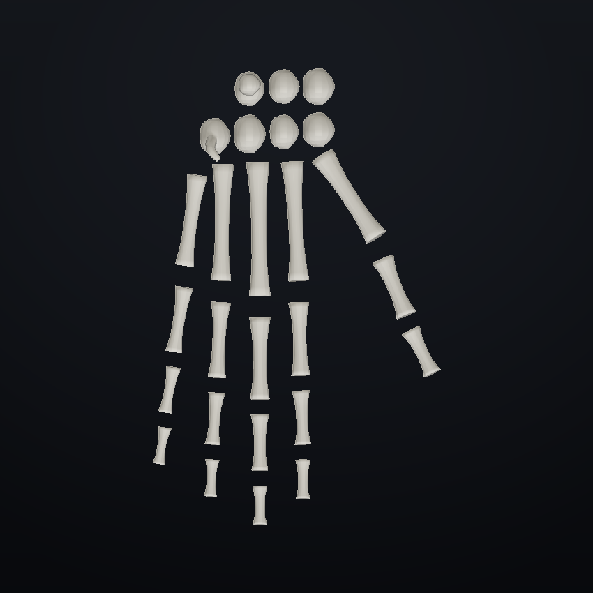
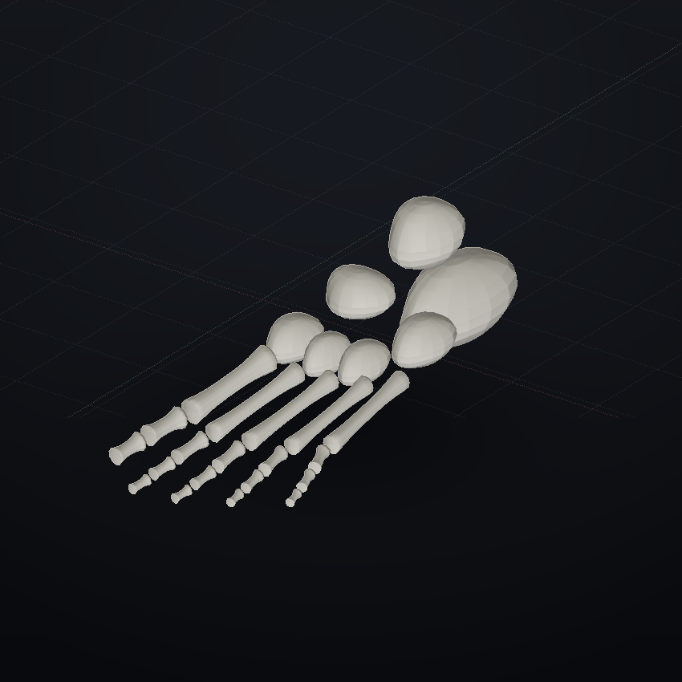

# Оригинальный параметрический скелет — 206 костей



## Что это

`examples/human_skeleton_original.forma` — **новый независимый проект**. Геометрия
создаётся с пустой сцены командой `skeleton_original`: собственные кольцевые сечения,
loft-трубки, изогнутые пластины, SDF-поля и булевы операции Forma. В проекте нет
команды `import`, готовых GLB/OBJ/STL-заготовок или координат, извлечённых из чужих
моделей. Прежний `human_skeleton.forma` и его адаптированная сторонняя геометрия не
изменялись и не использовались как источник этой сборки.

Это образовательная **параметрическая анатомическая аппроксимация** взрослого человека,
а не аттестованная медицинская модель и не инструмент для клиники или хирургии.
Зубы, хрящи, связки и необязательные сесамовидные кости не входят в стандартный счёт
206 костей. Параметрическая форма не претендует на уровень анатомической модели,
проверенной специалистами.

## Запуск

```forma
скелет = skeleton_original height=1750 color=#d9cfb6
```

* `height` — истинный параметр общего роста 1200…2200 мм: масштабирует каждую кость
  и её объём, а не только рамку просмотра.
* `color` — цвет костного материала.
* Команда создаёт 206 именованных объектов и группу `скелет` для общего материала
  и преобразований. Личные оси объектов следуют канону Forma.
* Канон: верх `+Z`, низ `−Z`, анатомическое право `+X`, лево `−X`, перёд `−Y`, зад `+Y`.

Повторный экспорт и машинный аудит:

```bash
cd forma
PYTHONPATH=. python tools/build_skeleton_original.py
# С перезаписью всех PNG-видов:
PYTHONPATH=. python tools/build_skeleton_original.py --render
```

## Анатомический состав

| Отдел | Костей |
|---|---:|
| Череп | 22 |
| Слуховые косточки | 6 |
| Подъязычная кость | 1 |
| Позвоночный столб, включая крестец и копчик | 26 |
| Рёбра | 24 |
| Грудина | 1 |
| **Осевой скелет** | **80** |
| Плечевые пояса | 4 |
| Плечо/предплечье | 6 |
| Запястья | 16 |
| Пястья | 10 |
| Фаланги кистей | 28 |
| Тазовые кости | 2 |
| Бедро/надколенник/голень | 8 |
| Предплюсны | 14 |
| Плюсны | 10 |
| Фаланги стоп | 28 |
| **Аппендикулярный скелет** | **126** |
| **Всего** | **206** |

Кисти: 54 кости, стопы: 52. На каждом большом пальце кисти и стопы ровно по две
фаланги. Грудина — одна анатомическая кость с тремя разделёнными костными частями,
поэтому вся сборка содержит 208 связных частей при 206 анатомических костях.

## Фактическая проверка этой сборки

* 206 объектов, **185 998 треугольников**, 93 309 исходных вершин Manifold.
* Общий рост: 1750 мм; GLB: 206 meshes и 206 nodes с meshes, 5 160 256 байт.
* **16/16 проверок**, записанных непосредственно в `.forma`.
* Все кости имеют `NoError`, положительный объём и ожидаемое число связных частей.
* Попарный аудит после AABB-отбора: **0 пересечений объёмом более 1 мм³**.
* Повторное открытие GLB в тесте: 206 геометрий; после сварки служебных
  UV/normals-дубликатов все сетки замкнуты и имеют согласованную ориентацию.
* Проверены фронтальный, задний, правый боковой и изометрический виды, а также
  увеличенные череп, таз, кисть и стопа.
* SHA-256 GLB: `7daad4f11c9b4d70a476b17ea717bf3e26adbbfdb6cc33ce4ed97a7532bdc47a`.

Машиночитаемый отчёт: `examples/assets/human_skeleton_original.audit.json`.
Автотесты: `tests/test_skeleton_original.py` (7 тестов, включая полный состав,
отсутствие пересечений, истинный рост, отсутствие mesh-import и повторное открытие GLB).

## Увеличенные виды

| Череп | Таз |
|---|---|
|  |  |

| Кисть | Стопа |
|---|---|
|  |  |

В каталоге `docs/human_skeleton_original/` также находятся отдельные полноразмерные
`front`, `back`, `right`, `iso` и изометрия черепа.
