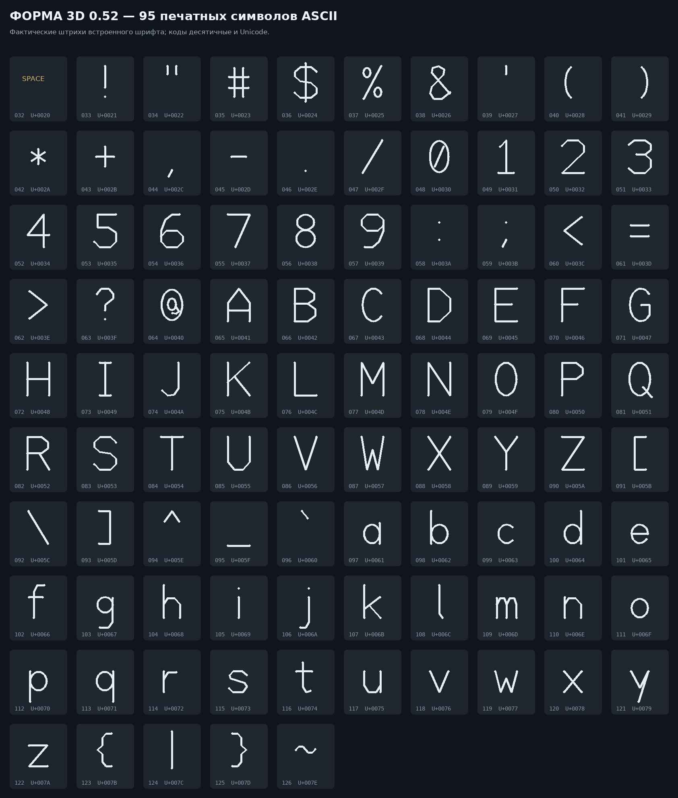

# Форма 0.52 — группы, копии, интерьер и первый уровень ткани

Канон неизменен: верх `+Z`, низ `−Z`, право `+X`, лево `−X`, перед `−Y`, зад `+Y`. Размеры — миллиметры. Все составные команды создают обычные тела Forma с независимыми именами, материалами и параметрами в исходной строке.

## Группы

`group` теперь работает с обычными преобразованиями. Имена и материалы членов сохраняются, тела не объединяются:

```forma
a = box size=[30,20,10] color=#b54d3e
b = cylinder radius=8 height=35 at=[40,0,0] color=#d1b05c
g = group [a,b]
translate [g] offset=[0,30,0]
# Для группы обе следующие команды используют общий центр AABB:
rotate [g] angle=25
scale [g] factor=1.2
```

Для `rotate` и `scale` общий pivot по умолчанию — центр общего AABB группы. Явный `pivot=[x,y,z]` имеет приоритет. Присваивание при преобразовании группы не нужно. Это именно групповое поведение: у одиночной детали прежний pivot по умолчанию `[0,0,0]` не изменился.

Составные интерьерные команды используют иерархию имён. `door` перемещает всю дверь, а `door.leaf` — только полотно, филёнки, ручку и замок. Для открывания укажите мировую точку оси петель; локальная исходная точка хранится в `door.meta.hinge_pivot_local` и по умолчанию находится на левом переднем ребре полотна.

## Отдельные копии: array и scatter

Прежнее поведение сохранено: одиночный `array`/`scatter` по умолчанию объединяет результат. Новый режим `as=objects` создаёт группу отдельных копий `name_001`, `name_002`, …; у каждой сохраняются исходные материал и возможность редактирования.

### Упаковка в ряд

```forma
a = box size=[12,24,35] color=#a54337
b = box size=[16,24,42] color=#315f7d
стол = box size=[180,45,3] at=[0,0,0]
ряд = array [a,b] mode=pack on=стол axis=x count=8 gap=1 inset=3 sequence=loop justify=center align=bottom scale=[0.9,1.1] turn=4 seed=7 as=objects
```

- `on` берёт область и опору из габарита хозяина; `length` может задать её вручную.
- `gap` гарантирует зазор между последовательными AABB копий. Если заданный `count` не помещается, команда честно сообщает об этом. Без `count` режим заполняет доступную длину, не превышая 400 копий.
- `sequence=loop|random` работает для нескольких прототипов.
- `align=bottom|center|none`, `justify=start|center|end`, `inset`, `scale=[min,max]`, `turn`, `seed` и `at` сохраняются в строке.

### Разброс

```forma
a = rock size=[12,9,7] color=#746e67
b = box size=[5,5,12] color=#65805a
опора = box size=[160,120,4]
предметы = scatter [a,b] on=опора count=18 gap=0.5 inset=5 sequence=random scale=[0.8,1.3] turn=360 seed=12 as=objects
```

`gap` включает отбор без пересечений: `gap=0` запрещает наложения консервативных XY-радиусов, положительное значение добавляет зазор. `on=хозяин` автоматически задаёт область и высоту верхней грани; `align=bottom` ставит копии низом. Невозможность разместить заданное число — ошибка, а не молчаливое уменьшение `count`.

## Пакетный отчёт пересечений

```forma
interference tolerance=0.01 allow="door.*:wall,table.*:floor" limit=100
interference [группа_1,группа_2] parts=да
```

Без аргументов проверяются все видимые объекты. Сначала выполняется AABB-отбор, затем точный `Manifold` intersection кандидатов. В `Scene.interferences` и payload попадают имена пары, объём в мм³, AABB контакта, число кандидатов и разрешённых пар.

- `allow="a:b,c:d"` поддерживает маски `*`.
- По умолчанию пары с общим корнем имени (`table` и `table.leg_01`) пропускаются как штатные контакты сборки; `parts=да` включает их проверку.
- `tolerance` — минимальный объём, а не допуск по расстоянию.
- Отчёт выполняется только по требованию, не тормозит каждое построение и включается в «Проверки» и копируемый текст. Щелчок по паре подсвечивает обе детали.

## Стол

```forma
стол = table width=180 length=100 height=75 thickness=5 shape=rounded corner=10 round=0.8 legs=4 layout=inset inset=12 leg_shape=tapered leg_radius=4 taper=0.65 splay=4 shelf=да shelf_height=20 shelf_scale=0.9
```

Формы столешницы: `rect`, `rounded`, `ellipse`. Раскладки: `corners`, `inset`, `circle`, `pedestal`. Ножки: `round`, `square`, `tapered`. Результат: корень `table`, `table.leg_01`, … и необязательная `table.shelf`.

`top_object=имя` и `leg_object=имя` используют пользовательские прототипы. Их геометрия остаётся отдельной; исходный прототип скрывается так же, как при других операциях копирования.

## Дверь

```forma
door = door width=90 height=210 thickness=4.5 frame=5 gap=0.6 panels=4 columns=2 panel_depth=0.5 hinges=3 handle_height=105 lock=да
rotate [door.leaf] angle=35 axis=z pivot=[-44.4,-2.25,0]
```

Отдельны коробка, полотно, каждая филёнка, каждая петля, части ручки и замок с настоящим отверстием. Лицо двери — `−Y`, петли слева `−X`, ось петель вертикальна.

## Штора

```forma
штора = curtain width=140 height=220 folds=8 fold_depth=7 thickness=0.18 wave=2 billow=1.5 detail=8 rows=28 rod=да rings=да
```

Складки являются объёмной геометрией, а не нормалями или плоской текстурой. У ткани есть две стороны, торцы и толщина. Карниз и кольца — отдельные детали. `detail` ограничен 4…16 сегментами на складку, `rows` — 4…80.

## Драпировка: рабочий первый уровень

```forma
ткань = box size=[140,110,0.4] at=[0,0,35]
опора = box size=[90,70,20] at=[0,0,0]
скатерть = drape [ткань] on=опора detail=24 iterations=60 constraints=8 stiffness=0.9 bend=0.12 damping=0.86 gravity=0.25 pin=none gap=0.05 thickness=0.25
```

Это не `shrinkwrap`: верхняя сетка исходной детали подразбивается, интегрируется гравитация, сохраняются длины структурных рёбер, добавляется слабое изгибное ограничение, работают закрепления и контакт. Контакт выполняется внутри итераций сохранения длин; скорость контактных узлов гасится.

- `pin=none|corners|edges|front|back|left|right`; дополнительно `pins=[[x,y,z],…]` и `pin_radius`.
- `on` принимает опору или список опор; `z` задаёт нижнюю плоскость.
- `meta.cloth` хранит число узлов, закреплений, свободных узлов, контактов и максимальную ошибку длин.
- Штатные `detail=24`, `iterations=60`, `constraints=8` — разумный первый уровень. Плотная сетка на остром крае требует больше проходов и времени.

**Границы уровня:** контакт — вертикальная высотная карта верхней поверхности. Сложные поднутрения, трение по настоящей боковой физике и самопересечения ткани не моделируются. Команда не выдаёт себя за полноценный cloth-решатель.

## Ковёр

```forma
ковёр = rug width=180 length=120 shape=rounded corner=12 thickness=1.2 pad=0.25 border=8 pattern=полосы pattern_size=3 pattern_step=10 wave=0.35 lift=6 lift_corner=front_right binding=0.35 stitches=да fringe=ends fringe_length=8 fringe_count=24 detail=64 rings=10
```

Основа деформируется настоящей сеткой. Отдельно создаются подложка, кайма, окантовка, стежки и бахрома. Узор — экспортируемая окраска верхних граней, а не тысячи объёмных фигур. `detail≤128`, `rings≤16`, `fringe_count≤80`, число стежков≤160.

## Розетка, выключатель, лампочка

```forma
розетка = socket sockets=2 pitch=72 holes=6 pin_pitch=19 ground=да screws=да
выключатель = switch rockers=2 state=on angle=7 led=да screws=да
лампа = bulb shape=a60 base=E27 diameter=60 height=110 glass_wall=0.6 thread=да glow=да glow_color=#ffd7a0 glow_strength=3
```

У розетки отверстия проходят и через вставки, и через пластину. У выключателя клавиши находятся в настоящих вырезах, а `state` меняет наклон геометрии. У лампочки доступны `a60`, `globe`, `candle`, `tube`, `pear`, цоколи `E27`/`E14`, полое стекло с внутренней поверхностью, отдельные цоколь, контакт, изолятор, спиральная резьба и светящийся элемент. `thread=нет` — честный упрощённый гладкий цоколь.

## Текст: полный печатный ASCII-набор

Существующий `text` теперь имеет контуры всех **95 печатных символов U+0020…U+007E**. Это включает обе кавычки, апостроф, обратный апостроф, `\`, `|`, скобки и знаки препинания. Пробел корректно остаётся пустым; остальные 94 знака дают непустое замкнутое тело с положительным объёмом. Строчные латинские буквы имеют собственные формы, а не уменьшенные прописные.

Для спецсимволов используется обычное экранирование строк DSL; карточка «Надпись» выполняет его через `JSON.stringify` и не обрезает ведущие/конечные пробелы:

```forma
знак = text "A \\ \"B\" `C` | # $ % & ~" size=12 depth=1.2 weight=0.35 plane=xy
```

Проверяются не только успешные статусы: `tests/test_text_ascii.py` строит каждый знак отдельно, проверяет конечную тесселяцию, объём, различие строчных/прописных форм и roundtrip всей ASCII-строки через parser. Браузерный сценарий дополнительно вводит все 95 символов через редактор и поле карточки.



Геометрический и кириллический контрольные листы: [text_geometry_052.png](text_geometry_052.png), [text_cyrillic_052.png](text_cyrillic_052.png). Все три атласа воспроизводятся командой `PYTHONPATH=forma python forma/docs/make_text_ascii_052.py`.

## Пересобранная гостиная

`examples/living_room_diorama.forma` применяет новые команды вместе с существующими `lathe`, `sweep`, `oval`, `torus`, `leaf`, `sphere`, `text`, `difference`, группами и массивами. В сцене 233 видимых объекта и 94 608 исходных треугольников. Неожиданные пересечения и наложения каркаса книжного шкафа отсутствуют; дверной и оконный проёмы проверены объёмными зондами с нулевым остатком.

Исходник, состав сцены, воспроизводимый генератор и точные проверки: [living_room_diorama.md](living_room_diorama.md). Регресс `tests/test_living_room_052.py` также повторно открывает GLB независимым импортёром `trimesh`; запуск Blender в этой среде не заявляется.
