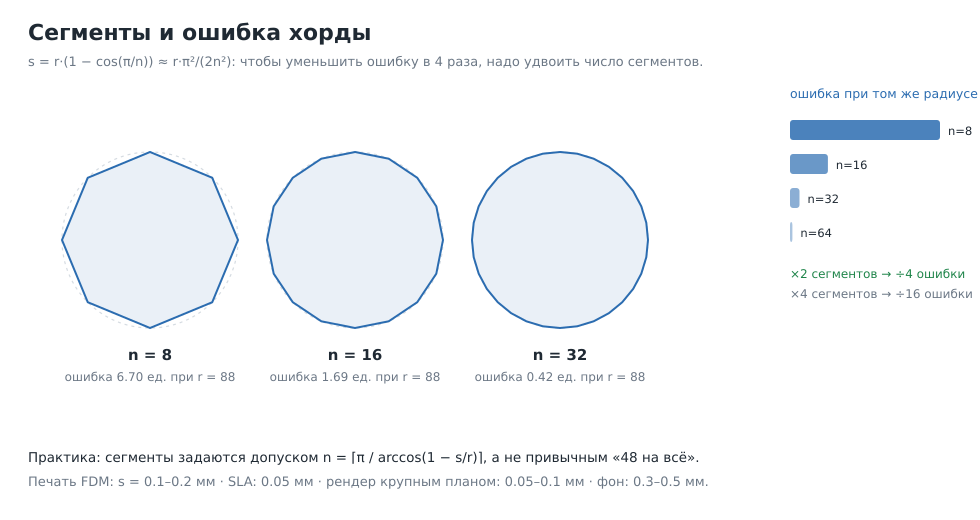

# Экономия полигонов без потери качества: общие правила

> Часть серии: [индекс всех документов и инструментов](topology_index.md).

Не про персонажей, а про всё: посуду, мебель, технику, архитектуру, органика,
печать. Правила выведены из геометрии, а не из вкуса, поэтому их можно
запрограммировать.

---

## 1. Главный закон: ошибка квадратична, полигоны линейны



Хорда дуги радиуса `r`, разбитой на `n` сегментов, отступает от дуги на

```
s = r · (1 − cos(π / n))  ≈  r · π² / (2 n²)
```

То есть **чтобы уменьшить ошибку в 4 раза, надо удвоить число сегментов** (в 2
раза больше треугольников). Уменьшить ошибку в 16 раз — вчетверо больше
полигонов.

Проверено численно: 24 → 48 сегментов даёт отношение ошибок 3.996.

Обратная формула — сколько сегментов нужно при допуске `s`:

```
n = ⌈ π / arccos(1 − s/r) ⌉
```

| Радиус, мм | s = 0.05 | s = 0.1 | s = 0.2 | s = 0.5 |
|---:|---:|---:|---:|---:|
| 10 | 32 | 23 | 16 | 10 |
| 25 | 50 | 36 | 25 | 16 |
| 50 | 71 | 50 | 36 | 23 |
| 100 | 100 | 71 | 50 | 32 |

**Вывод для приложения:** `segments` нельзя держать константой «48 на всё». Для
кружки радиусом 40 мм при допуске 0.2 мм достаточно 29 сегментов; 48 — это в 1.65
раза больше полигонов за ошибку, которую глаз не видит. И наоборот: для
скульптуры радиусом 5 мм 48 — это мало.

Допуск выбирается по назначению:

| Назначение | Допуск хорды | Почему |
|---|---|---|
| Печать FDM | 0.1–0.2 мм | слой 0.1–0.3 мм; точнее станок не сделает |
| Печать SLA | 0.05 мм | слой 0.05 мм |
| Рендер крупным планом | 0.05–0.1 мм на габарите ≤ 200 мм | видно на 1000 px |
| Рендер/фон | 0.3–0.5 мм | разница меньше пикселя |
| Game-ready | 0.2–0.5 мм плюс LOD | силуэт важнее поверхности |

---

## 2. Тратить полигоны на кривизну, а не на площадь

Плоская панель 500 × 500 мм стоит 2 треугольника, если её не будут гнуть.
Цилиндр радиусом 20 мм — уже 25 сегментов, чтобы край не был гранёным.

Практическое правило: **плотность обратно пропорциональна радиусу кривизны**.
Именно это делает `Manifold.refine_to_tolerance(tolerance)`: он дробит рёбра,
исходя из отклонения от гладкой поверхности по касательным, — то есть сам
сгущает там, где криво, и не трогает плоскости.

Что должно происходить автоматически:

1. после генерации — `refine_to_tolerance(0.2)` вместо `refine(2)` на всё;
2. после — `set_tolerance(0.05)`, который схлопывает рёбра короче допуска и
   сливает копланарные треугольники (у `Manifold` это описано прямо: «треугольники,
   копланарные в пределах допуска, сливаются, рёбра короче допуска — схлопываются»);
3. проверить, что разброс длин рёбер `p95 / p5` не вырос.

Пример экономии: у кружки сейчас 41 248 треугольников и 78 % вытянутых граней.
Плоские области дна и стенки при допуске 0.05 мм схлопываются почти полностью;
ожидаемый результат — 8–15 тыс. треугольников при той же форме.

---

## 3. Девять приёмов, которые дают больше всего

### 3.1 Силуэт решает, остальное — текстура

Если деталь не меняет силуэт (швы, гравировка, фаска 0.1 мм, поры), её место в
normal map / roughness / bump, а не в геометрии. Исключение — печать: там
текстуры не существует, поэтому мелкая деталь либо геометрия, либо её нет.

Проверка «на пиксель»: отрендерить объект высотой 96 px и сравнить с версией без
детали. Если разницы нет — деталь лишняя для этого класса объектов.

### 3.2 Одна фаска вместо трёх

`chamfer`/`bevel` из 1 сегмента убивает «мыло» на ребре почти так же, как из 3.
Дорогие сегменты нужны только там, где на фаске лежит блик крупным планом.
Правило: 1 сегмент — до 3 мм, 2–3 — на геройных кромках.

### 3.3 Кратность сегментов у соседних деталей

Если цилиндр входит в отверстие, у обоих должно быть одинаковое число сегментов
(или кратное), иначе на стыке появятся иглы и зубчатый шов. Это дешевле, чем
потом чинить булевой операцией.

### 3.4 Удалять внутренние поверхности сваркой

Две детали, воткнутые друг в друга, дают скрытые грани внутри объёма. `union` /
`weld` / `fuse` убирают их и заодно уменьшают число оболочек. Для печати это
важно: слайсер иначе «видит» внутренние стенки.

Исключение — намеренные технологические вхождения (посадки, зазоры): их нельзя
сливать, иначе пропадёт подвижность.

### 3.5 Дробление только под инструмент

`refine` нужен, когда мелкий инструмент (`dent`, `складка`, `emboss`) ложится на
крупную сетку и край выходит гранёным. Дробить всю деталь «на всякий случай» —
самая частая потеря полигонов. Правило: длина ребра ≤ 1/3 размера инструмента.

### 3.6 Одинаковые детали — копии, а не пересборка

`array`, `group`, `scatter` переиспользуют одну геометрию. В файле это либо
инстансы, либо (в glTF) общие меши; пересобирать 40 одинаковых винтов отдельными
операциями — 40× работы и 40× полигонов.

### 3.7 LOD строится по экранному размеру

Три уровня: 100 %, 50 %, 12–25 % треугольников. Критерий — не «сколько не жалко»,
а «на каком расстоянии объект занимает сколько пикселей». Уровень допустим, если
на целевом размере силуэт не изменился.

### 3.8 Сглаживание вместо плотности

Фасетка на изогнутой поверхности лечится не всегда полигонами: правильный угол
сглаживания (crease angle 30–40°) и сглаженные нормали убирают «лесенку» почти
бесплатно. Обратная сторона: на силуэте сглаживание не помогает — там нужны
сегменты.

### 3.9 Порог «мусорного» размера

Всё, что меньше 0.05 мм по ребру и 0.001 мм² по площади, — мусор: схлопывать.
Именно такие элементы дают разброс длин рёбер ×30 000 и ×600 000 (наши замеры на
`plant_pot` и `мостик_колёс`) и ломают UV.

---

## 4. Бюджеты, которые можно вписать в код

| Класс объекта | Треугольники | Комментарий |
|---|---:|---|
| Мелкий реквизит (кнопка, винт) | 200–2 000 | силуэт простой |
| Обычный предмет (кружка, ваза, лампа) | 3 000–20 000 | после схлопывания плоскостей |
| Сложная техника (часы, камера) | 20 000–80 000 | много деталей, мало кривизны |
| Мебель | 5 000–40 000 | прямые панели почти бесплатны |
| Геройная органика (лицо, скульптура) | 40 000–150 000 | только если крупный план |
| Окружение / фон | 1 000–10 000 | LOD-уровень 2 |
| Печать (на деталь) | 20 000–200 000 | ограничение — не полигоны, а время слайсера |

Дополнительные пороги, которые стоит проверять автоматически:

* медиана длины ребра в диапазоне 0.3–2.0 мм для предметов 50–300 мм;
* `p95 / p5` длин рёбер ≤ 8 (иначе «волны» при подразбиении);
* доля игл на изгибе ≤ 0.2 % площади;
* доля вытянутых (aspect > 10) ≤ 10 %;
* минимальная длина ребра ≥ 0.05 мм;
* отношение площадей соседних граней ≤ 4.

---

## 5. Частные, но дорогие случаи

**Текст и гравировка.** Каждый глиф — отдельное тело; при 40 символах это 40
оболочек и десятки тысяч треугольников. Экономия: высота рельефа 0.3–0.6 мм,
`refine` только по контуру, `set_tolerance(0.02)` после, шрифт без засечек при
малом кегле.

**Резьба и накатка.** Настоящая винтовая резьба — это тысячи треугольников на
виток. Для дальнего плана хватает 1–2 витков геометрией и текстуры; для печати
резьба нужна настоящая, но шаг и число витков ограничивают бюджетом.

**Органика из SDF.** `blob`/`from_sdf` дают равномерную сетку по всему объёму:
и на плоском, и на мелком. После них обязательны `set_tolerance` (схлопывание
лишнего) и `simplify` с допуском — иначе файл в 2–3 раза тяжелее нужного.

**Сборки из сотен деталей.** Экономия не в отдельных мешах, а в:
* общих материалах (меньше draw call);
* инстансах повторяющихся деталей;
* удалении невидимых граней (тыльные стороны, стыки);
* LOD для дальних групп.

**Печать.** Здесь «больше полигонов» не значит «лучше»: слайсер всё равно
пересчитывает модель в слои. Целевая точность — половина слоя, дальше геометрия
работает против вас (время, размер файла, риск артефактов).

---

## 6. Что мерить, чтобы экономить осознанно

| Метрика | Как считать | Норма |
|---|---|---|
| Треугольники на объект | `num_tri()` | по таблице §4 |
| Треугольники на см² поверхности | `tris / area_cm²` | 50–400 для криволинейных, < 20 для панелей |
| Медиана длины ребра | `p50` по рёбрам | 0.5–1.5 мм для предметов |
| Разброс длин | `p95 / p5` | ≤ 8 |
| Доля игл | min-угол < 3° | ≤ 2 % всех, ≤ 0.2 % площади на изгибе |
| Вытянутые | aspect > 10 | ≤ 10 % |
| Копланарные пары | угол < 0.5° | должны быть схлопнуты |
| Оболочки | `decompose()` | столько, сколько деталей по замыслу |

Все восемь метрик считаются одним проходом по массивам вершин и граней — это
часть `topology_report`, см. `topology_autofix_spec.md`.

---

## 7. Пять фраз, которые стоит вшить в инструкцию нейросети

1. Плотность задаётся допуском (`refine length=`), а не привычкой.
2. Плоское — схлопывай, кривое — дроби по допуску.
3. Мелкая деталь, не меняющая силуэт, — текстура, а не геометрия.
4. Соседние детали — одинаковое число сегментов.
5. Сначала силуэт на 96 px, потом полигоны.
