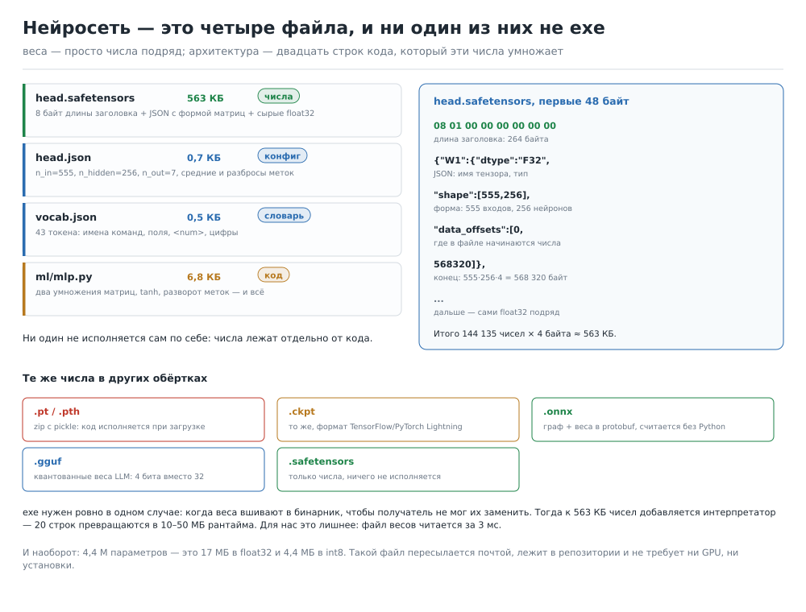
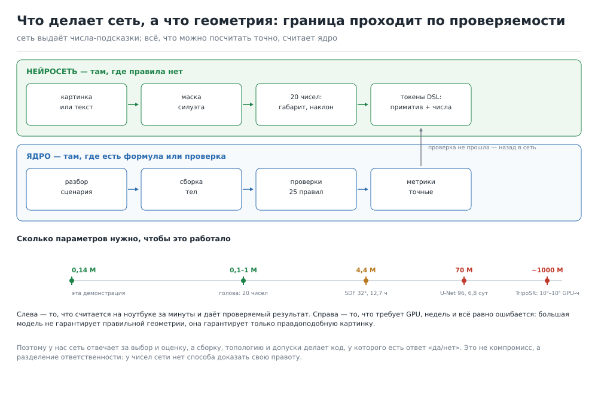

# Нейросеть ФОРМЫ: из чего она состоит физически

Документ отвечает на четыре вопроса без общих слов:

1. Что такое «голова» и правда ли, что сеть — это «просто числа и веса».
2. **В каких файлах живёт нейросеть** — exe, txt или что-то ещё, и почему.
3. Как она строится: от сцены в DSL до матрицы 555×256 и обратно.
4. Сможем ли мы сделать сеть, которая понимает и создаёт 3D-модели,
   «мыслит примитивами» и умеет их менять и описывать — с честной границей.

Всё, что ниже, **не пересказ статей, а прогон кода из этого репозитория**.
Команда одна:

```bash
cd forma
python ml/demo.py --scenes 800 --epochs 400
```

Она за 41 секунду на двух ядрах строит датасет, обучает сеть, пишет файл
весов и печатает всё, о чём здесь написано. Числа в документе — вывод именно
этого прогона.



---

## 1. «Голова» — это последний слой, а не отдельная сеть

Слово «голова» (head) путает, потому что звучит как «ещё одна нейросеть».
По факту это **последняя матрица** в общей сети плюс своя функция ошибки:

```
вход → [общий ствол: слои, которые видят все задачи] → [голова 1] → 20 чисел
                                                     → [голова 2] → карта 32×32×32
                                                     → [голова 3] → одно число 0..1
```

Ствол считается один раз. Головы — это развилка в конце: у каждой своя
матрица `n × k` и свой смысл выхода. Поэтому «добавить голову» — это не
«написать вторую сеть», а «добавить 20 строк и один слой», и обучаются они
часто вместе, потому что ствол им нужен одинаковый.

Три головы из плана (`own_engine_and_model.md`, §7.5):

| Голова | Вход | Выход | Параметров | Что проверяет |
|---|---|---|---|---|
| Габарит и камера | маска 256×256 | 20 чисел: 3 размера, 3 угла, 2 сдвига, 12 кромок | 0,1–1 M | `iou`, `deviation` по сетке |
| SDF-подсказка | маска 128×128 | поле 32³ (грубая форма) | 4,4 M | `deviation` < 1 мм после `from_sdf` |
| Критика | маска + метрики | число «похоже / нет» | 0,5–2 M | согласие с `iou` > 90 % |

Первые две головы сидят на одном стволе (U-Net-lite), третья — на мелком
своём: ей нужны не пиксели, а сводка метрик.

### «Это просто числа и веса?»

Да, и это не упрощение. В обученной сети **все знания — в числах**:

* архитектура (что складывать и в каком порядке) — это код, около 20 строк;
* веса (чему научились) — это числа, файл;
* функция ошибки (что считается «правильно») — это тоже код, и она
  определяет, чему сеть вообще может научиться.

Меняете файл весов — меняется поведение. Меняете код — меняется класс
поведения, который вообще возможен. Никакого третьего компонента нет:
ни «базы знаний», ни «понимания» внутри файла.

---

## 2. В каких файлах живёт нейросеть

Наша демонстрационная сеть — это четыре файла, **ни один из них не exe**:

| Файл | Размер | Что внутри | Кто читает |
|---|---|---|---|
| `ml/weights/head.safetensors` | 563,3 КБ | только числа: 144 135 float32 | `load_safetensors()` |
| `ml/weights/head.json` | 0,7 КБ | `n_in=555, n_hidden=256, n_out=7`, средние и разбросы меток, версия | `MLP.load()` |
| `ml/weights/vocab.json` | 0,5 КБ | 43 токена словаря | `Tokenizer.load()` |
| `ml/mlp.py` | ≈7 КБ | 20 строк арифметики, которые эти числа умножают | Python |

Плюс `report.json` — отчёт об обучении (ошибки, время, размеры). Он сети не
нужен, это журнал.

### Что именно лежит в `.safetensors`

Реальные первые 96 байт файла из прогона:

```
0000  08 01 00 00 00 00 00 00 7b 22 57 31 22 3a 7b 22
0010  64 74 79 70 65 22 3a 22 46 33 32 22 2c 22 73 68
0020  61 70 65 22 3a 5b 35 35 35 2c 32 35 36 5d 2c 22
0030  64 61 74 61 5f 6f 66 66 73 65 74 73 22 3a 5b 30
0040  2c 35 36 38 33 32 30 5d 7d 2c 22 62 31 22 3a 7b
0050  22 64 74 79 70 65 22 3a 22 46 33 32 22 2c 22 73
```

Разбор по байтам:

| Байты | Что это | Значение |
|---|---|---|
| 0–7 | длина заголовка, little-endian u64 | `08 01 …` = 264 байта |
| 8–271 | JSON-заголовок | `{"W1":{"dtype":"F32","shape":[555,256],"data_offsets":[0,568320]}, "b1":{…}, "W2":{…}, "b2":{…}}` |
| 272… | сырые float32 подряд | 555·256·4 = 568 320 байт для `W1`, дальше `b1`, `W2`, `b2` |

То есть **файл весов — это таблица умножения, записанная подряд**, с
оглавлением из 264 байт. Ни команд, ни кода, ни сжатия. Открывается
`xxd`, читается `numpy.frombuffer` за 11 мс.

Формат не наш: это [safetensors](https://github.com/huggingface/safetensors)
— то же, чем лежат веса на Hugging Face. Смысл ровно один: в отличие от
`pickle`, такой файл **ничего не исполняет при загрузке** и читается
отображением в память.

### Почему exe не обязателен

Потому что «сеть» — это данные плюс интерпретатор. Интерпретатор у нас уже
есть — это Python и numpy. Вот весь прямой проход из `ml/mlp.py`:

```python
def forward(self, x):
    z = x @ p["W1"] + p["b1"]     # 555×256 умножений
    h = np.tanh(z)                # сглаживание
    y = h @ p["W2"] + p["b2"]     # 256×7
    return y
```

Две матрицы, одна нелинейность. У большой модели (GPT, TripoSR) таких
блоков сотни, но природа та же: умножение, сложение, нелинейность.
exe нужен ровно в одном случае — когда хотят **вшить веса в бинарник**,
чтобы получатель не мог их заменить. Тогда к 563 КБ чисел добавляется
10–50 МБ рантайма, а выигрыш — только в защите от правки. Нам это не нужно:
файл читается 11 мс, и его видно в репозитории целиком.

### Чем отличаются форматы, которые все путают

| Расширение | Что физически внутри | Нужен ли Python | Где встречается |
|---|---|---|---|
| `.pt`, `.pth` | zip с `pickle`: при загрузке **исполняется код** | да (PyTorch) | учебники, чекпойнты |
| `.ckpt` | то же, формат TensorFlow / Lightning | да | исследовательский код |
| `.safetensors` | 8 байт + JSON + сырые числа, ничего не исполняется | нет, хватит numpy | Hugging Face, наши веса |
| `.onnx` | [protobuf](https://github.com/onnx/onnx): граф операций + веса | **нет** | запуск в C++/C#/браузере |
| `.gguf` | [один файл](https://github.com/ggerganov/ggml/blob/master/docs/gguf.md): метаданные + квантованные веса | нет (llama.cpp) | локальные LLM |
| `.h5`, SavedModel | граф + веса в иерархии | да (TF/Keras) | старые проекты |

Практический вывод для нас: **обучаем в чём угодно, отдаём в `.onnx`**.
ONNX — это те же числа плюс описание операций, и его считает C++ рантайм
без Python. Именно так сеть попадает в приложение: 17 МБ файла рядом с
`forma.exe`, 45 мс на кадр, без интернета и без установки PyTorch.

Слова «модель» и «веса» в индустрии означают разное, и это главная путаница:

* **веса** — файл чисел (`head.safetensors`);
* **чекпойнт** — веса + состояние оптимизатора, чтобы продолжить обучение;
* **модель** — веса + код, который знает их форму (у нас `mlp.py`);
* **архитектура** — только код, без чисел.

Один и тот же `head.safetensors` с другим кодом — другая модель. Одни и те
же 563 КБ с другим обучением — другие числа в том же файле.

---

## 3. Как она строится: шесть шагов с числами

### Шаг 1. Данные делает ядро, а не человек

`ml/synth.py` берёт таблицу примитивов с их настоящими параметрами
(`box size`, `cylinder radius/height`, `torus outer/inner`, `washer`,
`prism sides/radius`, `pyramid`, `cone`, `sphere`, `sheet`), случайно
собирает сцену из 1–3 тел, отдаёт её в `build()` и забирает **точные**
метки из `r.analysis["metrics"]`.

| Что | Число |
|---|---|
| сцен | 800 |
| время сборки сцены | 45 мс |
| весь датасет | 36 с на 2 ядрах |
| годных сцен | 800 из 800 (генератор перевыбирает параметры при ошибке) |
| объём текста | 83 КБ |

Метки — семь чисел на сцену: `log10` объёма в мм³, род (число отверстий),
число деталей, `log10` треугольников, габариты X/Y/Z. Логарифмы нужны
потому что объём меняется от 10² до 10⁶ мм³: без них сеть училась бы только
большим деталям.

Главное свойство: **метки бесплатные и точные**. Это и есть причина, по
которой своя геометрия важнее своей сети — она производит данные.

### Шаг 2. Текст → токены

`ml/tokenizer.py` режет сценарий регуляркой:

```
o0 = box size=[30,20,10] center=да at=[0,0,0]
→ o0 = box size = [ 30 , 20 , 10 ] center = да at = [ 0 , 0 , 0 ]
→ числа заменяются на <num> + отдельные цифры: <num> 3 0 , <num> 2 0 …
```

Словарь — 43 токена, и он весь помещается в одну строку:

```
<pad> <unk> <num> \n = , - [ ] 0 1 2 3 4 5 6 7 8 9
at center да radius height sides inner outer thickness width length
o0 o1 o2
box cylinder sphere cone prism pyramid sheet torus washer
```

Девять примитивов, девять полей, три имени объектов, `да`, десять цифр,
шесть знаков и четыре служебных токена. Всё, что не попало в словарь,
превращается в `<unk>`: если ядро получит новую команду, её придётся
добавить в словарь и переобучить голову — это дешёвая операция, но она
ручная. Обратное преобразование проверено тестом: `decode(encode(текст))`
даёт читаемый сценарий, а не кашу.

Размер словаря — это первое место, где видно масштаб: у GPT-2 словарь
50 257 токенов, у нас 43. Наша задача **уже** ограничена языком, который
ядро и так понимает; сети не нужно учить русский язык, ей нужно выучить
девять примитивов и их поля.

### Шаг 3. Токены → вектор признаков

Просто «мешок слов» (сколько раз встретился каждый токен) теряет порядок:
`size=[30,20,10]` и `size=[10,20,30]` для него одинаковы, а габариты разные.
Поэтому к 43 частотам добавлены 512 «корзин» для пар соседних токенов
(хеш `a·31+b`):

```
вход = 43 частоты + 512 пар = 555 чисел
```

Это дешёвая замена свёртке по последовательности: параметров становится
больше на 512·256, но порядок начинает учитываться. Полноценное решение —
трансформер с вниманием по 96 позициям (см. §7), и это отдельный разговор
о цене.

### Шаг 4. Матрицы и число параметров

```
x (555) ──W1 555×256──► tanh ──W2 256×7──► 7 чисел
```

| Тензор | Форма | Чисел | Байт |
|---|---|---|---|
| `W1` | 555×256 | 142 080 | 568 320 |
| `b1` | 256 | 256 | 1 024 |
| `W2` | 256×7 | 1 792 | 7 168 |
| `b2` | 7 | 7 | 28 |
| **итого** | | **144 135** | **576 540** байт чисел; файл 576 812 байт с заголовком (563 КБ) |

Инициализация — Ксавье (`sqrt(2/n)`): если начать со случайных чисел
масштаба 1, `tanh` сразу упирается в насыщение, производная равна нулю и
сеть не учится вообще. Это не теория: с неправильной инициализацией
ошибка на проверке стояла на месте все 400 эпох.

### Шаг 5. Обучение: ошибка, производные, Adam

Прямой проход даёт 7 чисел. Считаем средний квадрат разницы с правдой
(метки нормированы: минус среднее, делить на разброс). Дальше — цепное
правило, вручную, без PyTorch:

```
dy  = 2·(y − target)/N          ошибка по выходу
gW2 = hᵀ·dy                     градиент последней матрицы
dh  = dy·W2ᵀ
dz  = dh·(1 − h²)               производная tanh
gW1 = xᵀ·dz                     градиент первой матрицы
```

Шаг — Adam с `lr=3e-3`: он держит свой масштаб для каждого числа, поэтому
не приходится подбирать скорость обучения под слой. Это тот же оптимизатор,
что в больших моделях, только считает numpy на CPU.

| Что | Число |
|---|---|
| эпох | 400 (полный проход по 480 сценам за эпоху) |
| ошибка на проверке | 0,81 на эпохе 0 → 0,22 к 40-й, дальше плато и медленный рост; сохраняется лучшая эпоха |
| время обучения | 5–6 с на 2 ядрах (в отчёте `report.json`: 5,1 с) |
| разбиение | 480 обучение / 160 проверка / 160 тест |

### Шаг 6. Инференс

`predict_text()` читает три файла, кодирует текст и делает два умножения:

| Операция | Время |
|---|---|
| загрузка `head.safetensors` (563 КБ) | 11 мс |
| сам проход, 143 872 умножения | 14 мкс |
| чтение всех файлов на каждый вызов (как в демо) | 3,4 мс |

Вот и весь «искусственный интеллект» по факту: чтение чисел с диска и два
умножения матриц.

---

## 4. Что получилось и как это читать

Тест — 160 сцен, которых сеть **не видела**. Ошибка — средняя абсолютная,
в тех же единицах, что метка (для габаритов — миллиметры).

| Величина | Сеть | Правило без сети | «Предсказывать средним» |
|---|---|---|---|
| log объёма | 0,27 | **0,00** | — |
| род (отверстия) | **0,32** | 0,84 | — |
| частей | 0,30 | **0,19** | — |
| log треугольников | **0,31** | 2,69 | — |
| габарит X | 14,22 | **3,13** | — |
| габарит Y | 14,38 | **3,05** | — |
| габарит Z | 7,58 | **0,19** | — |
| среднее по семи | 5,34 | — | 10,66 |

R² по целям: объём 0,71, род 0,76, части 0,72, треугольники 0,81,
габарит X 0,67, Y 0,66, Z 0,88.

Три живых примера (сеть против движка):

```
box size=[30,20,10]     сеть: объём 4,38  габарит 46,9×45,4×33,2
                        ядро: объём 3,78  габарит 30,0×20,0×10,0

sphere radius=25        сеть: объём 4,20  габарит 39,9×36,6×30,1
                        ядро: объём 4,81  габарит 50,0×50,0×50,0

box 40×40×10 + cylinder сеть: объём 5,46  габарит 85,1×82,9×78,1
                        ядро: объём 4,40  габарит 40,0×40,0×65,0
```

Что этот результат значит честно:

* сеть **выучила структуру** там, где она дискретна: треугольники (R² 0,81),
  отверстия (0,76), число деталей (0,72), порядок величины объёма (0,71) — это
  уже не случайность;
* сеть **плоха в арифметике**: `box 30×20×10` она видит как «коробку
  среднего размера», потому что 480 примеров на 9 примитивов — это по
  50 примеров на примитив, а зависимость габарита от числа внутри строки
  нашей модели приходится выучивать, а не считать;
* **правило бьёт сеть везде, где правило есть**. Разобрать строку и умножить
  три числа — это ноль ошибки и ноль байт весов. Держать сеть на этой
  задаче бессмысленно, и демонстрация это показывает специально:
  `ml/rule.py` — 120 строк, и он точнее на объёме и на габаритах.

Отсюда рабочее правило проекта, а не лозунг:

> Сеть ставим туда, где **нет формулы** (по картинке понять форму, придумать
> сцену, выбрать приём). Где формула есть — работает код, и он же проверяет
> то, что предложила сеть.

Именно поэтому демонстрация полезна: она даёт **число**, а не обещание.
Такую же таблицу можно снять для любой головы до того, как тратить недели
GPU.



---

## 5. «Сможем ли сделать сеть, которая мыслит примитивами»

Короткий ответ: **да, но не так, как это звучит**. Разберём по частям.

### Что значит «мыслить примитивами» на уровне файлов

У нас уже есть язык, в котором модель описывается примитивами: 227 команд
DSL, 1147 алиасов, у каждой команды поля с типами (`forma/ops.py`). «Мыслить
примитивами» означает буквально одно: **сеть выдаёт последовательность
токенов этого языка**, а не вершины и не картинку:

```
сеть → "o0 = box size=[40,40,10] …  o1 = cylinder radius=8 …"
                                  ↓
                          build() → тела, топология, метрики
                                  ↓
                    25 правил проверки → да / нет + причина
```

Достоинство не в красоте: **ошибка сети ограничена словарём**. Если она
выдала `radius`, но забыла `height`, ядро скажет «Неизвестный параметр» или
«Высота капсулы меньше двух радиусов» — и это не «нейросеть ошиблась
непонятно», а конкретная строка с номером. Такую ошибку можно поймать,
перегенерировать и посчитать, сколько раз она повторилась.

Сеть, которая выдаёт меш (как TripoSR), такого не даёт: у неё на выходе
80 тысяч вершин, и «почти правильно» проверить нечем, кроме `deviation`.
Поэтому DSL-выход — не компромисс, а более проверяемая постановка.

### Три задачи, и они очень разной цены

| Задача | Вход → выход | Реалистичный размер | Данные | Железо | Проверка |
|---|---|---|---|---|---|
| Габарит и камера по фото | маска 256² → 20 чисел | 0,1–1 M | синтетика ядра, бесплатно | 39 мин на 4 ядрах | `iou`, наклон < 3° |
| Форма по фото (SDF 32³) | маска 128² → поле 32³ | 4,4 M | синтетика + фото, дни | 12,7 ч (2 job'а) | `deviation` < 1 мм |
| Сцена по описанию (DSL) | текст → токены DSL | 5–20 M (трансформер) | 10⁵–10⁶ сцен, генерируются | дни–недели | сборка + 25 правил |

Первая строка — это то, что стыкуется с уже написанным `forma/vision`
(`fit.py`: `render_mask`, `fit_camera`, `compare_model`, `iou`). Вторая —
то, что честно требует GPU-часов. Третья — самая интересная и самая
дорогая: чтобы сеть придумывала сцены, ей нужно увидеть не 800 сцен, а
сотни тысяч, и «правильность» каждой определяет всё тот же `build()`.

### Где проходит граница по размеру

Числа из `docs/train_budget.py` (4 ядра, КПД 0,5):

| Модель | Параметров | Время обучения | Влезает в лимиты GitHub |
|---|---|---|---|
| наша демонстрация | 0,14 M | 5 с (2 ядра) | да, с запасом |
| голова «20 чисел» | 0,1–1 M | 39 мин | да, один job |
| SDF 32³ | 4,4 M | 12,7 ч | да, 2 job'а по 6 ч |
| U-Net 48 | 17,7 M | 3,8 сут | 15 job'ов, на грани |
| U-Net 96 | 70,7 M | 6,8 сут | 27 job'ов, неудобно |
| TripoSR-класс | сотни миллионов–1 млрд | 10³–10⁵ GPU-часов | нет, только аренда GPU |

Лимиты GitHub Actions: 4 CPU, 16 ГБ, 14 ГБ диска, job ≤ 6 ч, 20 параллельных
job'ов, GPU нет. Значит: **до 5 M параметров** проект обучает сам, бесплатно
и воспроизводимо; **17 M** — уже на пределе; **70 M и больше** — это аренда
GPU, и обещать её «за неделю» нельзя.

### Что вообще не должно быть сетью

Это самая важная часть, потому что именно здесь проекты ломаются:

| Работа | Почему не сеть | Что делает |
|---|---|---|
| Булевы операции (объединение, вычитание) | точная геометрия, ошибка недопустима | `manifold3d` через `build()` |
| Топология (род, замкнутость, самопересечения) | проверяется по числу, а не «на глаз» | 25 правил `analysis["checks"]` |
| Подгонка под фото | оптимизация по 20 числам, сходится за секунды | `fit.py`: `fit_camera`, `iou` |
| Допуски, зазоры, резьба | ГОСТ/ISO, таблицы | `lookup()` и параметры команд |
| Метрики (объём, масса, площадь) | арифметика | `analysis["metrics"]` |
| «Поправить примитив» | одна замена числа в строке | DSL + повторная сборка |

Последняя строка — ответ на «умеет ли менять примитивы». Сеть может
**предложить** правку (`radius 8 → 10`), но применяет её код, и он же
проверяет, что после правки сцена собирается и отверстие не стало меньше
толщины стенки. Если проверка не прошла — откат. «Сеть переписала число
и оно стало неправильным» — это не сценарий, это отсутствие проверки.

### Итог по 3D

* **Понимать примитивы** сеть может уже на 0,1–1 M: распознать, что на фото
  коробка с цилиндром, оценить габарит и наклон. Это проверяется `iou`.
* **Создавать сцены** сеть может на 5–20 M, если разрешить ей выдавать DSL
  и генерировать данные ядром. Это дни обучения, а не часы.
* **Менять и описывать** — не отдельная модель: изменение это правка
  токенов, описание — обратный проход «сцена → текст» (его можно собрать
  шаблоном из `analysis["metrics"]` без сети вообще).
* **«Мыслить» в смысле «понимать физику»** — нет. Сеть не знает, что
  капсула не бывает короче двух радиусов; это знает проверка, и в этом
  смысле надёжность даёт не модель, а код вокруг неё.

---

## 6. Что есть в коде, а чего нет

Есть и работает (проверено прогоном):

* `forma/ml/synth.py` — генератор сцен и меток из ядра, 45 мс на сцену;
* `forma/ml/tokenizer.py` — словарь 43 токена, обратимое кодирование;
* `forma/ml/mlp.py` — сеть на numpy, прямой и обратный проход, Adam,
  запись и чтение `.safetensors` (формат совместим с Hugging Face);
* `forma/ml/train.py` — признаки, разбиение, обучение, оценка MAE/R²;
* `forma/ml/rule.py` — точное правило для сравнения (объём, габарит, род);
* `forma/ml/demo.py` — сквозной прогон за 41 с и печать всех чисел;
* обученные веса в репозитории: `ml/weights/` (563 КБ).

Нет и не обещаю без отдельной работы:

* свёрточной/трансформерной сети (сейчас два полносвязных слоя);
* обучения на реальных фото (только синтетика ядра);
* головы «картинка → сцена» (есть только постановка и бюджет);
* ONNX-экспорта (понадобится, когда появятся свёртки; для MLP хватит
  `numpy`);
* GPU-обучения и проверки на внешних наборах (ShapeNet и подобные).

---

## 7. Как повторить

```bash
cd forma
python -m venv /tmp/fv && /tmp/fv/bin/pip install numpy manifold3d
PYTHONPATH=. /tmp/fv/bin/python ml/demo.py --scenes 800 --epochs 400
```

Время на 2 ядрах: данные 36 с, обучение 6 с, печать 1 с. Файлы появятся в
`forma/ml/data/` (датасет) и `forma/ml/weights/` (веса, конфиг, словарь,
отчёт). Веса воспроизводимы: два прогона подряд с одними и теми же
`--scenes` и `--epochs` дали совпадающие до последнего знака метрики —
порядок сцен фиксируется сидом, а не планировщиком процессов.

---

## 8. Что почитать по существу

1. Формат весов: [safetensors](https://github.com/huggingface/safetensors) —
   спецификация в README, 8 байт + JSON + данные.
2. Граф вместо кода: [ONNX](https://github.com/onnx/onnx) — почему модель
   можно запускать без Python.
3. Квантованные веса одним файлом: [GGUF](https://github.com/ggerganov/ggml/blob/master/docs/gguf.md).
4. Минимальная учебная реализация языковой модели на 10,7 M параметров:
   [nanoGPT](https://github.com/karpathy/nanoGPT) — тот же принцип «числа +
   200 строк», что и у нас, но с вниманием.
5. Бюджет и лимиты обучения — в этом же репозитории:
   `docs/own_engine_and_model.md`, `docs/train_budget.py`.
