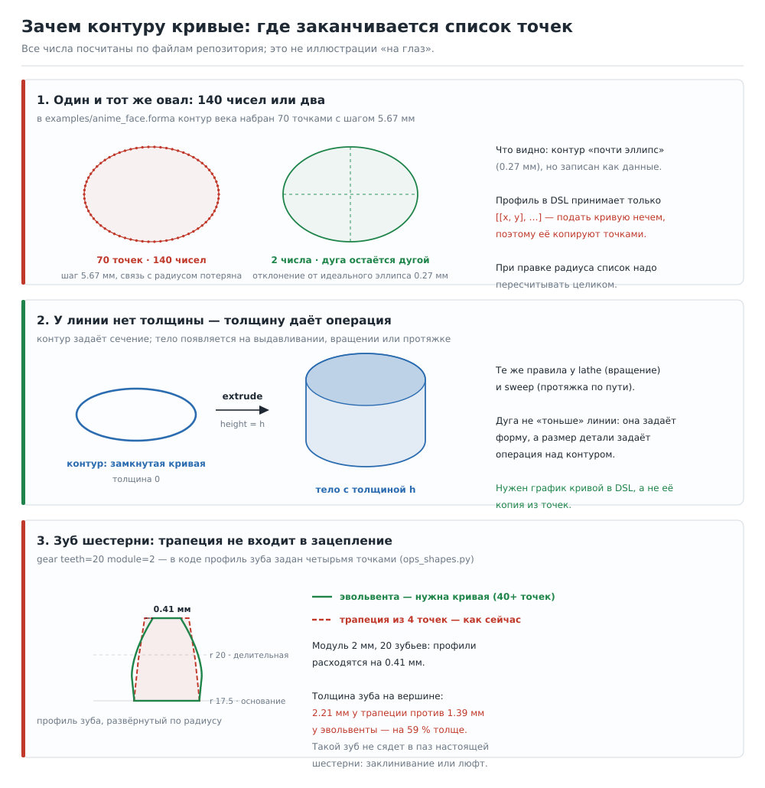
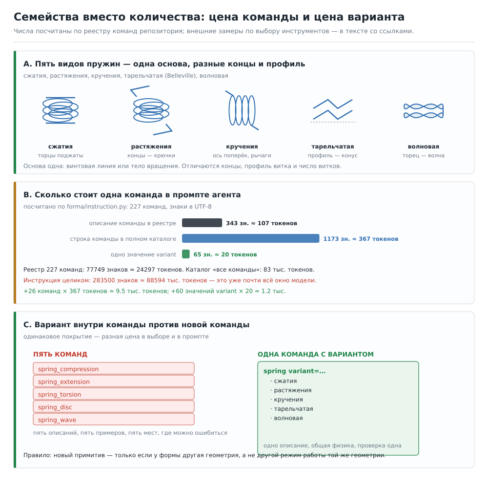

# Контур, пружины, семейства и «зачем математика»: ответы на вопросы к аудиту примитивов

Этот документ отвечает на восемь вопросов к отчёту
[`primitives_gap_analysis.md`](primitives_gap_analysis.md). Где прошлый отчёт был
неточен — это сказано прямо, с исправлением (раздел 8).

Схемы:

* [`img/sketch_curve_why.svg`](img/sketch_curve_why.svg) — почему контуру нужны
  кривые: 70 точек против двух чисел, линия без толщины → тело, зуб шестерни;
* [`img/families_vs_count.svg`](img/families_vs_count.svg) — пять видов пружин;
  сколько знаков и токенов стоит одна команда; вариант против новой команды.

Все числа в схемах и ниже посчитаны по файлам репозитория
(`examples/anime_face.forma`, `forma/ops_shapes.py`, `forma/instruction.py`) —
скрипты `forma/docs/make_sketch_svg.py` и `forma/docs/make_family_svg.py`
считают их при каждой сборке схемы.

---

## 1. Эскиз, дуги и сплайны

### 1.1. Да, это линии без толщины. Толщину даёт операция

Ты прав: кривая в эскизе — одномерный объект, у неё нет толщины. Тело
появляется, когда контур **замыкают** и проводят по нему операцию:

| Операция | Что делает с контуром | Пример |
|---|---|---|
| `extrude` | тянет контур на высоту `height` | пластина, кронштейн, корпус |
| `lathe` | вращает профиль вокруг оси Z | ваза, бутылка, тарелка |
| `sweep` | ведёт профиль по 3D-пути | ручка, поручень, труба по трассе |
| `loft` | соединяет несколько контуров | кузов, лодка, обувь |

Это ровно то, как работает любой САПР: эскиз безразмерный по толщине, размер
даёт операция. Поэтому дуга в эскизе — не «тонкая линия» вместо тела, а
**замена куче чисел, которыми сейчас описывают ту же форму**.



### 1.2. Зачем именно дуги и сплайны: четыре причины, все с числами

**Причина 1 — объём описания.** В `examples/anime_face.forma` контур века
записан 70 точками: 140 чисел, шаг 5.67 мм, а сам контур — почти идеальный
эллипс (отклонение от идеального эллипса 0.27 мм). Два числа (полуоси) дают ту
же форму: 140 → 2. Сейчас профиль в DSL принимает только `[[x, y], …]`, то есть
кривую физически нечем подать, её копируют точками.

**Причина 2 — правка.** Когда клиент говорит «радиус скругления 8, а не 6»,
с точками надо пересчитать весь список (70 точек на каждую правку). С дугой
меняется одно число, форма пересчитывается сама. Это же и есть «редактируемая
форма», о которой говорит ваш собственный промпт для ИИ.

**Причина 3 — экономия там, где сейчас особенно дорого.** Дуга r = 8 мм при
допуске печати 0.05 мм требует 8 отрезков на 90°, то есть 7 внутренних точек
(14 чисел) на одну галтель. У детали с четырьмя галтелями это 56 чисел против
четырёх `arc` с радиусом и центром.

**Причина 4 — точность там, где ошибка видна.** Профиль зуба шестерни сейчас
описан трапецией из четырёх точек (`forma/ops_shapes.py`, `gear`). Для модуля
2 мм и 20 зубьев расхождение с правильной эвольвентой — **0.41 мм**, а толщина
зуба на вершине **2.21 мм против 1.39 мм**: зуб на 59 % толще нормы. Такой зуб
не сядет в паз настоящей шестерни. Кривая (эвольвента как функция радиуса)
решает это одной строкой.

### 1.3. Что конкретно предлагается

Не «эскиз как в SolidWorks», а минимальный честный набор:

```
# сегменты контура: линия, дуга, сплайн
профиль = sketch segments=[
  {line: [[0,0],[40,0]]},
  {arc: {c: [40,8], r: 8, from: -90, to: 0}},
  {spline: {points: [[48,8],[60,30],[52,52]], tension: 0.5}},
  {line: [[52,52],[0,52]]}
] closed=да

деталь = extrude profile=[профиль] height=12
```

Что это даёт по слоям:

| Сейчас | После |
|---|---|
| `extrude`/`sweep` принимают только точки | принимают точки **или** контур из сегментов |
| галтель — только одна на весь контур (`fillet=`) | галтель на любом сегменте, разные радиусы |
| дуга/окружность в профиле — только вручную точками | `arc`, `circle`, `spline`, `ellipse` как сегменты |
| профиль нельзя переиспользовать | контур — именованный объект, его можно двигать, копировать, зеркалить |

Важно: **это не ломает существующее**. Список точек остаётся допустимым
значением `profile`, сегменты — добавка. Тесты на старые сценарии не меняются.
Внутри всё уже готово: `fillet_polyline` (`forma/geometry.py:254`) умеет
заменять угол на дугу, `lathe` уже принимает `arc=` и `smooth=`, `sweep` —
`smooth=8`, то есть дуги в ядре есть, их просто не пускают в профиль.

### 1.4. Где кривые не нужны

Чтобы не звучало как «всё надо переписать на NURBS»:

* призматические детали (кронштейн, пластина, уголок) — там прямые, и точки
  задаются за 4–8 чисел, кривая не нужна;
* стандартные изделия (болт, подшипник, швеллер) — кривая спрятана **внутри**
  примитива, пользователь её не пишет;
* «скульптурные» формы (лицо, тело, кузов) — их лучше строить SDF-полем
  (`blob`, `from_sdf`, `human`), а не контуром.

Кривые нужны ровно посередине: там, где деталь плоская или осесимметричная, но
её край — не ломаная.

---

## 2. Виды пружин: да, сжатия — не единственная

Сейчас `spring` — винтовая пружина сжатия. В инженерии различают четыре
основных семейства (сжатия, растяжения, кручения, постоянного усилия) и
специальные типы (тарельчатые/Belleville, волновые, листовые, спиральные,
газовые).

| Вид | Что делает | Геометрия | Чем отличается от нашего `spring` |
|---|---|---|---|
| сжатия | сжимается, толкает | винтовая линия | **есть** |
| растяжения | растягивается, тянет | та же линия + **крючки/кольца на концах**, витки с начальным натягом | концы и навивка виток к витку |
| кручения | закручивается, момент | та же линия, но **ось поперёк**, концы — прямые рычаги | ориентация и концы |
| тарельчатая (Belleville) | тарелка прогибается | **усечённый конус** с отверстием, стопкой | совсем другая геометрия |
| волновая | то же, но торец волнистый | кольцо с волной по торцу | профиль торца |
| листовая | рессора | пакет изогнутых полос | набор тел, а не виток |
| спиральная (часовой) | момент на валу | архимедова спираль в плоскости | плоская, не винтовая |



Вывод по нашей базе, честно: **четыре из семи — это не новые примитивы, а
варианты `spring`** (меняются концы, ориентация, профиль витка). Тарельчатая и
волновая — ближе к новому телу (конус/кольцо с волной), листовая — это
`strip`/`sheet` + `bend` + массив. То есть «пять видов пружин» стоят **одного
параметра `variant` и двух новых тел**, а не семи команд.

---

## 3. Почему множество команд мешает ИИ выбрать нужную

Тут два разных эффекта, и их важно не путать.

### 3.1. Наш собственный замер: сколько уже стоит каталог

Команды в ФОРМЕ — это DSL-текст, а не function-calling API. Но каталог всё
равно уезжает в промпт (кнопка «все команды» в веб-интерфейсе,
`forma/instruction.py`):

| Что | Знаков | ≈ токенов (рус., 3.2 знака/токен) |
|---|---:|---:|
| описание одной команды в реестре (имя + алиасы + описание + параметры) | 343 | **107** |
| строка одной команды в полном каталоге (с примером и параметрами) | 1 173 | **367** |
| одно новое значение `variant` | 65 | **20** |
| реестр 227 команд целиком | 77 749 | **24 300** |
| каталог «все команды» | 266 231 | **83 200** |
| инструкция целиком (правила + каталог) | 283 500 | **88 600** |

То есть **сейчас полная инструкция — это ~88 тыс. токенов до того, как модель
прочитала задачу**. При окне 128–200 тыс. на саму задачу, историю правок и код
сценария остаётся меньше половины. Каждая новая команда — это ещё 367 токенов
в этом каталоге, и они остаются там навсегда.

### 3.2. Внешние замеры: выбор деградирует нелинейно

Это не наша гипотеза, это измеренная в исследованиях закономерность:

| Источник | Условие | Результат |
|---|---|---|
| RAG-MCP (обзор 2026) | 100+ инструментов в контексте → выборка релевантных | точность выбора **13.6 % → 43.1 %** при том же наборе инструментов и той же модели; размер промпта −50 % |
| Berkeley Function Calling Leaderboard (обзор) | календарные задачи, 4 → 51 инструмент | точность **43 % → 2 %** |
| LangChain ReAct-замер (обзор) | 1 домен / 4 инструмента → 7 доменов / 51 инструмент | gpt-4o на поддержке: 58 % → 26 % |
| Обзор tool-selection (2026) | «безопасная зона» | **10–20 инструментов** на один контекст; выше 40–50 — нужна маршрутизация |
| Anthropic, «Writing effective tools for agents» | принципы проектирования | «больше инструментов не всегда лучше»; объединять функции, а не дробить; описания — это промпт |

Почему так: модель выбирает из дискретного набора, и при 40+ вариантах похожие
описания «размываются» в attention. Отказ выглядит не как «не знаю», а как
**уверенно выбранный неправильный вариант** или вызов с параметрами от соседней
команды. Для нас это значит: вместо `spring_compression` / `spring_extension` /
`spring_torsion` модель выберет одно из трёх почти наугад и подставит чужие
параметры.

Практическая оговорка: у нас не 227 конкурирующих инструментов, а один язык,
и модель может ошибиться «мягче» — написать не ту команду в тексте. Но цена
та же: неверная деталь и лишняя итерация. **Проверяемо**: нужен eval из
30–50 задач с автоматической проверкой (`check`), где метрика — не «похоже», а
«собрано с первой попытки» и «сколько итераций». Это уже есть в списке
нераскрытых тем как P0.

---

## 4. Что такое семейства

**Семейство** — одна команда с параметром `variant`, у которой варианты делят
геометрию и физику, но различаются режимом работы.

Примеры, которые нам нужны:

```
gear    variant=прямозубая|косозубая|шевронная|внутренняя|коническая
spring  variant=сжатия|растяжения|кручения|тарельчатая|волновая
bolt    variant=шестигранник|внутр.шестигранник|потайной|фланцевый
pulley  variant=канавочный|зубчатый|плоский|клиновой
sheet   variant=гладкий|рифлёный|перфорированный|просечной
```

Правило, когда семейство, а когда новая команда:

| Вопрос | Ответ «семейство» | Ответ «новая команда» |
|---|---|---|
| Та же геометрия, другой режим? | да → `variant` | нет → отдельная команда |
| Общие параметры (d, length, модуль)? | да | нет |
| Одна проверка на всех? | да | разные проверки (посадка vs печать) |
| Пользователь назовёт это одним словом? | «пружина», «шестерня» | «подшипник», «двутавр» |

Цена (см. схему, панель C): пять пружин как пять команд — 5 × 367 ≈ 1 835
токенов каталога и пять мест, где можно ошибиться. Как один `spring` с
`variant` — 367 + 4 × 20 ≈ 450 токенов и одно описание. Разница в четыре раза
при том же покрытии.

Совместимость: `variant` по умолчанию равен текущему поведению
(`spring variant=сжатия` ≡ сегодняшний `spring`), старые сценарии и алиасы
работают, тесты не меняются.

---

## 5. Зачем геликоид, гироид, катеноид, вороной и рельеф-поле

Справедливый вопрос: это же не «детали», а математика. Разберу по одному — что
это и где реально нужно. И сразу вывод: **почти всё из этого — не примитивы, а
режимы операций**, и прошлый отчёт ошибся, поставив их в список примитивов.

### 5.1. Что это такое

* **Геликоид** — винтовая поверхность, «резьба бесконечного шага». Линейчатая:
  через каждую точку проходят прямые. Бытовой аналог — пандус винтовой
  лестницы, шнек мясорубки, спираль Архимеда в объёме.
* **Гироид** — поверхность с нулевой средней кривизной, периодическая по трём
  осям (TPMS-класс). Внутри неё нет прямых участков и все каналы связаны.
* **Катеноид** — поверхность вращения цепной линии; единственная минимальная
  поверхность вращения (кроме плоскости). Форма мыльной плёнки между двумя
  кольцами.
* **Вороной (диаграмма/ячейки Вороного)** — разбиение пространства на области
  «что ближе к этой точке»: пена, пористая структура, чешуя, кристаллическая
  мозаика. В 3D — ячейки, из которых собирают пористые тела.
* **Рельеф-поле (heightfield)** — поверхность, заданная картой высот
  h(x, y): как рельеф на топографической карте. Любая неровная плоскость:
  ландшафт, тиснение, гравировка, рельеф коры.

### 5.2. Зачем конкретно

| Форма | Где применяется | Что даёт в 3D-редакторе |
|---|---|---|
| геликоид | шнек, червяк, спиральный транспортёр, винтовая лестница, спиральный теплообменник | строится как `sweep` по винтовой линии либо SDF-формулой |
| гироид | лёгкие решётки для печати (infill), теплообменники (компактность до 670 м²/м³), импланты для прорастания кости, фильтры | это **режим заполнения**, а не объект на полке |
| катеноид | мембраны, тентовые и натяжные конструкции, шейки бутылок | **закрывается уже сейчас** — см. 5.4 |
| вороной | пористая структура, ячеистые панели, фасады, текстура камня/кожи, разбиение площадки | операция «разбить на ячейки», как сейчас `lattice` |
| рельеф-поле | ландшафт и основа сцены, тиснение, гравировка, карты | операция «сместить по карте высот» — почти есть в `relief` |

Ключевой аргумент за: у гироида и вороного **нет параметров «ширина/высота»**,
у них есть «период, толщина стенки, доля пустоты». Это не тело, а правило
заполнения объёма. Поэтому их место — в операциях `lattice` (решётка уже есть),
`corrugate` (гофра уже есть), `relief` (карта высот уже есть). Тогда добавление
стоит один параметр, а не три команды.

Аргумент против (честно): для бытовых задач («кружка», «кронштейн», «шкаф»)
эти формы не нужны вообще. Их ценность — в инженерии печати, теплотехнике и
медицине, то есть в тех областях, где мы и так слабы (лаборатория, медицина,
производство).

### 5.3. Проверил, что уже работает без новых команд

| Форма | Способ | Результат прогона |
|---|---|---|
| гироид | `from_sdf` с формулой `sin(x/8)cos(y/8)+sin(y/8)cos(z/8)+sin(z/8)cos(x/8)−0.45` | **построился**: 70 118 треугольников, 0.35 с |
| геликоид | `from_sdf` с формулой `|sin(0.5z − atan2(y,x))·√(x²+y²)| − 6` | **построился**: 62 590 треугольников, 0.54 с |
| катеноид | `lathe` по замкнутому профилю из цепной линии (наружная + внутренняя) | **построился**: род 1, 7 424 треугольника, стенка 1.5 мм |
| катеноид | `from_sdf`: `|√(x²+y²) − 25·cosh(z/25)| − 1.5` (`cosh` через `exp`) | **построился**: стенка 3.0 мм |

Ограничения, которые при этом вылезли:

* в SDF-выражении **нет `cosh` и других спецфункций** — пришлось писать
  `(exp(t)+exp(−t))/2`; список разрешённых имён (`SDF_NAMESPACE`) —
  только 6 базовых тел (`sd_sphere`, `sd_box`, `sd_capsule`, `sd_cylinder`,
  `sd_torus`, `sd_ellipsoid`);
* `lathe` строит тело вращения **замкнутого** профиля: открытая цепная линия
  даёт «фигура пустая», нужен контур с толщиной стенки;
* SDF всегда даёт сетку marching cubes — 70 тыс. треугольников на безделушку
  (это тема `mesh_economy.md`, там же бюджеты).

### 5.4. Итог по этому пункту

Правильная формулировка для отчёта: **не «нет примитивов геликоид/гироид/
вороной», а «нет удобного доступа к ним»** — есть формула, но нет
`cosh/tanh/sign`, нет режима «гироид» у `lattice`, нет «ячейки Вороного» у
`scatter`. Чинить это надо шестью функциями в SDF и тремя режимами операций,
а не шестью примитивами.

---

## 6. Шпонка: почему это не «просто параллелепипед»

Форма — да, почти призма. Но примитив оправдан не формой, а тремя вещами,
которых у `box` нет.

1. **Стандарт задаёт размеры, а не пользователь.** DIN 6885 / ISO 773:
   ширина `b` (h9) и высота `h` (h11) жёстко связаны с диаметром вала
   (`b×h`: 4×4 до Ø12, 5×5 до Ø17, 8×7 до Ø30, 14×9 до Ø58 …), длины — ряд,
   глубины пазов `t1` на валу и `t2` во втулке — тоже табличные. Если это
   `box`, пользователь должен каждый раз помнить четыре числа из таблицы.
2. **Паз — не прямоугольник.** Шпоночный паз на валу фрезеруют концевой фрезой,
   поэтому концы паза **скруглены радиусом фрезы**. У шпонки тип A — круглые
   концы, B — прямые, C — один круглый. Это влияет на сборку и на проверку
   «шпонка вошла в паз»: `box` + `difference` дадут острые концы и неверный
   зазор.
3. **Есть что проверять числом.** Глубина паза, зазор по высоте (шпонка не
   должна упираться в дно — иначе втулка «висит»), посадка по ширине
   (H9/h9 — скользящая, P9 — плотная), длина шпонки против длины ступицы.

То есть `ключ` = «призма + таблица + радиус фрезы + проверка посадки». Первые
две части можно собрать из `box` и `fillet`, но таблицу и проверку — нет.
Именно поэтому в списке пробелов шпонка стоит рядом с подшипником и фитингами:
это класс «стандартное изделие», а не класс «форма».

Если решим не делать примитив — альтернатива: `box` + `fillet` + отдельная
команда `keyway` (паз на валу/в ступице с таблицей). Это дешевле и честнее по
смыслу.

---

## 7. Филигрань, арабеска, медальон, розетка: почему они в одном списке

Тут прошлый отчёт был неаккуратен: он смешал **символы** (знак с одним
смыслом: сердце, звезда, молния) и **орнамент** (узор с правилом повторения).
Это разные вещи, и объединять их в «Символы, орнамент, 2.5D» было ошибкой —
исправлено ниже.

Что за геометрия у каждого:

| Название | Что это на самом деле | Геометрия (что параметризуется) |
|---|---|---|
| розетка | круглый орнамент с поворотной симметрией (окно-«роза», потолочная розетка) | `n` лучей, радиус, профиль лепестка, глубина рельефа |
| медальон | круглое или овальное поле в рамке с бордюром (награда, барельеф, камея) | форма поля (круг/овал), ширина бордюра, высота рельефа |
| картуш | рамка с завитками вокруг надписи или герба | рамка + завитки по углам + поле под текст |
| арабеска | растительный узор с повторением и отражением (исламский орнамент) | тайлинг, ось отражения, кривизна стебля, листья |
| филигрань | узор из тонкой проволоки, напаянной на фон | сеть трубок (`sweep`) + радиус проволоки + узор |

Общее у всех пяти: **это не объекты, а генераторы узора**. Пользователь не
скажет «дай мне филигрань 40×40», он скажет «узор на крышке». Поэтому
правильная форма для них — две операции, а не пять примитивов:

```
ornament вид=розетка|медальон|картуш|арабеска лучи=12 r=60 борт=6 рельеф=2
filigree узор=... провод=0.8 сетка=...
```

Разделение по смыслу, которое стоит закрепить в категориях:

* **Символы** (17 существующих): `star`, `heart`, `plus`, `arrow`, `crescent`,
  `spiral`, `crown`, `lightning`, `seven_seg`, `yin_yang`, `blot`… — знак,
  который узнаётся силуэтом.
* **Орнамент** (нет ни одного): розетка, медальон, картуш, арабеска,
  филигрань, гильош, багет — правило повторения и бордюр.
* **Декор поверхностей** (есть операции `pattern`, `emboss`, `relief`,
  `corrugate`): то, что наносят на готовое тело.

---

## 8. Что исправлено в прошлом отчёте

| Было | Стало | Почему |
|---|---|---|
| «в геометрии нет катеноида» | катеноид **закрывается** `lathe` (замкнутый профиль) и `from_sdf` | проверено прогоном, см. 5.3 |
| «нет геликоида, гироида, вороного, рельеф-поля» в списке **примитивов** | это **режимы операций и SDF-формулы**, не примитивы | у них нет «ширины и высоты», есть период и доля пустоты |
| «Символы, орнамент, 2.5D» одной группой | разделено: символы (есть), орнамент (нет, но это операция), 2.5D-фигуры (есть) | смешаны три разных класса |
| «шпонка = просто фигура» | стандартное изделие: таблица DIN 6885 + радиус фрезы + проверка посадки | форма простая, содержание — нет |
| «пять видов пружин» как список | 4 из 7 — варианты `spring`, 2 — новые тела, 1 — композиция | правило семейств, раздел 4 |
| «эскиз с дугами» без объяснения | объяснено: линия без толщины, толщину даёт операция; 4 причины с числами | раздел 1 |

Пункты 6.1, 6.3, 6.17 и приложение отчёта обновлены, чтобы не расходиться с
этим документом.

---

## 9. Источники

По выбору инструментов ИИ:

1. Anthropic, «Writing effective tools for agents» —
   <https://www.anthropic.com/engineering/writing-tools-for-agents> (принципы:
   объединять функции, «больше инструментов не всегда лучше», описания — это
   промпт). Обзоры с цитатами:
   <https://howaiworks.ai/blog/anthropic-writing-tools-for-agents>,
   <https://getcandlekeep.com/marketplace/writing-effective-tools-for-agents-49yy0c>.
2. RAG-MCP: точность выбора 13.62 % → 43.13 % при 100+ инструментах —
   обзор с числами: <https://tianpan.co/blog/2026/04/19/over-tooled-agent-problem>;
   сводная таблица по замерам: <https://webscraft.org/blog/tool-rag-scho-robiti-koli-u-agenta-zabagato-instrumentiv?lang=en>.
3. Berkeley Function Calling Leaderboard: 43 % → 2 % при 4 → 51 инструменте —
   там же (tianpan) и <https://achan2013.medium.com/how-tool-complexity-impacts-ai-agents-selection-accuracy-a3b6280ddce5>.
4. «Безопасная зона» 10–20 инструментов, деградация после 40–50 —
   <https://tianpan.co/blog/2026/04/09/tool-selection-problem-agent-tool-routing-at-scale>.

По формам и стандартам:

5. Виды пружин (сжатия, растяжения, кручения, постоянного усилия; тарельчатые,
   волновые, листовые, спиральные) — <https://aimsindustrial.com.au/blogs/product-guides/types-of-springs-guide>,
   <https://www.team-mfg.com/blog/types-of-springs.html>,
   <https://www.afiparts.com/spring-types.html>.
6. Сортамент: ГОСТ 8239-89 (двутавр), ГОСТ 8240 (швеллер), ГОСТ 8509-93 и
   8510-86 (уголки) — <https://gk-sc.ru/baza-znanij/metalloprokat-spravochnik/gost-sortament/>,
   <https://vmasshtabe.ru/stroitelstvo/metallokonstrukcii/sortament-dvutavr-ugolok-profil-shveller.html>.
7. Крепёж и подшипники: ISO 4762 (винт с внутр. шестигранником, = DIN 912),
   ISO 4032 (гайка), ISO 15 (габариты подшипников) —
   <https://geartoolkit.com/standard/iso/iso-4762/>,
   <https://accu-components.com/us/p/485-iso-standard-charts-for-engineering-fasteners-components>.
8. Шпонки: DIN 6885 / ISO 773, таблица `b×h` и глубины пазов `t1`, `t2` —
   <https://engineeringhardware.com/guide/standard/din-6885-parallel-keys/>,
   <https://www.boltsfastener.com/standards/pins-keys-standard/din-6885.html>.
9. Гироид и TPMS: применение (теплообменники, импланты, лёгкие решётки),
   компактность до 670 м²/м³ — <https://onlinelibrary.wiley.com/doi/10.1002/ente.202301287>,
   <https://www.mdpi.com/2073-4360/17/24/3307>,
   <https://layerx3d.in/blog/lattice-tpms-gyroid-design-3d-printing-lightweight-structures>.
