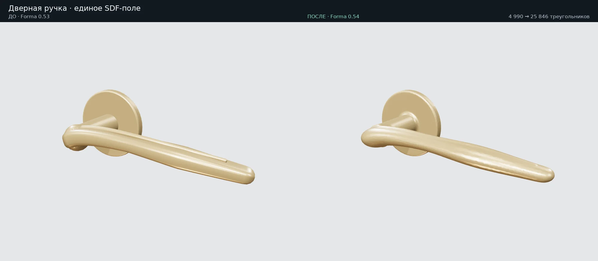
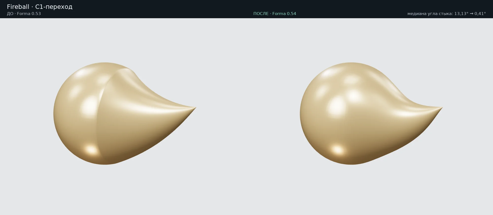
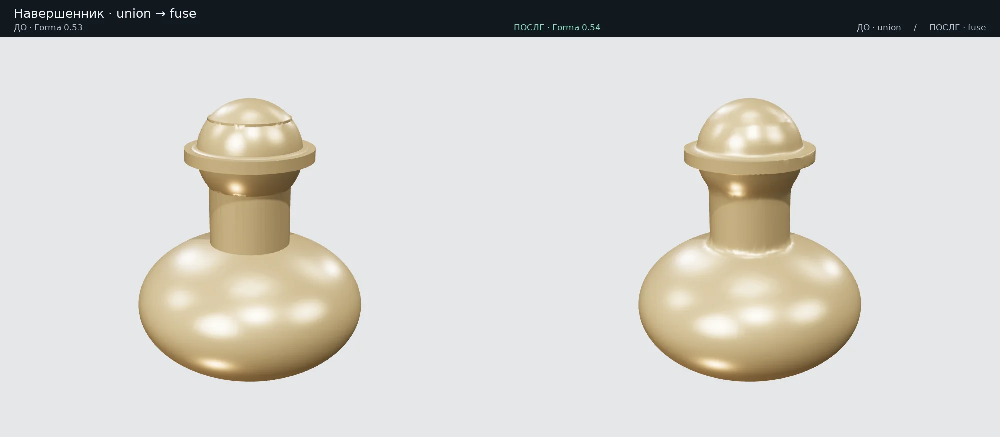

# Forma 0.54 — сопряжения без видимых склеек

## Что изменено в геометрии

### Дверная ручка

`door_handle` больше не собирается `batch_boolean` из розетки, шейки, sweep-рычага и отдельного ребра. Все части остаются аналитическими примитивами в одном SDF-поле до построения сетки:

- `RoundedCylinder` — цилиндр с плоскими торцами и дуговыми кромками;
- `Tube` — единая трубка с переменным радиусом и эллиптическим сечением;
- smooth union соединяет розетку, шейку, рычаг/шар и встроенное продольное ребро;
- C1-интерполяция контрольных значений толщины и малый smooth min внутри `Tube` убирают изломы между сегментами;
- Laplacian polish выполняется до бережного `simplify`, а не вместо формирования сопряжений.

Параметры `blend` и `resolution` меняют реальную геометрию и сохраняются в `primitive_params`. Если `resolution` не задан, шаг вычисляется из тонкой части и `segments`. Сетка ограничена 8 млн SDF-ячеек: при превышении шаг честно увеличивается, выдаётся предупреждение, а в параметры попадает фактический шаг.

| Форма по умолчанию | Треугольники | GLB, байт |
| --- | ---: | ---: |
| изогнутая | 25 030 | 704 068 |
| рельефная | 25 846 | 726 296 |
| сферическая | 33 536 | 940 864 |
| дисковая | 22 540 | 633 312 |

Все четыре варианта — по одному замкнутому телу `Error.NoError`; задняя плоскость розетки остаётся на `y=0`.



### Fireball / объёмный инь-ян

Общего кольца вершин недостаточно. В 0.53 радиус сферы и хвоста имел разные производные при `x_join=0.38R`, а дуга хвоста начиналась с постоянной кривизны. В 0.54:

- начальный `dr/dt` хвоста равен производной сферического сечения;
- изгиб входит с нулевой начальной кривизной, сохраняя конечную точку и направление;
- шаг последних сферических и первых хвостовых колец согласован;
- три прохода той же Laplacian-функции, что использует кисть `polish`, применяются с ненулевым весом только возле соединения;
- объём сохраняется существующим `_preserve_volume`.

На эталонной сетке углы между гранями на общем кольце изменились так:

| Метрика | 0.53 | 0.54 |
| --- | ---: | ---: |
| медиана | 13,132° | 0,412° |
| 90-й процентиль | 23,079° | 0,419° |
| максимум | 23,763° | 0,419° |
| треугольники | 21 000 | 31 584 |

Это регрессионный тест `test_shared_ring_is_c1_not_merely_watertight`: проверяется именно излом нормалей, а не только `NoError` и watertight.



### Общий `fuse`

Сеточный `fuse` сохранён для произвольных тел, но подготовка и контроль усилены:

- будущий полигонаж оценивается по площади **до** `refine_to_length`;
- при необходимости шаг увеличивается и выполняется одно повторное дробление из исходной сетки;
- `max_tris` проверяется после дробления, поэтому бюджет нельзя незаметно превысить;
- `_relax_triangles` выравнивает треугольники, фиксируя острые рёбра;
- `polish=0…1` управляет только локальным сглаживанием выбранных стыков;
- `edges=вогнутые` не стирает намеренные внешние кромки; `edges=все` остаётся явным выбором пользователя.

Пример `smooth_transitions_054.forma` содержит навершенник из эллипсоида, стержня, диска, сферы и кольца. Исходные тела используют `detail=5`, поэтому увеличенные `segments` не обрезаются обычным автоматическим допуском. После `fuse` стыки сглажены, а острые рёбра диска остаются в сетке.



## Практические параметры

```text
ручка = door_handle form=рельефная relief=.72 blend=3.5 resolution=.52
огонь = yin_yang form=объёмная diameter=120 tail_length=90 tail_angle=30
деталь = fuse [а,б] radius=6 edges=вогнутые detail=1.5 polish=.8 max_tris=50000
```

- Для ручек начальные значения: `blend=2…5`, автоматическое `resolution`.
- Для `fuse`: `detail≈radius/4`; уменьшайте его только с запасом `max_tris`.
- Для простых исходных тел при необходимости используйте `detail=5`: одно большое `segments` может быть ограничено автоматическим допуском.
- Не применяйте `edges=все`, если нужно сохранить острые внешние кромки.

## Демонстрация и размер загрузки

Полная сцена `smooth_transitions_054.forma` содержит ручку, fireball и навершенник: **3 объекта, 109 280 треугольников**, без попарных пересечений. Полный GLB — около **3,08 МБ**.

Для статического стенда задан отдельный `preview_source`: интерактивно загружается только ручка (**26 104 треугольника**). Самостоятельный preview GLB — около **734 КБ**, пакетированный preview на стенде — **628 612 байт** (gzip при проверке — 378 413 байт). Preview запрашивается только по кнопке; полный GLB и Forma скачиваются отдельно. Для обычных старых сцен требование геометрического совпадения full/preview сохранено, а для явного subset каждая сцена проходит собственный round-trip.

## Достаточно ли ресурсов

Дополнительная настройка Blender или новые внешние геометрические библиотеки не потребовались. Использованы уже имеющиеся NumPy, Manifold, SDF smooth union, refinement, Laplacian/`polish` и volume preservation. Проблема была в месте и способе их применения: булево объединение уже построенных мешей не создаёт касательное сопряжение, а дробление само по себе не убирает излом производной.

Ограничения остаются явными: SDF стоит времени и памяти, экстремально мелкий шаг огрубляется бюджетом, а сеточный `fuse` не является точным CAD-филлетом с аналитическим радиусом. Эти ограничения видны в справке, параметрах и журнале, а не скрыты за визуальным результатом.
