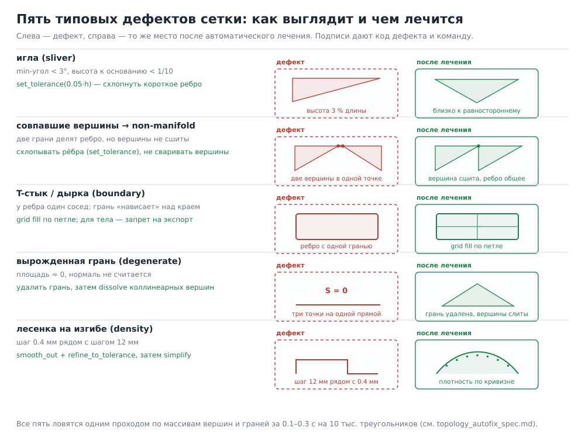

# Спецификация: автопроверки и автоисправление топологии в ФОРМА 3D

> Часть серии: [индекс всех документов и инструментов](topology_index.md).

Документ для того, кто будет внедрять. Всё, что здесь описано, работает **без
участия нейросети**: пользователь (или ИИ) вызывает обычные команды, приложение
само считает дефекты, само лечит и само отказывается выпускать плохой файл.

Основано на замерах: `mug` 41 248 трис / 76.97 % игл, `clock` 50 062 / 2 ошибки,
`alien` 19 056 / 3 non-manifold после сварки, `living_room` 94 512 / 1 ошибка.
Аудит готового GLB на 94 тыс. треугольников — 1.6 с.

---

## 0. Что должно появиться

| Модуль | Содержимое | Заменяет |
|---|---|---|
| `forma/topology.py` | `topology_report()`, `scene_topology()`, коды дефектов, пороги | дублирование логики в `tools/topology_audit.py` |
| `forma/heal.py` | `heal_manifold()`, `fill_holes()`, `decimate()`, валидация и откат | разрозненные `clean`/`repair` |
| `forma/metrics.py` | блок `topology` в `analyze()` + предупреждения | — |
| `forma/checks.py` | 6 новых правил | — |
| `forma/ops_io.py`, `webui.py`, `cli.py` | гейт на экспорте + `<имя>.topology.json` | — |
| `forma/sdf.py` | пост-обработка сетки SDF | самописные артефакты |
| `web/` | вкладка «Топология», кнопка «Починить» | — |

`tools/topology_audit.py` остаётся CLI и начинает импортировать `forma/topology.py`
(чтобы отчёт приложения и CLI были одним и тем же). Тесты
`tests/test_topology_audit.py` (10 шт.) должны проходить без изменений.

---

## 1. Модель данных и один проход по сетке

Вход: `verts: (V,3) float64`, `faces: (T,3) int64` — из `geometry.manifold_mesh()`.
Все метрики считаются за один-два прохода, без внешних библиотек кроме numpy.

### 1.1 Сварка по координатам (для анализа, не для изменения геометрии)

```python
def weld_index(verts, eps):
    """Возвращает map: исходный индекс вершины -> индекс класса совпадения."""
    q = np.round(verts / eps).astype(np.int64)          # квантование
    _, inverse = np.unique(q, axis=0, return_inverse=True)
    return inverse
```

`eps` по умолчанию `max(1e-4, bbox_diag * 1e-7)`. Сварка нужна **только для
диагностики**: она показывает, что случится, если пользователь нажмёт
«Merge by Distance» в Blender или слайсер склеит вершины.

### 1.2 Карта рёбер

```python
e = np.vstack([faces[:, [0, 1]], faces[:, [1, 2]], faces[:, [2, 0]]])  # направленные
key = np.sort(e, axis=1)
key_code = key[:, 0] * V + key[:, 1]
uniq, inv, counts = np.unique(key_code, return_inverse=True, return_counts=True)
```

* `counts == 1` → **граничное ребро** (дырка) — для тела невозможно, возможно
  для импорта;
* `counts > 2` → **non-manifold**;
* для `counts == 2`: если два направленных ребра совпадают по направлению —
  **несогласованный обход** (winding).

### 1.3 Геометрия граней

```python
a = np.linalg.norm(v1 - v0, axis=1)   # стороны
area2 = np.linalg.norm(np.cross(v1 - v0, v2 - v0), axis=1)   # 2S
area = area2 / 2
alt = 2 * area / np.maximum(longest, 1e-12)      # высота к длинной стороне
aspect = longest / np.maximum(alt, 1e-12)        # «вытянутость»
angles = ...  # три угла по теореме косинусов
min_angle = angles.min(axis=1)
```

Порог вырожденности: `area < (1e-4 · median_edge)²` — относительный, а не
абсолютный, иначе мелкая деталь 1 мм будет считаться мусором.

### 1.4 Оболочки и род

Union-find по граням через общие рёбра. Для каждой оболочки:
`χ = V − E + F`, `g = (2 − χ) / 2` (замкнутая ориентируемая поверхность).
Знак объёма — по формуле `V = Σ (v0 · (v1 × v2)) / 6`.

### 1.5 Полюса

Валентность = число уникальных рёбер в вершине. В треугольной сетке регулярна
6; отчёт даёт гистограмму и два числа: «полюса 3/5» и «звёзды ≥ 7». Порог
«звезды» важен для будущего SubD; для печати это просто информация.

### 1.6 Иглы: плоские и на изгибе (главное отличие от `check tri_quality`)

Для каждой грани с `min_angle < α` считаем максимальный двугранный угол с
соседями:

```python
cosang = clip(dot(n_i, n_j), -1, 1)
dihedral = degrees(arccos(cosang))
flat = dihedral.max(axis=neighbours) <= 5.0     # плоская игла — безвредна
```

Доля площади игл на изгибе — та метрика, которую стоит проверять (у кружки
76.97 % игл, но на изгибе 0.01 %; у `стойка_1` в часах — 86 % площади на изгибе).

### 1.7 Плотность

Длины уникальных рёбер: `p5, p50, p95`, `ratio = p95 / p5`, число рёбер короче
0.05 мм. Отдельно — «почти совпадающие кольца»: доля рёбер короче 10 % от
медианы.

### 1.8 Кэш

Ключ: `f"{name}:{num_tri}:{num_vert}"`. Так же устроен `MetricsCache`, поэтому
интеграция бесплатная: анализ переиспользует уже посчитанное.

Стоимость: 1.6 с на 94 тыс. треугольников чистым Python без numpy-векторизации.
С векторизацией ожидаемо 0.1–0.3 с. Бюджет: ≤ 0.1 с на 10 тыс. треугольников.

---

## 2. Коды дефектов и пороги



Коды — те же 15, что в CLI: `non_manifold, boundary, winding, degenerate_area,
degenerate_index, duplicate_faces, inverted, normals_inverted, normals_flat,
slivers, stretched, density, loose, doubles, shells`.

Уровни и пороги зависят от назначения (`purpose`):

| Параметр | печать | рендер | деформация | cad |
|---|---|---|---|---|
| `non_manifold` | ошибка | ошибка | ошибка | ошибка |
| `boundary` | ошибка | ошибка | ошибка | ошибка |
| `degenerate_area` | ошибка | предупр. | ошибка | ошибка |
| `degenerate_index` (после сварки) | предупр. | предупр. | ошибка | ошибка |
| `slivers` (все) | инфо | инфо | предупр. | инфо |
| `slivers_on_bend`, % площади | ≤ 1.0 | ≤ 1.0 | ≤ 0.2 | ≤ 2.0 |
| `stretched`, % граней | ≤ 20 | ≤ 20 | ≤ 10 | ≤ 30 |
| `density` (`p95/p5`) | ≤ 30 | ≤ 30 | ≤ 10 | ≤ 50 |
| `shells` | = числу деталей | любое | = 1 | = 1 |
| `min_edge`, мм | ≥ 0.05 | ≥ 0.01 | ≥ 0.05 | ≥ 0.05 |
| `tris` | по таблице бюджета | по бюджету | по бюджету | по бюджету |

Порог `slivers_on_bend` для деформации (0.2 %) — единственный, который стоит
сделать блокирующим при экспорте «под анимацию».

---

## 3. Автоматическое лечение (`forma/heal.py`)

### 3.1 Порядок шагов

```
1. снимок метрик (объём, габарит, род, число оболочек, tris)
2. схлопывание коротких рёбер и копланарных граней   (set_tolerance)
3. удаление вырожденных граней                        (dissolve / Manifold)
4. удаление крошечных оболочек                         (decompose + batch_boolean)
5. заливка дыр                                        (только импорт)
6. сглаживание лесенок                                (smooth_out + refine_to_tolerance)
7. упрощение до бюджета                               (simplify)
8. проверка и откат шагов, испортивших форму
```

Шаги 2–4 и 6–7 делаются средствами ядра — это быстро и без потери многообразия:

| Задача | Вызов | Что делает по документации ядра |
|---|---|---|
| схлопнуть короткие рёбра и копланарные грани | `m.set_tolerance(eps)` | «треугольники, копланарные в пределах допуска, сливаются, рёбра короче допуска схлопываются» |
| упростить с гарантией отклонения | `m.simplify(tol)` | остаётся подмножество вершин, поверхность смещается меньше допуска |
| убрать лесенку без усадки | `m.smooth_out(angle, smoothness).refine_to_tolerance(tol)` | сглаживание через касательные + адаптивное дробление |
| дать ядру свободу схлопывать плоское | `m.as_original()` | сбрасывает историю, позволяет схлопывать грани плоскостей |
| мелкая пыль | `m.decompose()` + `batch_boolean` | удаление кусков меньше доли объёма |

**Чего делать нельзя:** глобальная сварка вершин по расстоянию. Именно она
превращает 3 пары совпавших вершин `alien` в 3 non-manifold ребра. Схлопывать
надо **рёбра**, а не совпавшие вершины: `set_tolerance` делает именно это и
сохраняет многообразие.

### 3.2 SDF и marching cubes

`forma/sdf.py::Field.mesh()` строит поверхность своим marching cubes. Правка:

```python
solid = manifold_from_arrays(verts, faces, what)
# вместо «как есть»:
solid = solid.set_tolerance(0.25 * self.h)     # убрать короткие рёбра
if simplify > 0:
    solid = solid.simplify(float(simplify))
solid = solid.smooth_out(52.5, 0.2).refine_to_tolerance(0.4 * self.h)  # при smooth_iters > 0
```

Альтернатива для дешёвых полей — `Manifold.level_set(f, bounds, edgeLength,
tolerance=0.1*h)`: marching tetrahedra по BCC-решётке, вершины притягиваются к
поверхности, короткие рёбра не образуются. Минус — вызов Python-функции на каждый
узел, поэтому для тяжёлых полей оставить numpy-сетку и пост-обработку выше.

### 3.3 Заливка дыр (только импорт)

Веер из центра (как в текущем `repair`) на дыре в 200 рёбер даёт 200 игл. Нужен
grid fill:

```
для каждой граничной петли:
    если len(loop) < 4: пропустить
    p = вершины петли, n = нормаль (PCA)
    если len(loop) чётное и петля почти плоская (отклонение < 2 % диагонали):
        уложить сетку k×m по петле, сшить по краям (grid fill)
    иначе:
        добавить центр-вершину, веер, затем 1–2 итерации релаксации
        и один проход set_tolerance(0.1 * median_edge)
```

Критерий качества после заливки: доля игл на изгибе не выросла больше чем на
0.1 п.п., объём изменился ≤ 2 %.

### 3.4 Упрощение и LOD

Основной инструмент — `simplify(tolerance)` (гарантия отклонения). Для LOD:

| Уровень | Треугольники | Допуск |
|---|---|---|
| L0 | 100 % | 0 |
| L1 | 50 % | 0.05 мм |
| L2 | 25 % | 0.1 мм |
| L3 | 12 % | 0.2 мм |

После каждого уровня — проверка силуэта: рендер 96 px и сравнение площади
силуэта (допуск 2 %) плюс проверка, что `genus` и число оболочек не изменились.
Если изменились — откат уровня.

### 3.5 Валидация и откат

```python
def heal_manifold(m, purpose="печать", budget=None):
    before = fingerprint(m)           # volume, bbox, genus, shells, tris
    for step in plan(m, purpose):
        candidate = step(m)
        after = fingerprint(candidate)
        if not acceptable(before, after, purpose):
            log.warn("шаг отменён: %s", step.__name__)
            continue
        m, before = candidate, after
    return m
```

`acceptable()`:

| Проверка | Допуск |
|---|---|
| объём | ±2 % (для деформации ±0.5 %) |
| габарит по каждой оси | ±0.1 мм или ±0.2 % |
| род | не изменился |
| число оболочек | не выросло |
| доля игл на изгибе | не выросла |
| отклонение от исходной поверхности (двустороннее) | ≤ tolerance |

Всё, что не прошло, откатывается — форма важнее «чистоты».

### 3.6 Идемпотентность и детерминизм

`heal(heal(x)) == heal(x)` — обязательное свойство (проверяется тестом).
Никаких случайных чисел; порядок обхода — по индексам, не по словарю.

---

## 4. Гейт на экспорте

Точка входа — одна функция, вызываемая из `webui.export()` и `cli.cmd_export()`:

```python
report = topology_report_for_export(solids)   # считаем по тем же массивам, что уходят в файл
write_json(out.with_suffix(".topology.json"), report)
if report["status"] == "error" and not force:
    raise FormaError(
        f"Экспорт остановлен: {report['summary']}",
        hint=f"Выполните «{report['suggest']}» или повторите экспорт с force=да")
```

Формат сообщения (по-русски, с кодом, объектом и подсказкой):

```
✗ Экспорт остановлен: 3 non-manifold ребра после сварки — «пришелец».
  Причина: совпавшие вершины из SDF-поля (marching cubes).
  Что сделать: пришелец = heal [пришелец]      (или force=да, если это осознанно)
```

Схема JSON:

```json
{
  "schema": 1,
  "status": "ok|warn|error",
  "file": "model.glb",
  "objects": 233,
  "tris": 94512,
  "summary": "1 ошибка: degenerate_index (lamp_bulb, 96 граней)",
  "suggest": "lamp_bulb = heal [lamp_bulb]",
  "codes": [
    {"code": "degenerate_index", "level": "error", "object": "lamp_bulb",
     "value": 96, "threshold": 0, "hint": "…", "where": [x, y, z]}
  ],
  "objects_report": [
    {"name": "lamp_bulb", "tris": 1200, "slivers": 210, "slivers_on_bend_pct": 0.0,
     "edge_ratio": 12.4, "shells": 1, "genus": 0}
  ]
}
```

`where` — центр масс проблемного кластера, чтобы ИИ мог лечить точечно
(`dent`, `flatten`, `simplify` по области), а не всю деталь.

---

## 5. Новые правила `check`

| Правило | Синтаксис | Смысл |
|---|---|---|
| `shells` | `check деталь shells 1` | число оболочек |
| `slivers` | `check деталь slivers 2` | % треугольников с min-углом < 3° |
| `slivers_bend` | `check деталь slivers_bend 0.2` | % площади игл на изгибе |
| `poles` | `check деталь poles 8` | доля вершин-полюсов (3/5), % |
| `edge_spread` | `check деталь edge_spread 8` | `p95/p5` длин рёбер |
| `topology` | `check деталь topology` | композит: все коды, ошибка при любом `error` |

Реализация — в `checks.py`, данные берутся из кэша `topology_report`, чтобы не
считать дважды. `tri_quality` при этом **не удалять**, а переопределить как
алиас `slivers` (для совместимости старых сценариев).

---

## 6. Интерфейс

Вкладка «Проверки» получает блок «Топология»:

* светофор по худшему коду (зелёный / жёлтый / красный);
* таблица: объект, треугольники, оболочки, иглы %, иглы на изгибе %, `p95/p5`;
* кнопка **«Починить»** → выполняет `heal` на выбранных объектах, показывает
  «до/после» (треугольники, объём, габарит, коды) и предлагает отменить (undo).

Правило UX: кнопка не активна, если `heal` не сможет улучшить (например, у
плоской панели все иглы плоские).

---

## 7. Тесты

1. **Golden** (числа зафиксированы по нашим замерам):

```python
def test_mug_slivers_are_flat():
    rep = report_for("examples/mug.forma")
    assert rep["tris"] == 41248
    assert rep["slivers_pct"] > 70
    assert rep["slivers_on_bend_pct"] < 0.1     # плоские — не дефект

def test_alien_has_coincident_vertices():
    rep = report_for("examples/alien.forma")
    assert any(c["code"] == "non_manifold" and c["after_weld"] for c in rep["codes"])

def test_clock_has_degenerate():
    rep = report_for("examples/clock.forma")
    assert any(c["code"] == "degenerate_index" for c in rep["codes"])

def test_export_gate_blocks_alien():
    with pytest.raises(FormaError):
        export("examples/alien.forma", force=False)
```

2. **Свойства:** для случайных сцен (примитив + булева + деформация) —
   `non_manifold == 0`, `boundary == 0`, `winding == 0` **до и после** `heal`;
   `heal` идемпотентен; `heal` не меняет род и число оболочек больше чем на 0.
3. **Производительность:** `topology_report` на 100 тыс. треугольников ≤ 0.3 с;
   полный `analyze` на гостиной не дольше +2 с к текущим 10.6 с.
4. **Регресс:** `tests/test_topology_audit.py` без изменений; CI-шаг на
   `forma/exports/**/*.glb` с базовой линией «0 ошибок».

---

## 8. План внедрения и порядок работ

| Шаг | Что | Оценка | Зависимости |
|---|---|---|---|
| 1 | `forma/topology.py` + тесты на golden | 1 день | — |
| 2 | блок `topology` в `analyze` + предупреждения | 0.5 дня | 1 |
| 3 | гейт на экспорте + JSON + `force` | 0.5 дня | 1 |
| 4 | `heal.py` (set_tolerance, simplify, small shells) | 1 день | 1 |
| 5 | SDF-постобработка + `set_tolerance` в `sdf.py` | 0.5 дня | 4 |
| 6 | заливка дыр grid fill для импорта | 1 день | 4 |
| 7 | правила `check` | 0.5 дня | 1 |
| 8 | UI-блок и кнопка «Починить» | 1 день | 2, 4 |
| 9 | LOD + проверка силуэта | 1 день | 4 |
| 10 | CI-аудит экспортов | 0.5 дня | 3 |

Порядок важен: 1–3 дают 80 % пользы (видно и не выпускает), 4–5 снимают основную
рутину, остальное — удобство.

---

## 9. Приложение: каркас `topology.py`

```python
"""Топология сетки: диагностика и коды дефектов. Без внешних зависимостей, кроме numpy."""
from __future__ import annotations
import numpy as np
from dataclasses import dataclass, field

CODES = {  # как в tools/topology_audit.py
    "non_manifold": "ошибка", "boundary": "ошибка", "winding": "ошибка",
    "degenerate_area": "ошибка", "degenerate_index": "ошибка",
    "duplicate_faces": "ошибка", "inverted": "ошибка", "normals_inverted": "ошибка",
    "normals_flat": "предупреждение", "slivers": "инфо", "stretched": "инфо",
    "density": "предупреждение", "loose": "предупреждение",
    "doubles": "инфо", "shells": "инфо",
}

@dataclass
class Topology:
    name: str
    tris: int = 0
    verts: int = 0
    boundary: int = 0
    non_manifold: int = 0
    winding: int = 0
    degenerate: int = 0
    duplicates: int = 0
    shells: int = 0
    genus: int = 0
    coincident: int = 0          # после сварки
    slivers: int = 0
    slivers_on_bend_area_pct: float = 0.0
    stretched_pct: float = 0.0
    edge_p5: float = 0.0
    edge_p50: float = 0.0
    edge_p95: float = 0.0
    min_edge: float = 0.0
    poles_pct: float = 0.0
    stars: int = 0
    codes: list[dict] = field(default_factory=list)
    where: dict[str, list[float]] = field(default_factory=dict)

def analyze_arrays(verts, faces, name="объект", *, weld_eps=None,
                   min_angle=3.0, max_aspect=10.0) -> Topology: ...
def topology_of(manifold, name="объект", **kw) -> Topology: ...
def scene_report(scene, **kw) -> dict: ...
```

Эту схему можно расширять, но **коды и их уровни менять нельзя** — на них
завязаны отчёт, UI, CLI и документация.
