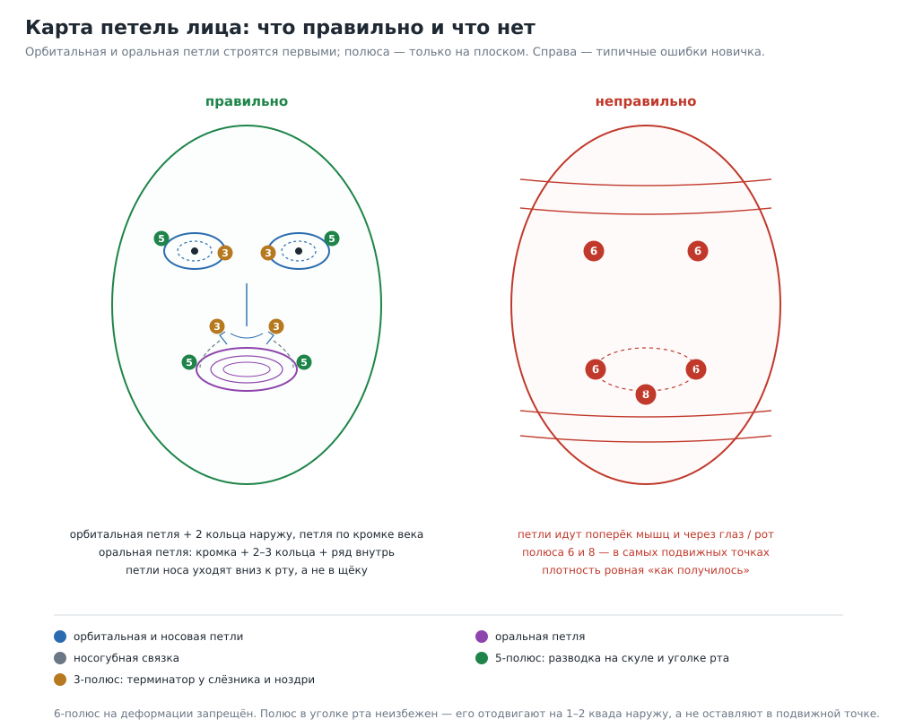

# Топология человека: тело, голова, лицо

> Часть серии: [индекс всех документов и инструментов](topology_index.md).

Практический разбор для случая «модель из ФОРМА 3D уходит в Blender на риг и
анимацию». Все правила — про **квадовую** сетку: в приложении её нет, но именно
её ждёт скиннинг, поэтому модель надо либо строить под ретопологию, либо честно
предупредить пользователя.

Источники: Polycount (FaceTopology / BodyTopology / ShoulderTopology),
Topology Guides (петли, loop reduction, кратность 4), Blender StackExchange
(плечо), студийные разборы (cgtyphoon — локти, vsquad — полюса на лице).

---

## 1. Три принципа, из которых выводится всё остальное

1. **Петля идёт по мышце и поперёк оси вращения.** Круговая мышца глаза
   (`orbicularis oculi`) — кольцо вокруг глаза; круговая мышца рта
   (`orbicularis oris`) — кольцо вокруг губ; дельта — дуга через плечо. Если петли
   идут против движения, квады при деформации становятся неплоскими, рендер
   разбивает их на треугольники и появляется «рубчик» поперёк замысла.
2. **Плотность пропорциональна подвижности.** Глаза, рот, локти, плечи, колени —
   плотно; череп, спина, бёдра сбоку — редко. Переход плотности делается
   полюсами и loop reduction, а не общим сгущением.
3. **Полюс — не ошибка, а адрес.** Валентность 5 — «разводящий», 3 —
   «терминатор». Оба хороши на плоском и малоподвижном; валентность 6+ на
   деформации даёт щипок и «чёрную дыру» при сглаживании.

---

## 2. Тело: карта петель

| Зона | Сколько петель | Где ставить полюса | Тест |
|---|---|---|---|
| Плечо | 3–4 концентрических вокруг дельты (до 5–6 для крайних поз) | 3-полюс спрятан под мышкой/лопаткой; 5-полюс — на трапеции | отведение руки 90° и 180°: нет залома ключицы, дельта не вытягивается в иглу |
| Локоть | 3–4 (мобильный персонаж) / 4–6 (обычный) / 6–8 (герой крупным планом) | никогда на линии сгиба | сгиб 135°: объём сохраняется, внутренняя сторона не складывается в ноль |
| Запястье | 16 петель — «щедро и достаточно»; кратность 4 | 5-полюса по тыльной стороне | сгиб кисти 70°, поворот предплечья |
| Кисть | отдельные петли на каждый палец, одинаковое число у всех пальцев, петля по ладони и «перепонка» большого пальца | 5-полюс у основания большого, 3-полюс на кончиках | сжатие в кулак: ладонь не рвётся, перепонка не режется |
| Бедро | 4–6 вокруг бедра, петля по ягодичной складке | 5-полюс на внешней стороне бедра | подъём ноги 90°, присед |
| Колено | 4–6; петля сзади в подколенной складке | не на передней части колена | сгиб 120° |
| Щиколотка | 16 или 24 петли на стопу | 3-полюса на пятке | сгиб стопы, подъём на носок |
| Шея | 2–3 петли вокруг, петля по линии челюсти | 5-полюс у угла челюсти | поворот головы 60°, наклон |
| Торс | петли вдоль косых мышц и широчайших, спокойная центральная линия по позвоночнику | 3-полюса по центру спины | наклон, скручивание |

Правило кратности: число рёбер в кольце конечности держат кратным 4 — тогда
переходы между разной плотностью делаются стандартными схемами (2-1, 4-1), а не
«лесенкой».

---

## 3. Голова: порядок построения

Ретопология головы всегда идёт от двух якорей, а не «сверху вниз»:

1. **Орбитальная петля** вокруг каждого глаза.
2. **Оральная петля** вокруг рта.
3. **Носогубная связка** между ними (щека).
4. Лоб, висок, ухо, челюсть, шея — «заливка» вокруг готового каркаса.

Если начать с черепа, петли глаз и рта потом некуда вписать: придётся рвать
сетку и появляются полюса в самых подвижных местах.

### 3.1 Глаз

| Элемент | Как делать |
|---|---|
| Кольцо вокруг века | 8–12 рёбер по кругу; это «регулярная» петля, не считая полюсов |
| Концентрические кольца | 2 кольца наружу (веко → глазница) до слияния с соседними потоками |
| Кромка века | отдельная петля по самому краю века + петля внутрь, иначе при закрытии веко «проваливается» |
| Уголки | 3-полюс у внутреннего уголка (слёзник), 5-полюс у внешнего — не на самом уголке, а на 3–5 мм в сторону |
| Мешок под глазом | петля вдоль скулы, продолжающая нижнее веко |

Ошибки: петля «через глаз» (веко не закрывается), полюс в уголке (разрыв при
мигании), 6-полюс на скуле (щипок при улыбке).

### 3.2 Рот

| Элемент | Как делать |
|---|---|
| Кромка губ | петля по линии смыкания (vermilion border) — обязательна |
| Концентрические | 2–3 вокруг губ; для широкой мимики 4–5 |
| Внутрь | минимум один ряд внутрь рта, иначе при открытии видно «схлопывание» |
| Уголки | 5-полюс неизбежен; ставить чуть в сторону от активной зоны |
| Носогубная складка | петля от крыла носа к уголку рта; при улыбке она и образует складку |
| Подбородок | петля по chin-бугру и переход к челюсти |

Ошибки: две петли на весь рот (губы «режутся»), полюс прямо в уголке (артефакт
при улыбке), отсутствие внутренней петли (видно изнанку при открытом рте).

### 3.3 Нос

| Элемент | Как делать |
|---|---|
| Ноздря | кольцо из 8 квадов вокруг каждой ноздри |
| Крыло | петля по алярной складке (крыло → щека) |
| Спинка | 2–3 петли вдоль спинки, сходящиеся к переносице |
| Основание | 3-полюс у основания ноздри — «терминатор» лишних петель |
| Направление | петли носа уходят **вниз, к рту**, а не в щёку: иначе ломается поток щеки |

### 3.4 Щека, лоб, ухо, челюсть

* **Щёка:** 5-полюс на скуловой дуге работает «разводкой»: разворачивает
  круговые петли рта к ушам и шее. Ромбовидный поток (diamond flow) в скуловой и
  лобной зоне даёт сетке сжиматься и растягиваться «мехами».
* **Лоб:** горизонтальные петли для поднятия брови (фронтальная мышца тянет
  вверх), 5-полюс у надбровной дуги, 3-полюс у виска.
* **Ухо:** если ухо не крупный план — отдельный объект или упрощённая схема
  (спираль завитка, противозавиток, чаша), 3-полюс у козелка. Экономия: 40–80
  квадов на ухо вместо 500.
* **Челюсть и шея:** петля по краю челюсти, петля под подбородком, 5-полюс у угла
  челюсти; 2–3 кольца вокруг шеи.

### 3.5 Бюджет головы

| Класс | Треугольники на голову | Комментарий |
|---|---:|---|
| Мобильная игра, дальний план | 1 000–3 000 | лицо читается силуэтом, детали — текстурой |
| Обычный game-персонаж | 4 000–8 000 | хватает на 2 кольца глаза и 3 рта |
| Герой крупным планом | 15 000–40 000 | возможны складки, поры геометрией |
| Кинематограф / SubD | 40 000+ | почти всегда скульпт + ретопология + SubD |

Пропорция: на лицо уходит 60–70 % бюджета головы, остальное — череп, уши, шея.

---

## 4. Тесты деформации (минимальный набор)

| Тест | Что проверяет |
|---|---|
| Мигание 100 % | кольца века, полюса в уголках |
| Улыбка + поднятие брови | носогубная петля, скуловой полюс, лобные петли |
| Открытый рот 30° | внутренняя петля губ, уголки |
| Поцелуй / вытянутые губы | круговые петли рта |
| Поворот головы 60° | шея, угол челюсти |
| Рука вверх 90°/180° | плечо, ключица, дельта |
| Сгиб локтя 135°, колена 120° | кольца суставов |
| Кулак | кисть, перепонка большого пальца |

Оценка не «на глаз»: смотреть на силуэт в каркасе и на просвет, а не только в
закрашенном виде.

---

## 5. Что из этого применимо к ФОРМА 3D

1. **Модели приложения статические и треугольные.** `human`, `anime_face`,
   скелет — это SDF/примитивы, а не квадовая сетка. Для печати и рендера это
   нормально; для скиннинга — непригодно.
2. **Единственное, что приложение может сделать само** — честно предупредить:
   если у сцены/объекта `purpose=деформация`, а сетка треугольная, выдавать
   вердикт «нужна ретопология в Blender» и ссылку на этот документ.
3. **Полезное, что можно автоматизировать уже сейчас:** бюджет полигонов по
   классу (голова/тело), плотность в зонах (глаза/рот/суставы), контроль
   «петель» невозможен на треугольной сетке, но контроль **равномерности** и
   **отсутствия игл** — возможен и нужен.
4. **Будущее (P2):** квад-доминантный вывод для сфер/цилиндров/лофтов через
   `primitive_topology` + поле направления. Это отдельный большой проект; без
   него «топология под анимацию» остаётся ручной работой в Blender.

---

## 6. Чек-лист «лицо готово к ригу»

- [ ] Орбитальная петля замкнута, 8–12 рёбер, 2 кольца наружу
- [ ] Петля по кромке века и петля внутрь (толщина века)
- [ ] Кромка губ отдельной петлёй, 2–3 кольца вокруг, 1 ряд внутрь
- [ ] Уголки рта — 5-полюса, смещены от активной зоны
- [ ] Носогубная петля от крыла носа к уголку
- [ ] Ноздря — кольцо из 8 квадов, 3-полюс у основания
- [ ] Ни одного 6-полюса на щеке, веке, губах
- [ ] Плотность: лицо плотнее черепа, переход через полюса
- [ ] Все тесты из §4 пройдены на 90–100 % амплитуды
- [ ] Квады везде, где есть деформация; треугольники — только в скрытых зонах
